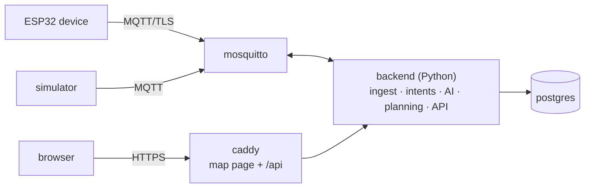

# AeroLink

**AI-assisted planning for Florida's low-altitude air corridors: eVTOL passenger, cargo, and medical flights.**

AeroLink plans AAM flights on corridors modeled on FDOT's Aerial Highway Network, connecting Tampa, Lakeland, Orlando, and Sebring. It uses the FAA's own traffic-management concepts (filed operational intent, strategic deconfliction, demand-capacity balancing, conformance monitoring) and adds AI prediction where the classical method assumes a perfect world: arrival times that vary, demand that isn't filed yet, and aircraft that drift off plan. Medical flights get priority.

**Scope:** low-altitude AAM only. Commercial and military airspace are no-go constraints; AeroLink does not manage airliners or military aircraft.

> **Not for flight.** AeroLink is a simulation-based engineering prototype. It is not certified equipment, an FAA-approved service provider, a surveillance system, an ATC service, or a collision avoidance system.

**Status:** design stage.

| Document | Contents |
|---|---|
| [docs/ARCHITECTURE.md](docs/ARCHITECTURE.md) | regulatory model, network, constraints, classical baseline, AI, planning, evaluation, real-data validation, services, contracts, hardware |
| [docs/PLAN.md](docs/PLAN.md) | milestones, task checklists, dependencies, risks |
| [docs/HACKATHON.md](docs/HACKATHON.md) | theme and rules fit, Lakeland demo script, judge Q&A, sources |

---

## Why AI

The classical approach assumes aircraft fly their filed timing exactly and that all demand is filed in advance. Neither is true:

| Classical assumption | Reality | AeroLink AI |
|---|---|---|
| fixed ±60 s time windows | timing uncertainty varies | **arrival-time forecaster** with calibrated uncertainty: LightGBM + MAPIE conformal intervals, trained on simulated and real Central Florida flight tracks; Chronos-2 (pretrained, Hugging Face) as the zero-shot comparator |
| only filed flights count | medical dispatches and upcoming departures aren't filed yet | **demand forecaster** reserves capacity ahead of time |
| fixed conformance bounds | the right tolerance depends on speed and manoeuvre | **conformance monitor** with learned bounds |
| conflicts are yes/no | timing windows overlap with some probability | **risk-weighted route ranking** |

**AI predicts; deterministic algorithms decide.** Routes are always paths in a corridor graph that can't touch no-go airspace. Deconfliction and landing-slot allocation stay deterministic.

**Proof:** in a closed-loop simulation, the classical method and full AeroLink are compared on delay, loss-of-spacing events, and medical delay. The forecaster is also validated on real helicopter and light-aircraft tracks over Central Florida.

---

## The network

- **Vertiports:** Tampa Executive, Orlando Executive, and Sebring Regional, all on FDOT's Phase 1A list.
- **Cargo hub:** SunTrax, Auburndale.
- **Hospital pads:** Tampa General, Lakeland Regional, AdventHealth Sebring, Orlando Health ORMC.
- **Corridors:** along I-4, US-27, and connecting highways.
- **No-go airspace:** from FAA open data, including the TPA and MCO controlled airspace, MacDill AFB, and the Avon Park Air Force Range.
- **Fleet:** 10 simulated aircraft (5 passenger, 3 cargo, 2 medical) plus the physical device.

---

## What you can use

**Web dashboard:** a live map with:
- traffic by mission
- filed intents and prediction cones
- a congestion timeline (+45 min)
- a **classical vs AeroLink** toggle
- a planner with briefings
- a medical priority panel
- AI impact numbers

**AeroLink navigation device:** a general-purpose ESP32-S3 touchscreen unit for any AAM mission. The pilot:
1. picks passenger, cargo, or medical
2. picks a destination
3. reviews the ranked routes with reasons
4. files an intent
5. receives re-route offers in flight

The device is a breadboard build (Rev 0) wired to a KiCad schematic. A custom PCB comes after the MVP.

---

## How it fits together



| Part | Stack |
|---|---|
| Backend (`backend`) | Python: FastAPI + aiomqtt (ingest, intent registry, re-planning, API) and the AI/planning layer: Chronos-2 (`chronos-2-small`), LightGBM, MAPIE, OR-Tools, networkx, shapely |
| Dashboard | TypeScript, Vite, MapLibre GL JS, OpenFreeMap basemap |
| Simulator | Python, closed-loop, deterministic scenarios |
| Device | ESP32-S3, ESP-IDF, C, LVGL (Espressif display/touch/LVGL components); KiCad wiring schematic |
| Infrastructure | Mosquitto, PostgreSQL, Caddy, Docker Compose, GCP Compute Engine |

---

## Quickstart

Prerequisites: Docker with Compose v2 and [uv](https://docs.astral.sh/uv/).

```bash
cp .env.example .env
./mosquitto/make-ca.sh                       # dev CA + broker cert
cd backend
uv run python -m aerolink.airspace.import_faa  # FAA airspace → constraints
uv run python -m aerolink.realdata.fetch --days 14   # optional: adsb.lol tracks
cd ..
docker compose up -d --build                 # caddy, backend, mosquitto, postgres
docker compose --profile sim up -d           # 10 simulated aircraft
open https://localhost
```

Evaluation:

```bash
cd backend
uv run python -m aerolink.eval --scenario all --seed 42 --ablations
uv run python -m aerolink.eval.realdata      # real-data forecaster benchmark
```

Tests:

```bash
cd backend && uv run pytest
```

Firmware: see `firmware/README.md`.

---

## Repository layout

```text
aerolink/
├── README.md
├── docs/{ARCHITECTURE,PLAN,HACKATHON}.md
├── compose.yaml
├── .env.example
├── Caddyfile
├── airspace/
│   ├── central-fl-v1.geojson               # nodes + corridors
│   └── constraints-central-fl.geojson      # FAA no-go volumes (snapshot)
├── contracts/{schemas,examples}/           # message contracts v3.0
├── backend/                                # Python: service, AI, planning, sim, eval
│   ├── src/aerolink/
│   │   ├── service/                        # ingest, intents, loops, API, store
│   │   ├── airspace/  graph/  missions/  forecast/  demand/
│   │   ├── conformance/  congestion/  planning/  classical/
│   │   ├── briefing/  sim/  realdata/  train/  eval/
│   ├── migrations/  scenarios/  models/  eval-results/  tests/
│   └── data/realdata/                      # gitignored (ODbL source data)
├── web/                                    # Vite + TS + MapLibre (static, served by Caddy)
├── firmware/                               # ESP-IDF
├── hardware/
│   ├── kicad/rev0-wiring/                  # wiring schematic (+ PDF)
│   ├── cad/                                # Rev 0 tray
│   └── datasheets/
└── mosquitto/                              # config, ACLs, CA script
```

---

## Built on existing work

Existing tools are reused wherever they fit; custom code covers only the planning core, the corridor network, the simulator, the conformance monitor, and the flight-data parser. Contracts follow ASTM F3548 naming, with [InterUSS](https://github.com/interuss/dss) as the reference. See the decisions table in [ARCHITECTURE §17](docs/ARCHITECTURE.md#17-decisions) for what was adopted and what was reviewed and not used.

## Data and attribution

- **Flight tracks:** contains data from [adsb.lol](https://www.adsb.lol/docs/open-data/historical/), licensed under the [Open Database License 1.0](https://opendatacommons.org/licenses/odbl/1-0/). Raw data is not redistributed.
- **Airspace:** [FAA Aeronautical Data Delivery Service](https://adds-faa.opendata.arcgis.com/) open data.
- **Pretrained model:** [Amazon Chronos-2](https://huggingface.co/amazon/chronos-2) (Apache-2.0).
- **Basemap:** [OpenFreeMap](https://openfreemap.org), © OpenStreetMap contributors.

---

## Built for

*Cleared for Takeoff: AI for Florida's Skies.* AeroLink targets all three theme pillars: **safer**, **more efficient**, and **more accessible**. See [docs/HACKATHON.md](docs/HACKATHON.md).
