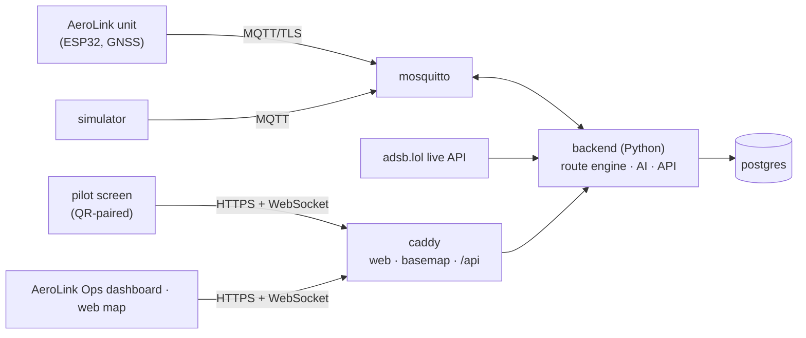

# AeroLink

**Navigation for Florida's low-altitude air corridors, with AI traffic prediction: Google Maps for eVTOL passenger and medical flights.**

A pilot picks a destination. AeroLink shows route options on a map with **AI-predicted traffic and arrival times**, and suggests a faster route when traffic builds up. AeroLink Ops, used by AeroLink or vertiport operations staff, sees every route and the predicted congestion on a dashboard. Real air traffic control (ATC) still talks to pilots by radio, as today. Corridors are modeled on FDOT's Aerial Highway Network, connecting Tampa, Lakeland, Orlando, and Sebring.

AeroLink advises; it does not control. The backend uses the FAA's traffic-management concepts (planned flights, landing-pad capacity, off-route detection) as **calculations** to predict traffic well, but it never approves, rejects, or holds a flight. The pilot always chooses and remains pilot in command. Ops can send an advisory reroute that the pilot may accept or decline. Real ATC advises or instructs by voice radio. Ops can note that an ATC clearance or tower contact has happened, and the pilot sees "Ops noted: ATC clearance obtained"; that note is information, never a gate.

**Scope:** low-altitude passenger and medical eVTOL flights only. No aerial cargo or drone delivery. Commercial and military airspace are no-go constraints; AeroLink does not route airliners or military aircraft.

> **Not for flight.** AeroLink is a simulation-based engineering prototype. It is not certified equipment, an FAA-approved service provider, a surveillance system, an ATC service, or a collision avoidance system. It is not affiliated with the FAA, FDOT or any airport.

**Status:** M1 to M5 are complete (contracts, airspace and network, simulator and classical baseline, AI forecasting, real-data models and ablations). M6, the live system, is built: backend, web map, pilot screen, AeroLink Ops dashboard, live ADS-B, health and watchdogs. M7 to M9 (unit hardware and firmware, deployment, demo) are not done; a test client (`scripts/fake_unit.py`) stands in for the unit.

| Document | Contents |
|---|---|
| [docs/ARCHITECTURE.md](docs/ARCHITECTURE.md) | network, constraints, classical baseline, AI, route engine, evaluation, real-data validation, services, contracts, interface, hardware |
| [docs/PLAN.md](docs/PLAN.md) | milestones, epics, acceptance criteria, risks, post-MVP backlog |
| [docs/HACKATHON.md](docs/HACKATHON.md) | theme and rules fit, Lakeland demo script, judge Q&A, sources |

---

## Why AI

A navigation app is only as good as its traffic prediction. The classical approach assumes aircraft fly their planned timing exactly and that all traffic is known in advance. Neither is true:

| Classical assumption | Reality | AeroLink AI |
|---|---|---|
| fixed ±60 s arrival windows | timing uncertainty varies | **arrival-time forecaster** with calibrated uncertainty ("arrive 14:20, likely 14:17–14:26"): LightGBM + MAPIE conformal intervals, trained on simulated and real Central Florida flight tracks; Chronos-2 (pretrained, Hugging Face) as the zero-shot comparator |
| only planned flights count | medical dispatches and upcoming departures aren't planned yet | **demand forecaster** adds traffic that isn't on the map yet |
| fixed off-route bounds | the right tolerance depends on speed and manoeuvre | **off-route detection** with learned bounds → "recalculating" |
| traffic is yes/no | arrivals overlap with some probability | **risk-weighted route ranking** and en-route "faster route" suggestions |

**AI predicts; deterministic algorithms build routes.** Routes are always paths in a corridor graph that can't touch no-go airspace. AI changes predicted times and rankings, never the geometry.

**What was measured** (10 simulated scenarios, classical B1 against full AeroLink A5; `backend/eval-results/m5-ablations.md`):

- **ETA accuracy:** mean error at departure 61 s against 104 s; calibrated p10–p90 windows cover the landing 84% of the time (target 80%) against 39% for the fixed ±60 s window.
- **Routes and outcomes:** the same. On the current network, A5 chooses the same routes as B1 and offers no suggestions in any committed scenario, so trip time, holding, bunching and medical response are identical. The AI improves the predictions, not (yet) the outcomes here; see Known limitations.
- **Real data:** on four held-out days of real helicopter and light-aircraft tracks, `aerolink-gbm` beats constant velocity and zero-shot Chronos-2 at every horizon (30 s: 225 m against 287 m and 371 m mean error).

---

## The network

Two kinds of landing site, from FDOT plans and state aviation data:

| Site type | Examples | Who can fly there |
|---|---|---|
| **eVTOL sites** | Water Street (downtown Tampa, modelled site), Parramore (downtown Orlando, modelled site), Orlando Executive, Lakeland Linder, Sebring Regional, SunTrax | passenger aircraft |
| **Helipads** | 22 hospital and EMS pads, e.g. Tampa General, Lakeland Regional, Orlando Health ORMC, AdventHealth Sebring | medical aircraft |

Water Street and Parramore are **modelled sites**: they are placed for simulation until FDOT names its sites.

- **Corridors:** along I-4, US-27, SR-60, US-98, and US-17/92, with shapes from FDOT's highway GIS.
- **Airspace rules:** FDOT's plan zones. Class D only with ATC coordination, Class B only on designated clearance routes into downtown Tampa and Orlando, restricted and military airspace never.
- **No-go airspace:** from FAA open data, including the TPA and MCO controlled airspace, MacDill AFB, and the Avon Park Air Force Range.
- **Fleet:** 10 simulated aircraft (7 passenger, 3 medical) plus the physical unit.

---

## What you can use

| Screen | Who | What |
|---|---|---|
| **Pilot screen** `/device/<id>` | the pilot, on a phone or tablet paired by scanning the unit's QR code | car-navigation style, landscape-first and minimal: "Where to?", route cards with predicted time, ETA range, traffic and **Recommended** / **Fastest** badges, Go, "Faster route available", "Off route — recalculating", "Ops noted: ATC clearance obtained", End. No site login |
| **Web map** `/` | operators and judges | directions for any vehicle type, a traffic layer with a +45 min time slider, live aircraft and planned flights with prediction cones, a classical vs AeroLink toggle, a medical view, AI impact numbers, scenario control. The toggles and scenario control need an operator sign-in. Behind the site's basic auth |
| **AeroLink Ops dashboard** `/ops` | AeroLink or vertiport operations staff (not FAA ATC), after `/login` | every active flight with its airspace requirement (No ATC / Contact tower / Clearance needed) and an Ops note for clearance or tower contact, all traffic (units, simulated, live ADS-B), predicted congestion, ranked conflicts, what-if routes that Ops can send as advisory reroutes, fleet and system health, alerts. Ops can send an advisory reroute; the pilot may accept or decline it, and no instruction is ever sent to an aircraft |

**The AeroLink unit** is a screenless, portable ESP32-S3 box, one per aircraft, with no connection to the aircraft itself, its vehicle type fixed in hardware and its own GNSS. It talks to the backend over MQTT/TLS. The demo unit is an ESP32-S3 with Wi-Fi (to a phone hotspot) and a GPS module; other hardware for later units (for example a mesh radio instead of LTE or cellular) is still to be discussed; any screen the pilot already has shows the map. The unit is a design (ARCHITECTURE §14); there is no firmware in this repository yet.

---

## How it fits together



| Part | Stack |
|---|---|
| Backend (`backend`) | Python: FastAPI + aiomqtt (ingest, device registry, planned flights, suggestions, operator login, health and watchdogs, API) and the calculation layer: Chronos-2 (`chronos-2-small`), LightGBM, MAPIE, OR-Tools, networkx, shapely |
| Web (`web`) | TypeScript, Vite, MapLibre GL JS, self-hosted Protomaps basemap (PMTiles); web map, pilot screen, AeroLink Ops dashboard |
| Simulator | Python, closed-loop, deterministic scenarios; replayed live over MQTT |
| Infrastructure | Mosquitto, PostgreSQL, Caddy, Docker Compose; images built by GitHub Actions and pushed to GHCR |

---

## Quickstart

Prerequisites: Docker with Compose v2 (Docker Desktop or OrbStack), [uv](https://docs.astral.sh/uv/), Node.js 22 (web tests and development), and [`pmtiles`](https://docs.protomaps.com/pmtiles/cli) for the basemap. For the backend tests also `mosquitto` (the MQTT tests skip without it), and on macOS `libomp` for LightGBM.

```bash
scripts/dev-setup.sh              # .env, MQTT CA and accounts, web-map login (the password is shown once)
scripts/basemap.sh                # Florida basemap into basemap/ (about 475 MB, once)
docker compose up -d --build      # caddy, backend, mosquitto, postgres, sim (10 simulated aircraft)
```

`scripts/dev-setup.sh` fills only empty values in `.env` and never prints existing ones; open https://localhost (accept the local certificate) and sign in to the web map with the user `admin` and the password it printed.

**An operator for AeroLink Ops** (asks for the password twice):

```bash
docker compose exec backend python -m aerolink.service.operators add alice --name "Alice"
```

Then sign in at https://localhost/login and use `/ops`.

**A unit and a pilot screen:**

```bash
mosquitto/add-device.sh dev-001                    # MQTT login; prints dev-001:<password>
docker compose kill -s SIGHUP mosquitto            # the broker re-reads its passwords
docker compose exec backend python -m aerolink.service.devices add dev-001 passenger --callsign N123AL --demo
```

The last command prints a pairing link (`https://<AEROLINK_SITE>/device/dev-001?code=…`) and writes the QR label inside the container (`docker compose cp backend:/app/labels ./labels` copies it out). Open the link, or scan the QR code, on the pilot's phone.

**A test unit** (stands in for the hardware; flies a route at 1 Hz, with health heartbeats):

```bash
cd backend && uv run python ../scripts/fake_unit.py --id dev-001 --password '<the MQTT password>' --route ev-sef,ev-orl
```

`--help` lists the faults it can provoke (`--no-fix`, `--weak-signal`, `--silent-after`, `--gap`, `--toggle-after`).

**A real phone** needs HTTPS. With Tailscale: `scripts/dev-setup.sh --domain :80`, set `AEROLINK_SITE=https://<your tailnet host>` in `.env`, `docker compose up -d`, then `scripts/phone-https.sh start` (it changes the machine's `tailscale serve` configuration; `stop` resets it). Re-provision the unit afterwards so the QR code carries the new site.

Clear test alerts before a demo: `docker compose exec backend python -m aerolink.service.events purge --before <ISO time> --dry-run` (drop `--dry-run` to delete).

### Backend on the host

Compose is the supported way to run everything. To run the backend or the evaluations on the host: `cd backend && uv sync`, and set `OMP_NUM_THREADS=1` (torch and LightGBM each bring an OpenMP runtime and clash on macOS).

---

## Tests

```bash
cd backend && uv run pytest                      # backend (MQTT tests need mosquitto)
cd backend && uv run ruff check && uv run ruff format --check && uv run ty check
cd web && npm ci && npm test                     # type-check, build, Playwright against mocked APIs (needs `npx playwright install chromium`)
scripts/e2e.sh                                   # end to end on the real stack; restarts docker compose; see the header of the script
```

`scripts/e2e.sh` writes a PASS/FAIL table to `.work/e2e-results/<run>/RESULTS.md`. `scripts/broker-check.sh` checks the broker's ACLs (anonymous refused, one unit cannot touch another's topics).

## Results

| Where | What |
|---|---|
| `backend/eval-results/` | committed results of every evaluation, with the commands that reproduce them: see [backend/eval-results/README.md](backend/eval-results/README.md) |
| `backend/eval-results/m5-ablations.md` | the B0 / B1 / A1–A5 table, also in ARCHITECTURE §9.3 |
| `eval-results/` | the original M4 snapshot (see its README) |

Re-run the ablations: `cd backend && HF_HUB_OFFLINE=1 OMP_NUM_THREADS=1 uv run python -m aerolink.eval.ablations --update-docs`.

## Route summary (LLM)

Route cards carry a two-sentence summary. Without configuration it is a template sentence. To use an LLM, set in `.env` an **OpenAI-compatible** endpoint, for example a self-hosted Ollama server:

```text
LLM_BASE_URL=https://<your server>/v1
LLM_MODEL=<model id the server offers>
LLM_API_KEY=<key>
LLM_REASONING_EFFORT=none        # blank for providers that reject the parameter
```

The backend calls it only when both `LLM_BASE_URL` and `LLM_MODEL` are set. Every number in the answer is checked against the route data; a mismatch, an error or a timeout falls back to the template, and the options are never delayed (the LLM text follows as a revision). `uv run python -m aerolink.summary.evaluate --template-only` checks the plumbing without a model.

## Known limitations

- **No outcome gain on this network.** B1 and A5 choose the same routes and no suggestion fires in any committed scenario; only the ETA predictions improve. More sites and corridor alternatives are needed (PLAN post-MVP).
- **Departure windows are slightly under-covered:** p10–p90 coverage at departure is 0.748 on held-out flights against the 80% target, from a small calibration set (207 rows).
- **Predicted waits can be counted twice** (about 5 s per flight on average); reported, not changed.
- **Live ADS-B** uses adsb.lol's public API (500 requests per 24 h), so it is polled every 30 s while someone is watching and every 5 min otherwise; it is drawn on the AeroLink Ops dashboard and, as quiet grey markers, on the web map.
- **Simulator:** one stress-test setup shows a 0.24 m vertical separation shortfall from probe latency; the committed scenarios have none. Demand data is synthetic and labelled so.
- **Telemetry retention** (`TELEMETRY_RETENTION_DAYS`) is not enforced yet.
- **Not built yet:** the unit's firmware and hardware (M7 to M9), cloud deployment, backups.

Details and the rest of the backlog: [docs/PLAN.md](docs/PLAN.md#post-mvp-backlog).

---

## Repository layout

```text
aerolink/
├── README.md
├── docs/{ARCHITECTURE,PLAN,HACKATHON}.md
├── compose.yaml  compose.override.example.yaml
├── .env.example
├── caddy/                                  # Caddyfile (access rules) and image
├── mosquitto/                              # config, ACLs, CA and device-login scripts
├── scripts/                                # dev-setup, basemap, phone-https, broker-check, fake_unit, e2e
├── airspace/
│   ├── network.yaml                        # landing sites (evtol/helipad), waypoints, connections
│   ├── sites-evtol.geojson  sites-helipads.geojson  sites-review.csv
│   ├── fdot-highways.geojson               # FDOT highway centerlines (focus region)
│   ├── central-fl-v1.geojson               # built network (generated)
│   ├── build-report.txt                    # dropped edges, bands, routes per pair
│   ├── constraints-fl.geojson              # FAA no-go volumes, all of Florida (snapshot)
│   └── source/                             # raw FAA and FDOT downloads (gitignored)
├── basemap/                                # Florida PMTiles, fonts, sprites (gitignored, scripts/basemap.sh)
├── contracts/{schemas,examples}/           # message contracts v4.0 and v4.1
├── backend/                                # Python
│   ├── src/aerolink/
│   │   ├── service/                        # MQTT ingest, API, pilot and ops endpoints, auth, health, watchdogs, events
│   │   ├── adsb_live/                      # live ADS-B client
│   │   ├── airspace/  forecast/  demand/  offroute/  routing/  navigation/  traffic.py  network.py
│   │   ├── summary/  sim/  realdata/  eval/
│   ├── migrations/  scenarios/  models/  eval-results/  tests/
│   └── data/                               # synthetic demand, adsb.lol segments (ODbL; raw data never stored)
├── web/                                    # Vite + TS + MapLibre: web map, pilot screen, AeroLink Ops dashboard (static, served by Caddy)
├── eval-results/                           # original M4 snapshot
└── labels/                                 # QR labels from provisioning (gitignored; contain pairing codes)
```

**Hardware and firmware: not in this repo yet (M7/M8).** The unit's firmware (`firmware/`) and hardware design (`hardware/`) are described in ARCHITECTURE §14 and PLAN M7 to M9 and are not in this repository yet.

---

## Built on existing work

Existing tools are reused wherever they fit; custom code covers only the route engine, the corridor network, the simulator, off-route detection, and the flight-data parser. See the decisions table in [ARCHITECTURE §17](docs/ARCHITECTURE.md#17-decisions) for what was adopted and what was reviewed and not used.

## Data and attribution

- **Flight tracks:** contains data from [adsb.lol](https://www.adsb.lol/docs/open-data/historical/), licensed under the [Open Database License 1.0](https://opendatacommons.org/licenses/odbl/1-0/). Raw data is not redistributed; live aircraft on the AeroLink Ops dashboard also come from adsb.lol.
- **Airspace:** [FAA Aeronautical Data Delivery Service](https://adds-faa.opendata.arcgis.com/) open data.
- **Highways:** Florida Department of Transportation GIS data.
- **Pretrained model:** [Amazon Chronos-2](https://huggingface.co/amazon/chronos-2) (Apache-2.0).
- **Basemap:** [Protomaps](https://protomaps.com), © OpenStreetMap contributors.

## Path to real-world use

AeroLink is a simulation and real-data replay prototype today, not certified and not for flight. It stays advisory: the pilot in command decides and real ATC talks to pilots by voice. A possible path, each step subject to partners and approvals, is set out in [docs/REAL-WORLD.md](docs/REAL-WORLD.md):

- **Phase 0, demo (now):** labelled simulation and replay.
- **Phase 1, supervised field trial:** with a partner operator and vertiport, ground or shadow mode only.
- **Phase 2, advisory use in real flights:** under an operator's program.
- **Phase 3, scaled operations.**

## License

- **Code:** MIT (see [LICENSE](LICENSE)).
- **Data derived from adsb.lol:** ODbL 1.0 (see [backend/data/adsblol/README.md](backend/data/adsblol/README.md)).
- **Map data:** © OpenStreetMap contributors.

---

## Built for

*Cleared for Takeoff: AI for Florida's Skies.* AeroLink targets all three theme pillars: **safer**, **more efficient**, and **more accessible**. See [docs/HACKATHON.md](docs/HACKATHON.md).
