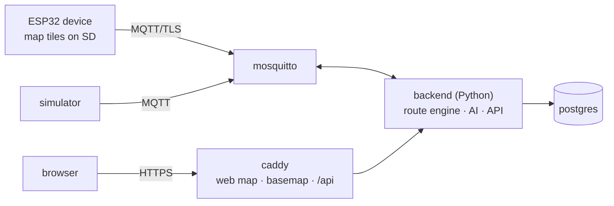

# AeroLink

**Navigation for Florida's low-altitude air corridors, with AI traffic prediction: Google Maps for eVTOL passenger and medical flights.**

A pilot picks a destination. AeroLink shows route options on a map with **AI-predicted traffic and arrival times**, and suggests a faster route when traffic builds up. Corridors are modeled on FDOT's Aerial Highway Network, connecting Tampa, Lakeland, Orlando, and Sebring.

AeroLink advises; it never controls. The backend uses the FAA's traffic-management concepts (planned flights, landing-pad capacity, off-route detection) as **calculations** to predict traffic well, but it never approves, rejects, or holds a flight. The pilot always chooses.

**Scope:** low-altitude passenger and medical eVTOL flights only. No aerial cargo or drone delivery. Commercial and military airspace are no-go constraints; AeroLink does not route airliners or military aircraft.

> **Not for flight.** AeroLink is a simulation-based engineering prototype. It is not certified equipment, an FAA-approved service provider, a surveillance system, an ATC service, or a collision avoidance system.

**Status:** M1 (foundations) and M2 (airspace and network) complete; M3 (simulator and classical baseline) next.

| Document | Contents |
|---|---|
| [docs/ARCHITECTURE.md](docs/ARCHITECTURE.md) | network, constraints, classical baseline, AI, route engine, evaluation, real-data validation, services, contracts, interface, hardware |
| [docs/PLAN.md](docs/PLAN.md) | milestones, epics, acceptance criteria, risks |
| [docs/HACKATHON.md](docs/HACKATHON.md) | theme and rules fit, Lakeland demo script, judge Q&A, sources |

---

## Why AI

A navigation app is only as good as its traffic prediction. The classical approach assumes aircraft fly their planned timing exactly and that all traffic is known in advance. Neither is true:

| Classical assumption | Reality | AeroLink AI |
|---|---|---|
| fixed ±60 s arrival windows | timing uncertainty varies | **arrival-time forecaster** with calibrated uncertainty ("arrive 14:20, likely 14:17–14:26"): LightGBM + MAPIE conformal intervals, trained on simulated and real Central Florida flight tracks; Chronos-2 (pretrained, Hugging Face) as the zero-shot comparator |
| only planned flights count | medical dispatches and upcoming departures aren't planned yet | **demand forecaster** adds traffic that isn't on the map yet |
| fixed off-route bounds | the right tolerance depends on speed and manoeuvre | **off-route detection** with learned bounds → "recalculating" |
| traffic is yes/no | arrivals overlap with some probability | **risk-weighted route ranking** and en-route "faster route" suggestions |

**AI predicts; deterministic algorithms build routes.** Routes are always paths in a corridor graph that can't touch no-go airspace. AI changes predicted times and rankings, never the geometry.

**Proof:** in a closed-loop simulation, classical navigation and full AeroLink are compared on trip time, waiting at landing pads, bunching events, and medical delay. The forecaster is also validated on real helicopter and light-aircraft tracks over Central Florida.

---

## The network

Two kinds of landing site, from FDOT plans and state aviation data:

| Site type | Examples | Who can fly there |
|---|---|---|
| **eVTOL sites** | Water Street (downtown Tampa), Parramore (downtown Orlando), Orlando Executive, Lakeland Linder, Sebring Regional, SunTrax | passenger aircraft |
| **Helipads** | 22 hospital and EMS pads, e.g. Tampa General, Lakeland Regional, Orlando Health ORMC, AdventHealth Sebring | medical aircraft |

- **Corridors:** along I-4, US-27, SR-60, US-98, and US-17/92, with shapes from FDOT's highway GIS.
- **Airspace rules:** FDOT's plan zones. Class D only with ATC coordination, Class B only on six designated clearance routes into downtown Tampa and Orlando, restricted and military airspace never.
- **No-go airspace:** from FAA open data, including the TPA and MCO controlled airspace, MacDill AFB, and the Avon Park Air Force Range.
- **Fleet:** 10 simulated aircraft (7 passenger, 3 medical) plus the physical device.

---

## What you can use

**AeroLink device:** an ESP32-S3 touchscreen navigation unit, one per aircraft. Its vehicle type (passenger or medical) is fixed in hardware. The pilot:
1. sees a real map they can pan and zoom, with corridors coloured by traffic
2. taps "Where to?" and picks from the destinations their aircraft can use
3. compares 2–3 route options with predicted times and traffic, and taps Go
4. gets "Faster route available" and "Off route — recalculating" in flight

The device draws its own map from tiles on its SD card and talks to the backend over MQTT; it doesn't run a browser. It's a breadboard build (Rev 0) wired to a KiCad schematic, with a demo button that cycles the vehicle type. A custom PCB comes after the MVP.

**Web map:** the same map in a browser, with:
- directions for any vehicle type
- a traffic layer with a +45 min time slider
- live aircraft and planned flights
- a **classical vs AeroLink** toggle
- a medical view and AI impact numbers

---

## How it fits together



| Part | Stack |
|---|---|
| Backend (`backend`) | Python: FastAPI + aiomqtt (ingest, device registry, planned flights, suggestions, API) and the calculation layer: Chronos-2 (`chronos-2-small`), LightGBM, MAPIE, OR-Tools, networkx, shapely |
| Web map | TypeScript, Vite, MapLibre GL JS, self-hosted Protomaps basemap (PMTiles) |
| Simulator | Python, closed-loop, deterministic scenarios |
| Device | ESP32-S3, ESP-IDF, C, LVGL 9, `0015/map_tiles` map view; tiles rendered with TileServer GL; KiCad wiring schematic |
| Infrastructure | Mosquitto, PostgreSQL, Caddy, Docker Compose, GCP Compute Engine |

---

## Quickstart

Prerequisites: Docker with Compose v2 and [uv](https://docs.astral.sh/uv/).

```bash
cp .env.example .env
./mosquitto/make-ca.sh                       # dev CA + broker cert
cd backend

# Airspace (raw FAA downloads in ../airspace/source/, see ARCHITECTURE §5.1)
uv run python -m aerolink.airspace.clip ../airspace/source/faa-class-airspace.geojson ../airspace/source/class-fl.geojson --region florida
uv run python -m aerolink.airspace.clip ../airspace/source/faa-special-use-airspace.geojson ../airspace/source/sua-fl.geojson --region florida
uv run python -m aerolink.airspace.convert --class-airspace ../airspace/source/class-fl.geojson \
  --special-use ../airspace/source/sua-fl.geojson --cycle 2026-10-29 --out ../airspace/constraints-fl.geojson

# Corridor network (FDOT zips in ../airspace/source/fdot/)
uv run python -m aerolink.airspace.fetch_fdot extract --network ../airspace/network.yaml \
  --source-dir ../airspace/source/fdot --out ../airspace/fdot-highways.geojson
uv run python -m aerolink.airspace.build_network --network ../airspace/network.yaml \
  --highways ../airspace/fdot-highways.geojson --constraints ../airspace/constraints-fl.geojson \
  --out ../airspace/central-fl-v1.geojson --report ../airspace/build-report.txt

uv run python -m aerolink.realdata.fetch --days 14   # optional: adsb.lol tracks
cd ..
docker compose up -d --build                 # caddy, backend, mosquitto, postgres
docker compose --profile sim up -d           # 10 simulated aircraft
open https://localhost
```

Evaluation:

```bash
cd backend
uv run python -m aerolink.eval --scenario all --seed 42 --ablations
uv run python -m aerolink.eval.realdata      # real-data forecaster benchmark
```

Tests:

```bash
cd backend && uv run pytest
```

Device tiles and firmware: see `firmware/README.md`.

---

## Repository layout

```text
aerolink/
├── README.md
├── docs/{ARCHITECTURE,PLAN,HACKATHON}.md
├── compose.yaml
├── .env.example
├── Caddyfile
├── airspace/
│   ├── network.yaml                        # landing sites (evtol/helipad), waypoints, connections
│   ├── sites-evtol.geojson                 # eVTOL site survey
│   ├── sites-helipads.geojson              # medical helipads (from FDEP/FDOT aviation data)
│   ├── sites-review.csv                    # helipad review sheet
│   ├── fdot-highways.geojson               # FDOT highway centerlines (focus region)
│   ├── central-fl-v1.geojson               # built network (generated)
│   ├── build-report.txt                    # dropped edges, bands, routes per pair
│   ├── constraints-fl.geojson              # FAA no-go volumes, all of Florida (snapshot)
│   └── source/                             # raw FAA and FDOT downloads (gitignored)
├── basemap/                                # Florida PMTiles + device tile set (gitignored, reproducible)
├── contracts/{schemas,examples}/           # message contracts v4.0
├── backend/                                # Python: service, AI, route engine, sim, eval
│   ├── src/aerolink/
│   │   ├── service/                        # ingest, devices, flights, loops, API, store
│   │   ├── airspace/  graph/  forecast/  demand/
│   │   ├── offroute/  traffic/  routing/  classical/
│   │   ├── summary/  sim/  realdata/  train/  eval/  tiles/
│   ├── migrations/  scenarios/  models/  eval-results/  tests/
│   └── data/realdata/                      # gitignored (ODbL source data)
├── web/                                    # Vite + TS + MapLibre (static, served by Caddy)
├── firmware/                               # ESP-IDF: LVGL UI, map view, MQTT, GNSS, vehicle-type key
├── hardware/
│   ├── kicad/rev0-wiring/                  # wiring schematic (+ PDF)
│   ├── cad/                                # Rev 0 tray
│   └── datasheets/
└── mosquitto/                              # config, ACLs, CA script
```

---

## Built on existing work

Existing tools are reused wherever they fit; custom code covers only the route engine, the corridor network, the simulator, off-route detection, and the flight-data parser. See the decisions table in [ARCHITECTURE §17](docs/ARCHITECTURE.md#17-decisions) for what was adopted and what was reviewed and not used.

## Data and attribution

- **Flight tracks:** contains data from [adsb.lol](https://www.adsb.lol/docs/open-data/historical/), licensed under the [Open Database License 1.0](https://opendatacommons.org/licenses/odbl/1-0/). Raw data is not redistributed.
- **Airspace:** [FAA Aeronautical Data Delivery Service](https://adds-faa.opendata.arcgis.com/) open data.
- **Highways:** Florida Department of Transportation GIS data.
- **Pretrained model:** [Amazon Chronos-2](https://huggingface.co/amazon/chronos-2) (Apache-2.0).
- **Basemap:** [Protomaps](https://protomaps.com), © OpenStreetMap contributors.

---

## Built for

*Cleared for Takeoff: AI for Florida's Skies.* AeroLink targets all three theme pillars: **safer**, **more efficient**, and **more accessible**. See [docs/HACKATHON.md](docs/HACKATHON.md).
