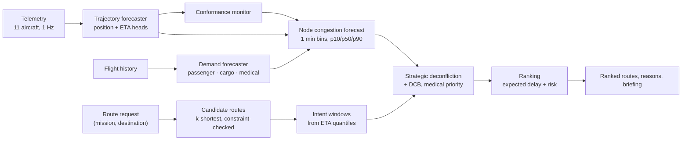
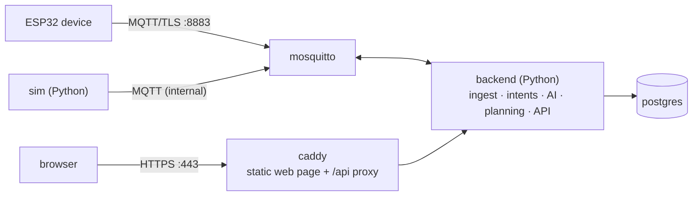

# AeroLink Architecture

Technical design for AeroLink. For the overview, see [README](../README.md). For the build plan, see [PLAN](PLAN.md). For the hackathon fit, see [HACKATHON](HACKATHON.md).

> **Not for flight.** AeroLink is a simulation-based engineering prototype. It is not certified equipment, an FAA-approved service provider, a surveillance system, an ATC service, or a collision avoidance system. Airspace data is processed for modeling and not authoritative. This document summarizes public plans and standards; it is not a legal or regulatory interpretation.

---

## Contents

1. [Scope and principles](#1-scope-and-principles)
2. [Regulatory and operational model](#2-regulatory-and-operational-model)
3. [Region and network](#3-region-and-network)
4. [Missions and fleet](#4-missions-and-fleet)
5. [Constraints](#5-constraints)
6. [Classical baseline](#6-classical-baseline)
7. [AI components](#7-ai-components)
8. [AeroLink planning pipeline](#8-aerolink-planning-pipeline)
9. [Evaluation](#9-evaluation)
10. [Real-data validation](#10-real-data-validation)
11. [System architecture](#11-system-architecture)
12. [Messaging and contracts](#12-messaging-and-contracts)
13. [Interface](#13-interface)
14. [Device and hardware](#14-device-and-hardware)
15. [Data](#15-data)
16. [Deployment and security](#16-deployment-and-security)
17. [Decisions](#17-decisions)
18. [Out of scope](#18-out-of-scope)
19. [References](#19-references)

---

## 1. Scope and principles

**Scope:** AeroLink plans **low-altitude AAM flights** (eVTOL **passenger**, **cargo**, and **medical** missions) on corridors modeled on FDOT's Aerial Highway Network, Phase 1A (Central Florida I-4 corridor), extended to Sebring.

**Commercial and military aviation are out of scope.** Their airspace is a no-go constraint. AeroLink never plans, predicts, or manages airliners or military aircraft.

Principles:

1. **AI predicts; deterministic algorithms decide.** Models forecast traffic and timing. Routes are always paths in a constraint-checked graph, and deconfliction and slot allocation are deterministic.
2. **Constraints hold by construction.** An invalid corridor cannot exist in the graph.
3. **Same framework as the classical approach, plus prediction.** AeroLink uses the FAA concepts of operational intent, strategic deconfliction, demand-capacity balancing (DCB), and conformance monitoring. AI makes them uncertainty-aware.
4. **Medical flights have priority.**
5. **The planning and AI layer is pure** (no database or MQTT access), so every decision can be replayed in a test.
6. **One Python backend owns all state** and is the only DB writer.
7. **MQTT is for aircraft only.** The browser uses HTTP.
8. **Silence never means clear.** Missing telemetry raises uncertainty; it never frees capacity.
9. **Every AI claim is measured** against the classical baseline (§6).

---

## 2. Regulatory and operational model

How AeroLink maps onto public FAA and FDOT concepts:

| Concept (source) | Meaning | In AeroLink |
|---|---|---|
| **Aerial Highway Network** (FDOT) | low-altitude corridors that roughly follow interstate highways, for air taxis, cargo, and emergency flights | corridor graph follows I-4, US-27, and related highways (§3) |
| **Phase 1A: Central Florida I-4 corridor** (FDOT) | first build-out region; includes Tampa Executive, Orlando Executive, SunTrax, Sebring Regional, and others | modeled region and vertiports |
| **Vertiport** (FAA EB 105A; Florida HB 1093) | a type of heliport serving VTOL aircraft | landing nodes with pad counts and arrival-slot capacity |
| **UAM corridors / cooperative areas** (FAA UAM ConOps 2.0) | defined airspace where operators manage traffic cooperatively | the graph's corridor edges |
| **Provider of Services for UAM (PSU)** (FAA UAM ConOps) | service that shares plans and positions between operators | AeroLink's role (`backend` + `backend`) |
| **Operational intent** (ASTM F3548, UTM) | a flight's planned route and timing, filed before departure | route + 4D time windows per node, filed when a route is selected |
| **Strategic deconfliction** (ASTM F3548) | checking a new intent against already-accepted intents | deterministic conflict check before an intent is accepted |
| **Demand-capacity balancing (DCB)** (FAA UAM ConOps 2.0) | matching demand to vertiport and corridor capacity | landing-slot and junction-throughput allocation |
| **Conformance monitoring** (ASTM F3548) | detecting aircraft outside their intent | conformance monitor (§7.4) |
| **Constraints** (ASTM F3548) | airspace restrictions | FAA airspace data loaded as no-go volumes (§5) |
| **Operational intent states** (ASTM F3548) | Accepted → Activated → Nonconforming / Contingent → Ended | intent lifecycle and `intent-status` messages (§12) |
| **FDOT AAM Business Plan** (Nov 2025) | Phase 1A city centers, first routes (Orlando–Tampa, Orlando–SunTrax, Tampa–SunTrax), eVTOL operating band of 1,000–3,000 ft, AAM passenger trips forecast at 220 thousand to 1.4 million in 2027 | network, corridor altitudes, and demand scaling (§3, §7.2) |

AeroLink acts as a **simulated service provider**. The FAA keeps authority over airspace and FDOT over infrastructure. Neither is modeled as an actor.

**Reference implementation, not a dependency:** [InterUSS DSS](https://github.com/interuss/dss) is the open-source implementation of the ASTM F3548 synchronization service. It shares references to operational intents between providers; it doesn't plan. AeroLink copies its field names and state names so the contracts are recognizable, but doesn't run it (it needs CockroachDB/Yugabyte and OAuth, and adds nothing to a single-provider demo).

---

## 3. Region and network

### 3.1 Region

Central Florida, from Tampa east to Orlando and south to Sebring:
- bounding box ≈ lat 27.3–28.8, lon −82.8 to −81.1
- coordinate system UTM zone 17N (EPSG:32617)

### 3.2 Nodes

| Type | Sites | Capacity (modeling parameters) |
|---|---|---|
| **Vertiports** (all on FDOT's Phase 1A list) | Tampa Executive (VDF), Orlando Executive (ORL), Sebring Regional (SEF) | 2 pads each |
| **Cargo hub + vertiport** | SunTrax, Auburndale (FDOT AAM test site) | 4 pads |
| **Hospital pads** | Tampa General Hospital, Lakeland Regional Health, AdventHealth Sebring, Orlando Health ORMC | 1 pad each |
| **Waypoints** | junctions along the corridors, e.g. Plant City, Lakeland, Davenport, Haines City, Lake Wales, Avon Park, Kissimmee | junction throughput (§3.4) |

Pad locations, waypoints, and coordinates are set when the graph is built. Each hospital pad position is verified against public sources and labelled "modeled".

### 3.3 Corridors

Corridors follow highway alignments, consistent with the Aerial Highway Network: e.g. I-4 (Tampa – Lakeland – Orlando), US-27 (Haines City – Lake Wales – Avon Park – Sebring), and connecting segments such as SR-60 and the Polk Parkway area. The final set is chosen during the graph build. The network covers FDOT's first planned routes: Orlando–Tampa, Orlando–SunTrax, and Tampa–SunTrax.

No published corridor geometry exists (FDOT publishes a plan map, not geodata), so the network is hand-authored and labelled illustrative.

Design rules:
- **At least two alternative paths per city pair**, so the ranking has real choices.
- **Corridor altitude band:** within FDOT's eVTOL operating band of 1,000–3,000 ft (≈305–915 m). Each corridor's band is set below any overlying controlled-airspace floor; the constraint check (§5.2) enforces it. Central Florida terrain is low, so MSL is used throughout.
- Connectors join each landing node to the nearest corridor, and are checked against constraints like every other edge.

Source file: `airspace/central-fl-v1.geojson` (hand-authored nodes and corridors), combined at build time with the FAA constraint data (§5).

### 3.4 Definitions

| Term | Definition |
|---|---|
| Time bin | 1 min |
| Landing slot | one arrival per pad per 5 min (pad turn time, a parameter) |
| Junction throughput | 1 aircraft per 60 s per junction |
| Spacing | 1 km along-track on the same edge; 60 s at the same junction (modeling parameters, not separation standards) |
| Loss of spacing | any spacing violation (simulated metric) |
| Node congestion(n, t) | expected arrivals at node n in bin t ÷ capacity in that bin |

### 3.5 Units

| Quantity | Convention |
|---|---|
| Coordinates | WGS84 on the wire; UTM 17N metres inside the models |
| Altitude | metres MSL |
| Speed | ground speed, m/s |
| Direction | course over ground, degrees true |
| Time | UTC, RFC 3339; device clock from GNSS |

---

## 4. Missions and fleet

| Mission | Simulated aircraft | Destinations | Priority | Cruise (param) | Demand pattern |
|---|---|---|---|---|---|
| Passenger | 5 | vertiports, SunTrax | normal | 60 m/s | time-of-day peaks |
| Cargo | 3 | SunTrax ↔ vertiports | low | 45 m/s | scheduled waves |
| Medical | 2 | hospital pads, vertiports | **high** | 65 m/s | unscheduled (random rate) |

- **Fleet:** 10 simulated aircraft, plus the physical device as an 11th.
- **Range:** a modeling parameter, default 160 km including reserve. Every route must be within range; that is a hard constraint.
- **Speeds:** parameters for simulation only, not tied to any specific aircraft type.

---

## 5. Constraints

### 5.1 Airspace data

**Source:** the FAA Aeronautical Data Delivery Service open data site (`adds-faa.opendata.arcgis.com`). It's free, needs no account, and offers GeoJSON downloads.

| Dataset | Used for |
|---|---|
| Class Airspace | Class B, C, and D volumes, with floor and ceiling |
| Special Use Airspace | restricted and prohibited areas, MOAs |

Processing:
- `backend/src/aerolink/airspace/import_faa.py` downloads both datasets as GeoJSON from the ArcGIS Hub download URLs, clips them to the region, and converts them to 3D no-go volumes (polygon + floor + ceiling) in `airspace/constraints-central-fl.geojson`.
- Vertical limits come from the `LOWER_VAL` / `UPPER_VAL` fields with their `*_CODE` and `*_UOM` companions (units and reference). Inspect these before writing the converter.
- The data is republished on an eight-week cycle. The snapshot is committed with its cycle date.

**Hand-modeled additions**, each labelled `modeled` and only where the FAA data doesn't already cover it:
- MacDill AFB: a polygon covering the base, if the FAA data only shows controlled airspace.
- Flight restrictions that aren't in special-use airspace data (e.g. the Walt Disney World area). Verify before adding.

### 5.2 Hard constraints (deterministic, never learned)

| Constraint | Enforcement |
|---|---|
| Corridor altitude band doesn't intersect any no-go volume in 3D (commercial Class B/C/D, restricted, prohibited, military) | graph build fails (CI test) |
| MOAs | avoided by default (treated as no-go); configurable |
| Connector edges into landing nodes avoid no-go volumes | graph build fails |
| Route length ≤ the mission range parameter | infeasible routes are discarded |
| Destination type is allowed for the mission (§4) | requests are rejected |
| Landing-slot and junction capacity | enforced by deconfliction and DCB (§6, §8) |

Every returned route is checked against the no-go volumes once more. A failure is treated as a bug: it is logged and the route is dropped.

### 5.3 Medical priority rules

- A medical intent may take over capacity held by non-medical intents.
- The non-medical flights it displaces are re-planned automatically, or offered a re-route if they're already airborne.
- Non-medical intents may never take capacity held by a medical intent.

---

## 6. Classical baseline

The **classical service-provider method**, implemented in full as the baseline for the evaluation. It uses no AI.

1. **Filing:** a route request produces candidate routes. Each candidate becomes an operational intent: the route plus a time window at each node, `[ETA − 60 s, ETA + 60 s]`. ETAs come from the mission cruise speed (fixed buffer).
2. **Strategic deconfliction (first come, first served):** the intent is checked against all accepted intents for:
   - junction overlap within 60 s
   - along-track spacing under 1 km on a shared edge
   - landing slots over pad capacity
3. **Resolution:** on a conflict, the method tries the next shortest candidate. If every candidate conflicts, departure is held on the ground in 30 s steps (up to 15 min), and then the request is rejected.
4. **DCB:** landing slots are allocated first come, first served, with the medical priority rules (§5.3).
5. **Conformance:** an aircraft is non-conforming if it is >300 m laterally off its route, or outside its time window at a node.
6. **Choice:** shortest feasible route.

This is the method the AI has to beat. Its weakness is that it assumes aircraft fly their filed timing exactly and that all demand is filed in advance.

---

## 7. AI components

All AI runs in the planning and AI layer of `backend` (Python package `aerolink`, §11).

### 7.1 Trajectory forecaster

Two heads behind one interface:

| Head | Predicts | Horizons | Used for |
|---|---|---|---|
| **Position head** | east/north/up displacement, p10/p50/p90 | 30, 60, 120, 300 s | prediction cones, conformance, short-term conflicts; validated on real data (§10) |
| **ETA head** | along-route progress, p10/p50/p90 → arrival-time distribution at every node on the route | 5, 10, 20, 30, 45 min | intent time windows, node congestion, DCB |

Implementations, switchable at runtime:

| ID | Type | Role |
|---|---|---|
| `cv` | constant velocity (position) / constant cruise speed (ETA) | non-AI baseline |
| `chronos` | Chronos-2 pretrained time-series model (Apache-2.0), zero-shot on east/north/up series (position head) and ground-speed series (ETA head). Default weights: `autogluon/chronos-2-small` (≈28M parameters, CPU-friendly); `amazon/chronos-2` (120M) if the VM allows | AI with no training data; comparator |
| `aerolink-gbm` | LightGBM quantile regression, residual over `cv`, one model per horizon and quantile, **calibrated with MAPIE** (below) | **primary ETA model** |

**Why LightGBM is the primary ETA model:** Chronos-2 forecasts time series; it isn't an aircraft trajectory predictor. Per-flight arrival time depends mostly on tabular context (remaining distance, corridor, mission, congestion), which a gradient-boosted model handles better. Chronos-2 stays as the zero-shot comparator and does the work where the problem really is a time series (demand, §7.2). No pretrained, permissively licensed trajectory model for low-altitude aircraft was found.

**Calibrated windows (MAPIE):** the LightGBM quantile model is wrapped in MAPIE's `ConformalizedQuantileRegressor` (BSD-3-Clause). The resulting p10–p90 interval comes with a stated coverage target (80%), and the evaluation reports measured coverage. That's what lets the intent windows replace the classical fixed ±60 s.

**`aerolink-gbm` features:**
- the last 30 s of kinematics
- mission type
- current edge and distance to the next junction
- turn options at the next junction
- remaining route length
- time of day
- the aircraft's historical speed bias

Graph features are empty for real-data samples (§10); LightGBM handles the missing values natively, so one model trains on both simulated and real data.

Fine-tuning Chronos-2 on simulated data is planned; first confirm that the installed `chronos-forecasting` version supports it.

### 7.2 Demand forecaster

Predicts flights that haven't been filed yet:

| Mission | Prediction | Model | Baseline |
|---|---|---|---|
| Passenger | departures per vertiport per 15 min (Chronos-2, time-of-day covariate) + destination probabilities (LightGBM) | Chronos-2 + LightGBM | historical mean rate + uniform destination |
| Cargo | next wave timing and size per hub | LightGBM on the schedule history | last known schedule |
| Medical | dispatches per hospital per 15 min, plus likely destinations | Chronos-2 on the dispatch history (time-of-day covariate) | constant mean rate |

Predicted flights become **phantom intents**. Their expected arrivals are added to node congestion, weighted by probability.

**Demand data is synthetic** (no public UAM demand dataset for the region was found). The simulator generates it with diurnal Poisson patterns, scaled from the FDOT AAM Business Plan's 2027 passenger-trip forecast, and it's labelled synthetic everywhere.

### 7.3 Node congestion forecast (derived)

```
ExpectedArrivals(node, bin) = Σ over accepted intents  P(arrive in bin)        (ETA head, 7.1)
                            + Σ over phantom intents   P(flight) × P(arrive)  (7.2)
                            + reachable-set mass of non-conforming aircraft    (7.4)
Congestion(node, bin) = ExpectedArrivals / Capacity(node, bin)
```

Every hot spot can be traced back to the flights causing it.

### 7.4 Conformance monitor

No maintained library for aircraft conformance monitoring exists, so this is custom code on standard tools:
- **Band check:** the aircraft is outside its calibrated forecast interval (position head p05–p95, or the intent's ETA window) for ≥3 consecutive samples.
- **Anomaly score:** scikit-learn `IsolationForest` on residual features (cross-track error, speed deviation, vertical-rate deviation), trained on clean real-data legs (§10).

Either signal moves the intent to the F3548 **Nonconforming** state.

When an aircraft is flagged:
- its occupancy spreads over every node it can reach within the horizon
- the dashboard alerts
- affected intents are re-checked

The baseline is the fixed bounds from the classical method (§6).

### 7.5 Pilot briefing (LLM)

An LLM, called through [OpenRouter](https://openrouter.ai) (OpenAI-compatible API, paid from OpenRouter credits), turns a route response into a two-sentence briefing. The model is set by `LLM_MODEL`.

Guardrails:
- The input is only structured `cost_terms`, ETA windows, and node labels.
- Every number in the output is checked against those fields. Any mismatch discards the text, and a template sentence is shown instead.
- The LLM never influences planning.

---

## 8. AeroLink planning pipeline

Same framework as §6, with prediction:



### 8.1 Steps

1. **Candidates:** up to k = 3 diverse paths with `networkx.shortest_simple_paths`, sharing at most 70% of their edges, and all within the mission range.
2. **Intent windows:** each node's window is the calibrated `[ETA p10, ETA p90]` interval from the ETA head (§7.1), replacing the classical fixed ±60 s.
3. **Strategic deconfliction:** the same rules as §6, using the AI windows. Overlap of uncertain windows gives a **conflict probability**:
   - above `p_max` (default 0.2) is a conflict
   - below it, the risk is carried into the cost
4. **DCB:** landing slots and junction throughput, including phantom intents (§7.2), with medical priority (§5.3). Solved as interval scheduling with Google OR-Tools CP-SAT (Apache-2.0): each landing site and junction is a capacity-limited resource over time, and the objective is priority-weighted delay (medical weighted highest). The classical baseline keeps greedy first-come-first-served. Verify the OR-Tools modelling approach early; greedy priority allocation is the fallback.
5. **Ranking:**

   ```
   cost = est_time_s + expected_ground_hold_s + expected_airborne_hold_s
        + μ × Σ conflict_probability
   expected_airborne_hold_s ← from Congestion p90 at the arrival node
   ```

   μ = 600 s per unit conflict probability by default. The candidate with the lowest cost is rank 1.
6. **Filing:** when the pilot (or a simulated aircraft) selects a route, its intent is filed and accepted.
7. **En-route re-planning:** every 2 min, the backend re-runs steps 2–5 for each airborne aircraft. If a better plan beats the current one by more than 10% of cost, or a medical priority displaces the flight, the backend publishes a revised route response.

### 8.2 Forecast refresh

Every 10 s, the backend's forecast loop runs the forecasters and caches the forecasts and the congestion grid. Route requests and re-planning reuse the cache. Model inference runs in a worker thread so it never blocks MQTT ingest.

---

## 9. Evaluation

Offline, in one Python process with a simulated clock and deterministic seeds. Results are committed to `backend/eval-results/`.

```bash
cd backend
uv run python -m aerolink.eval --scenario all --seed 42 --ablations
```

### 9.1 Simulator

A custom kinematic simulator: point-mass aircraft along corridor polylines, with speed and climb limits per mission and noise from a seeded `numpy.random.Generator`. Existing simulators were reviewed and not used: BlueSky (MIT, Python) targets airliner performance and tactical conflict resolution rather than corridor and landing-slot capacity, and MATSim-UAM is Java and agent-based at a much larger scale. A few hundred lines of custom code give full control over the deterministic classical-vs-AI comparison.

- 10 aircraft with the mission mix in §4.
- Stochastic cruise speed per aircraft and leg, wind-like speed bias, holds, diversions, and destination changes.
- Unscheduled medical dispatches.
- **Closed loop:** simulated aircraft request routes, file intents, and fly them.
- Two modes: **offline** (simulated clock, used for training and evaluation) and **live** (real time over MQTT, used for the demo).

### 9.2 Scenarios (`backend/scenarios/*.yaml`)

| Scenario | Stresses |
|---|---|
| `nominal_day` | mixed missions, normal demand |
| `i4_peak` | passenger flights converging on Orlando Executive |
| `sebring_race_weekend` | passenger surge into Sebring |
| `medical_dispatch` | unscheduled medical flight through busy corridors |
| `cargo_wave` | SunTrax cargo departures colliding with passenger peaks |
| `holds_and_diversions` | aircraft deviating from their filed timing |
| `rogue_aircraft` | injected route deviations, with labelled ground truth |
| `telemetry_dropout` | missing and delayed fixes |

### 9.3 Configurations (ablations)

| # | Configuration |
|---|---|
| B0 | shortest path, no coordination |
| B1 | **classical service-provider method** (§6), no AI |
| A1 | B1 + AI ETA windows (`chronos`) |
| A2 | B1 + AI ETA windows (`aerolink-gbm`) |
| A3 | A2 + demand forecaster |
| A4 | A3 + AI conformance |
| A5 | **full AeroLink** (A4 + risk ranking + en-route re-planning) |

### 9.4 Metrics

| Area | Metric |
|---|---|
| Efficiency | mean and p95 total delay (ground + airborne hold), landing-slot utilization, rejected requests |
| Safety | loss-of-spacing events, unresolved conflicts, conformance detection precision/recall and latency |
| Medical (accessibility) | medical delay caused by other traffic, medical time-to-destination |
| Forecasting | position ADE/FDE per horizon; ETA error per horizon; p10–p90 coverage (target ≈ 80%) |
| Demand | departure-time MAE, destination accuracy, medical rate calibration |
| Briefing | share of LLM outputs that pass the number check |

**Reported claim:** A5 vs B1, as measured, across every scenario.

---

## 10. Real-data validation

### 10.1 Source

[adsb.lol historical data](https://www.adsb.lol/docs/open-data/historical/):
- Daily ADS-B dumps published as GitHub releases.
- Free, with no account needed.
- Licensed under the Open Database License (ODbL 1.0).

### 10.2 Pipeline (`backend/src/aerolink/realdata/`)

1. **Download** N daily releases (start at 14 days). Each release is a split tar (`.tar.aa`, `.tar.ab`, …) of several GB. Stream it and extract only the `traces/` files. There is one file per aircraft per day; files may end in `.json` but contain gzip, so always try to decompress.
2. **Parse** with a small custom parser written against the readsb trace format ([README-json](https://github.com/wiedehopf/readsb/blob/dev/README-json.md)). Each trace point is `[seconds_offset, lat, lon, alt_ft or "ground", gs_kt, track, flags, vrate_fpm, details, source_type, geom_alt, geom_rate, ias, roll]`. Community parsers (e.g. marklit/adsb_json, Qourat/flights-converter) are references, not dependencies.
3. **Keep only traces inside the region's bounding box.**
4. **Keep only AAM analogues and exclude commercial and military traffic:**
   - altitude ≤ 3,000 ft (the top of FDOT's eVTOL operating band)
   - ground speed 40–160 kt
   - rotorcraft (emitter category A7) or light aircraft, from the `details` object where present; fall back to aircraft type, altitude, speed, and callsign rules
   - drop airline callsigns, heavy categories, and military
   - drop points whose `source_type` is `mlat` (prone to outliers)
5. **Segment** at the "start of a new leg" flag and at gaps > 30 s.
6. **Resample** to 1 Hz with the [`traffic`](https://github.com/xoolive/traffic) library (MIT). It runs in a data-prep step only, because its dependency tree is heavy.
7. **Write** Parquet to `backend/data/realdata/` (gitignored, never committed).

### 10.3 Use

- **Validation:** the position head (`cv` vs `chronos` vs `aerolink-gbm`) on held-out days. Real aircraft don't fly AeroLink corridors, so only the graph-free position head is evaluated on real data.
- **Training:** `aerolink-gbm` trains on simulated data plus the real-data training days (graph features empty for real samples).
- **Framing:** helicopters and light aircraft are the closest operating analogue to eVTOL. Air ambulances are part of the helicopter traffic but are not singled out.

### 10.4 Licence obligations (ODbL)

- **Attribution:** "Contains data from adsb.lol, licensed under ODbL 1.0", shown in the README and the dashboard footer.
- **Share-alike:** any derived database that is published (e.g. the filtered tracks) must be released under ODbL.
- **Raw data:** not redistributed. The pipeline script reproduces it from the source.

---

## 11. System architecture



**All Python, one backend.** Given the time constraints, there is a single Python service instead of separate Go and Python services. That means one language, one set of message models, one MQTT client, and one container fewer. FastAPI plus [aiomqtt](https://github.com/empicano/aiomqtt) (asyncio MQTT client) easily handles 11 aircraft at 1 Hz.

| Component | Language | Owns |
|---|---|---|
| `backend` | Python (FastAPI + aiomqtt) | MQTT ingest, live state (latest fix + 30 s history), **intent registry**, forecast refresh and re-planning loops, HTTP API, DB writes and migrations; plus all AI and planning (forecasters, demand, conformance, congestion, candidates, deconfliction, DCB, ranking, briefing, classical baseline) |
| `sim` | Python (same image, different entrypoint) | closed-loop fleet, scenarios |
| `web` | TypeScript (built to static files) | the map page; served by Caddy |
| `firmware` | C / ESP-IDF | GNSS, touch UI, MQTT |
| `postgres` | — | telemetry, intents, route history, eval runs |
| `caddy` | — | HTTPS, basic auth, static web files, `/api` reverse proxy |

**Internal structure (Python package `aerolink`):**

| Layer | Modules | Rule |
|---|---|---|
| Service layer | `aerolink.service` (ingest, intents, loops, API, store) | owns all state and all I/O (MQTT, database, HTTP) |
| Planning and AI | `aerolink.forecast`, `demand`, `conformance`, `congestion`, `planning`, `classical`, `briefing`, `graph`, `airspace` | **pure functions:** every call takes its full input (snapshot, intents, grid) and returns a result, with no database or MQTT access |
| Offline tools | `aerolink.sim`, `eval`, `realdata`, `train` | reuse the planning and AI layer directly |

Keeping the planning and AI layer pure preserves the original "stateless brain" benefit: any live decision can be replayed in a unit test, and the offline evaluation calls exactly the same code as the live system.

**Off-the-shelf infrastructure:** Eclipse Mosquitto (broker), PostgreSQL, and Caddy, all from standard Docker images. EMQX was considered and not used: it moved to the Business Source License 1.1 in v5.9.0, and Mosquitto covers the need.

### 11.1 Backend API (behind Caddy at `/api`)

| Endpoint | Method | Purpose |
|---|---|---|
| `/api/state` | GET | aircraft, missions, status, conformance flags |
| `/api/intents` | GET | operational intents and their states |
| `/api/forecast` | GET | cones + congestion grid |
| `/api/forecaster` | PUT | switch the forecaster |
| `/api/method` | PUT | switch `classical` / `aerolink` (live comparison) |
| `/api/plan` | POST | what-if plan; never filed, never sent to a device |
| `/api/route-requests/{request_id}` | GET | device request and result |
| `/api/eval` | GET | latest ablation results |
| `/api/models` | GET | loaded models, versions, last eval scores |
| `/api/airspace` | GET | corridors, nodes, no-go volumes (GeoJSON) |
| `/api/scenario` | PUT | switch the live sim scenario |
| `/api/aircraft/{id}/telemetry` | GET | history |
| `/healthz` | GET | liveness |

### 11.2 Device flow

1. The device publishes a `route-request` (mission + destination).
2. The backend validates it: the topic matches `aircraft_id`, the destination is allowed for the mission, and the request is idempotent on `request_id`.
3. The backend runs the planner on the current snapshot, accepted intents, and cached congestion grid, then generates the briefing.
4. The backend publishes the ranked routes in a `route-response`.
5. The pilot selects a route, and the device publishes an `intent` message.
6. The backend re-runs deconfliction for that route and accepts it or rejects it with a reason. The result goes back as an `intent-status` message.
7. While the flight is airborne, the backend may publish revised route responses (§8.1 step 7).

---

## 12. Messaging and contracts

### 12.1 Topics

| Topic | Direction | Retained | Purpose |
|---|---|---|---|
| `aerolink/aircraft/{id}/telemetry` | device → backend | no | 1 Hz position |
| `aerolink/aircraft/{id}/status` | device → backend | yes | Last Will |
| `aerolink/aircraft/{id}/route-request` | device → backend | no | mission + destination |
| `aerolink/aircraft/{id}/route-response` | backend → device | no | ranked routes; revisions |
| `aerolink/aircraft/{id}/intent` | device → backend | no | selected route (filing) |
| `aerolink/aircraft/{id}/intent-status` | backend → device | no | intent state changes (see below) |
| `aerolink/sim/{id}/…` | sim ↔ backend | same | same topics and payloads |

- The backend derives the source (physical or simulated) from the namespace, which the broker ACLs enforce.
- A payload whose `aircraft_id` doesn't match its topic is rejected.
- Delivery is QoS 1, with deduplication on `message_id` and out-of-order telemetry dropped.

### 12.2 Schemas (`contracts/schemas/`, v3.0)

**Telemetry**

```json
{
  "schema_version": "3.0",
  "message_id": "…",
  "aircraft_id": "dev-001",
  "mission": "medical",
  "timestamp": "2026-11-17T15:00:00Z",
  "position": { "lat": 28.0395, "lon": -81.9498, "alt_msl_m": 60.0 },
  "motion": { "ground_speed_mps": 0.0, "course_deg": 0.0, "vertical_speed_mps": 0.0 },
  "fix": { "type": "3d", "hdop": 0.9, "satellites": 11, "replayed": false },
  "active_intent_id": null
}
```

Fixes with `type` not `3d` or with `hdop > 5` are discarded. A fix outside the region is flagged `out_of_region`, and that aircraft's requests are rejected.

**Route request**

```json
{
  "schema_version": "3.0",
  "message_id": "…",
  "request_id": "…",
  "aircraft_id": "dev-001",
  "mission": "medical",
  "timestamp": "2026-11-17T15:00:00Z",
  "destination_node": "hp-tgh"
}
```

The origin is the latest accepted fix, snapped to the nearest landing node or waypoint through a constraint-checked connector.

**Route response**

```json
{
  "schema_version": "3.0",
  "message_id": "…",
  "request_id": "…",
  "aircraft_id": "dev-001",
  "revision": 0,
  "status": "ok",
  "method": "aerolink",
  "forecast_time": "2026-11-17T15:00:05Z",
  "expires_at": "2026-11-17T15:01:05Z",
  "forecaster": "aerolink-gbm@1.0",
  "graph_version": "central-fl-v1",
  "constraints_cycle": "FAA ADDS 2026-11",
  "briefing": "Route 1 avoids a predicted landing queue at Tampa General around 15:31.",
  "routes": [
    {
      "route_id": "…",
      "rank": 1,
      "distance_m": 74000,
      "est_time_s": 1140,
      "expected_hold_s": 30,
      "conflict_probability": 0.04,
      "cost_terms": { "est_time_s": 1140, "expected_hold_s": 30, "mu": 600, "conflict_probability": 0.04 },
      "reason": "avoids predicted landing queue at hp-tgh 15:30–15:34",
      "intent": [
        { "node": "wp-lakeland", "eta_p10": "…", "eta_p50": "…", "eta_p90": "…" },
        { "node": "hp-tgh", "eta_p10": "…", "eta_p50": "…", "eta_p90": "…" }
      ],
      "waypoints": [[28.0395, -81.9498, 300.0], [27.94, -82.46, 300.0]]
    }
  ]
}
```

`status` is one of `ok`, `no_route`, `rejected`, `error`. Values are illustrative.

**Intent**

```json
{
  "schema_version": "3.0",
  "message_id": "…",
  "request_id": "…",
  "aircraft_id": "dev-001",
  "route_id": "…",
  "timestamp": "…"
}
```

**Intent status**

```json
{
  "schema_version": "3.0",
  "message_id": "…",
  "aircraft_id": "dev-001",
  "intent_id": "…",
  "status": "accepted",
  "reason": null
}
```

`status` follows the ASTM F3548 operational-intent states, plus two AeroLink outcomes:

| Status | Meaning | Source |
|---|---|---|
| `accepted` | filed and deconflicted; not yet flying | F3548 |
| `activated` | the flight has departed on this intent | F3548 |
| `nonconforming` | the aircraft is outside its intent (§7.4) | F3548 |
| `contingent` | the aircraft can't return to its intent | F3548 |
| `ended` | the flight is complete | F3548 |
| `rejected` | filing refused (conflict, capacity, or constraint); `reason` says why | AeroLink |
| `superseded` | replaced by a re-plan or a medical priority | AeroLink |

Field names in the intent messages follow the F3548 OpenAPI where an equivalent exists (e.g. `time_start` / `time_end`, `priority`), using the InterUSS repositories as the reference.

---

## 13. Interface

### 13.1 Web dashboard

A custom page: Vite + TypeScript + MapLibre GL JS, built to static files in `web/` and served by Caddy. It polls `/api` every second.
- **Basemap:** OpenFreeMap (`https://tiles.openfreemap.org/styles/liberty`). No registration, no API key, OpenStreetMap data.
- **Fallback:** a self-hosted Protomaps PMTiles extract of Florida served by Caddy, if venue connectivity is a concern.
- **3D airspace:** no-go volumes and corridors as GeoJSON `fill-extrusion` layers, using floor and ceiling heights from the FAA data.
- **Optional:** deck.gl `TripsLayer` for animated trails, only if time remains.

| Feature | Purpose |
|---|---|
| Map | corridors, landing nodes by type, no-go volumes coloured by type (commercial / military / restricted) |
| Live traffic | 10 simulated aircraft + the device, coloured by mission; stale, lost, and non-conforming aircraft styled differently |
| Operational intents | filed routes with ETA windows |
| Prediction cones | position-head p10–p90 envelope |
| Congestion timeline | node congestion, +0 to +45 min |
| **Method toggle** | `classical` vs `aerolink`, compared live |
| Forecaster toggle | `cv` / `chronos` / `aerolink-gbm` |
| Planner | pick a mission, origin, and destination → ranked routes, reasons, briefing |
| Medical panel | active medical flights, the capacity reserved for them, displaced flights |
| AI impact panel | B1 vs A5 metrics, live and from committed runs |
| Alerts | conformance, out-of-region, rejected intents |
| Scenario control | switch the live scenario |
| Attribution footer | adsb.lol (ODbL), FAA ADDS, basemap |

### 13.2 Device UI (LVGL)

1. **Mission:** passenger / cargo / medical.
2. **Destination:** filtered by mission.
3. **Routes:** ranked list with ETA, hold, risk, reason, and briefing → select = file the intent.
4. **Flight:** intent status, next node ETA window, re-route offers, medical priority indicator.
5. **Status:** fix, HDOP, MQTT connection, region check, age of the last response.

---

## 14. Device and hardware

The device is **general-purpose**:
- not tied to an operator or mission
- each unit has its own MQTT credentials and an aircraft profile
- the mission is chosen per flight

### 14.1 Rev 0: breadboard device (the MVP device)

| Part | Notes |
|---|---|
| ESP32-S3-DevKitC-1, N8R8 variant | ESP32-S3-WROOM-1-N8R8 module |
| 3.5″ SPI display module with capacitive touch | prefer ST7796 (RGB565 over SPI) |
| ATGM336H GNSS breakout + active antenna | UART |
| USB-C power through the devkit | check the 3.3 V budget for backlight + GNSS |

### 14.2 Wiring schematic and datasheets (`hardware/`)

| Item | Location |
|---|---|
| KiCad schematic of the Rev 0 wiring + exported PDF | `hardware/kicad/rev0-wiring/` |
| Datasheets for every part | `hardware/datasheets/` |
| Tray for carrying Rev 0 | `hardware/cad/` |

Rules:
- **The schematic is the source of truth for wiring.** Rev 0 is wired exactly to it, and the firmware board config (`firmware/components/board/`) matches it. Discrepancies are fixed in the schematic.
- Avoid GPIO35–37 (used by the octal PSRAM) and take care with strapping pins (0, 3, 45, 46).
- Keep the SPI wires short and start the display clock at 20–26 MHz.
- For carrying it around: a soldered protoboard, or secured jumpers on the 3D-printed tray.

### 14.3 Custom PCB (post-MVP)

A custom PCB (Rev A) is planned after the MVP, starting from the Rev 0 schematic: ESP32-S3-WROOM-1-N8R8, display + touch, ATGM336H, USB-C, AP63203 3.3 V buck. The same firmware will run on it with a new board config. See [PLAN](PLAN.md#post-mvp-backlog).

### 14.4 Firmware

Built mostly from existing ESP-IDF components:

| Need | Component |
|---|---|
| ST7796 display | `espressif/esp_lcd_st7796` (ESP Component Registry). v1.5.0's licence shows as "Custom" while earlier versions are Apache-2.0; check it or pin an earlier version |
| Capacitive touch (FT6236 / FT6x36) | `espressif/esp_lcd_touch_ft5x06` + `esp_lcd_touch`. If the module turns out to use resistive XPT2046 touch, use `atanisoft/esp_lcd_touch_xpt2046` instead |
| LVGL integration | `espressif/esp_lvgl_port` (handles display/touch registration, tick, and the LVGL task) |
| GNSS (NMEA) | ESP-IDF's `nmea0183_parser` example (demoed with an ATGM332D, a sibling of the ATGM336H); `minmea` as an alternative |
| MQTT over TLS | `esp-mqtt` (built into ESP-IDF), starting from its `mqtt/ssl` example, with the CA certificate embedded via `EMBED_TXTFILES` |
| Starting template | [sukesh-ak/BSP-IDF5-ESP_LCD-LVGL9](https://github.com/sukesh-ak/BSP-IDF5-ESP_LCD-LVGL9): ST7796 + FT5x06 touch + LVGL 9 via `esp_lvgl_port` on an ESP32-S3 |

- ESP-IDF, C, and LVGL.
- Telemetry at 1 Hz, with a Last Will on `status`.
- Revisions and staleness are handled using `expires_at`.
- The project CA is pinned.
- **GNSS replay mode** plays a recorded NMEA track from flash and sets `fix.replayed = true`, for indoor demos.

### 14.5 Indoor demo notes

- Put the active antenna in a window, or run a cable outside. Power up early: a cold fix can take 30 s or more.
- The handheld moves at walking speed. Present it as an aircraft on the ground at its origin, about to depart.
- Bring a phone hotspot in case venue Wi-Fi blocks port 8883.

---

## 15. Data

PostgreSQL 16 without PostGIS. The backend owns the schema; migrations live in `backend/migrations/`.

| Table | Contents |
|---|---|
| `aircraft` | id, namespace, mission profile |
| `telemetry` | accepted fixes; index `(aircraft_id, ts)` |
| `route_requests` | request, snapshot hash, method, latency |
| `route_results` | ranked routes (jsonb), briefing, versions |
| `intents` | operational intents: route, windows, status, revisions |
| `eval_runs` | ablation results |

- **Volume:** 11 aircraft at 1 Hz ≈ 1 M rows/day. Telemetry is kept 7 days.
- **Simulated training data and models:** versioned in `backend/models/` with their seeds.
- **Real data:** local only (§10).

---

## 16. Deployment and security

One GCP Compute Engine VM (school-provided credits) runs everything: the MQTT broker, the website, and all other services, in Docker Compose with five containers: `caddy` (also serving the static web page), `backend`, `mosquitto`, `postgres`, and `sim`.

**VM size:** start at 4 vCPU / 16 GB, then resize to the smallest size that keeps the 10 s forecast refresh, based on the E4.2 measurement. The VM is the main credit cost; model inference runs on it at no extra charge.

| Port | Service | Notes |
|---|---|---|
| 443 / 80 | caddy | automatic HTTPS; basic auth on everything except `/healthz` |
| 8883 | mosquitto | TLS with the project CA |
| — | backend, postgres, sim | internal network only |

- Chronos-2 runs on the VM's CPU inside the `backend` container, defaulting to `autogluon/chronos-2-small` (≈112 MB of weights). Weights are downloaded at image build time.
- The LLM briefing is the only external AI service (OpenRouter).
- **Containers:** pinned images, non-root where practical, health checks, `restart: unless-stopped`, logs to stdout.
- **Backups:** nightly `pg_dump` to Cloud Storage, kept 14 days, with one restore drill.
- **MQTT:**
  - self-managed project CA, pinned on the device
  - each device gets its own credentials, with the ACL `pattern readwrite aerolink/aircraft/%u/#`
  - the `sim` account is limited to `aerolink/sim/#`
  - anonymous access is off
- **Secrets:** stored in `.env` (never committed), including the LLM API key.

---

## 17. Decisions

| Decision | Chosen | Rejected | Why |
|---|---|---|---|
| Scope | low-altitude AAM: passenger, cargo, medical | passenger only | matches FDOT's network and pilot program; covers all three theme pillars |
| Commercial/military | no-go constraints only | modeling their traffic | keeps the scope clear |
| Vertiports | Tampa Executive, Orlando Executive, Sebring, SunTrax + hospitals | major commercial airports | all on FDOT's Phase 1A list; no airline-hub confusion |
| Corridors | follow highways (Aerial Highway Network) | free routing | matches FDOT's plan |
| Framework | FAA concepts: operational intent, deconfliction, DCB, conformance | custom framework | recognizable; comparable to the classical approach |
| Main baseline | classical service-provider method | shortest path only | measures AI against what would really be used |
| AI role | uncertainty-aware windows, demand, conformance, risk ranking | AI generates routes | constraints and deconfliction stay deterministic |
| Pretrained model | Chronos-2 (`chronos-2-small` on CPU) | TimesFM 3.0, TiRex v1 | Apache-2.0, zero-shot quantiles; TimesFM 3.0 weights are non-commercial and TiRex v1 uses a community licence |
| Primary ETA model | LightGBM quantiles + MAPIE conformal calibration | Chronos-2 alone | per-flight ETA is tabular; conformal intervals give a stated coverage |
| DCB solver | OR-Tools CP-SAT (verify early; greedy fallback) | hand-written heuristics only | priority-weighted interval scheduling is what CP-SAT is built for |
| Simulator | custom kinematic simulator | BlueSky, MATSim-UAM | BlueSky targets airliners and tactical conflicts; MATSim is Java and agent-based |
| Standards implementation | InterUSS as a naming/state reference | running InterUSS DSS | the DSS synchronizes providers, doesn't plan, and needs CockroachDB/Yugabyte + OAuth |
| MQTT broker | Mosquitto | EMQX | EMQX moved to BSL 1.1 in v5.9.0; Mosquitto covers the need |
| Basemap | OpenFreeMap | keyed tile services | no account or API key |
| Firmware drivers | ESP-IDF registry components + an existing ST7796/LVGL template | custom drivers | display, touch, LVGL, GNSS, and MQTT/TLS all exist |
| Real data | adsb.lol (ODbL, no account), filtered to helicopters and light aircraft | OpenSky (history needs an account) | free with no account; real Central Florida tracks |
| Airspace data | FAA open data | hand-drawn polygons | official and free |
| Fleet | 10 simulated (5/3/2) + device | 50+ | prototype scale; still produces conflicts at landing nodes and junctions |
| Device | general-purpose, mission chosen per flight | per-operator device | one device for any AAM mission |
| Hardware | Rev 0 breadboard + KiCad wiring schematic and datasheets; custom PCB post-MVP | custom PCB in the MVP | focus on the software and AI; the schematic carries over to the PCB later |
| Backend language | all Python (one backend) | Go core + Python AI service | time constraints: one language, one set of message models, one MQTT client, one fewer container |
| AI/planning layer | pure functions inside the backend | separate stateless HTTP service | same replayability without a second service |
| Frontend | Vite + TS static page served by Caddy | Next.js | one page; no Node runtime |
| Map | custom MapLibre page | TAK (FreeTAKServer / OpenTAKServer + ATAK/iTAK) | TAK can't show the AI panels (method toggle, congestion, impact); a custom map is simpler than a CoT bridge |

---

## 18. Out of scope

Real flight operations; certification; acting as an FAA-approved service provider; FAA/ATC integration or authorization; commercial or military traffic management; authoritative surveillance; collision avoidance or detect-and-avoid; autopilot; separation assurance; weather; noise modeling; regions beyond Central Florida (Tampa – Orlando – Sebring); cellular connectivity; on-device inference; reinforcement learning; an LLM making planning decisions; user management beyond basic auth; Kubernetes; high availability.

---

## 19. References

- FDOT Aerial Highway Network and Phase 1A sites: [Florida Trend, Nov 2026](https://www.floridatrend.com/feature/2026/11/11/vertical-integration)
- Florida HB 1093 (Advanced Air Mobility Competitiveness and Infrastructure Act): [Holland & Knight summary](https://www.hklaw.com/en/insights/publications/2026/04/new-legislation-clears-the-runway-for-vertiport-development-in-florida)
- Sebring vertiport planning: [Sebring Airport Authority](https://sebring-airport.com/?p=4963)
- FAA UAM ConOps 2.0 (corridors, cooperative practices, DCB): [Halldale summary](https://www.halldale.com/civil-aviation/21140-cat-faa-considering-air-taxi-corridors-passing-lanes)
- ASTM F3548-21 (strategic coordination, conformance monitoring, constraints): [ASTM](https://store.astm.org/f3548-21.html)
- FAA Engineering Brief 105A, Vertiport Design: [FAA](https://www.faa.gov/airports/engineering/engineering_briefs/eb_105a_vertiports)
- FAA airspace open data: [FAA ADDS](https://adds-faa.opendata.arcgis.com/)
- adsb.lol historical data (ODbL): [adsb.lol](https://www.adsb.lol/docs/open-data/historical/)
- Chronos-2: [Hugging Face](https://huggingface.co/amazon/chronos-2), [chronos-forecasting README](https://github.com/amazon-science/chronos-forecasting/blob/main/README.md)
- FDOT AAM Business Plan (Phase 1A, first routes, operating band, demand forecast): [Urban Air Mobility News summary](https://www.urbanairmobilitynews.com/new-city-projects/florida-dot-publishes-its-aam-network-development-plan/)
- InterUSS DSS and monitoring (ASTM F3548 reference): [interuss/dss](https://github.com/interuss/dss), [interuss/monitoring](https://github.com/interuss/monitoring)
- FAA ADDS data notes: [ADDS readme](https://adds-faa.opendata.arcgis.com/pages/adds-readme)
- readsb trace format: [README-json](https://github.com/wiedehopf/readsb/blob/dev/README-json.md)
- `traffic` library: [xoolive/traffic](https://github.com/xoolive/traffic)
- MAPIE (conformal prediction): [docs](https://mapie.readthedocs.io/en/stable/api/)
- aiomqtt: [empicano/aiomqtt](https://github.com/empicano/aiomqtt)
- BlueSky (reviewed, not used): [TUDelft-CNS-ATM/bluesky](https://github.com/TUDelft-CNS-ATM/bluesky)
- ESP-IDF LCD touch components: [Espressif docs](https://docs.espressif.com/projects/esp-iot-solution/en/latest/display/lcd/lcd_touch.html)
- ESP32-S3 + ST7796 + LVGL template: [sukesh-ak/BSP-IDF5-ESP_LCD-LVGL9](https://github.com/sukesh-ak/BSP-IDF5-ESP_LCD-LVGL9)
- ESP-IDF NMEA example: [nmea0183_parser](https://github.com/espressif/esp-idf/blob/master/examples/peripherals/uart/nmea0183_parser/README.md)
