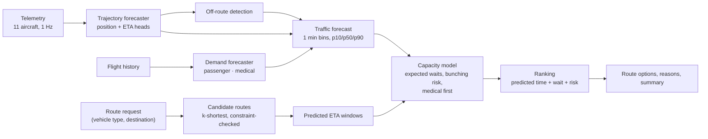
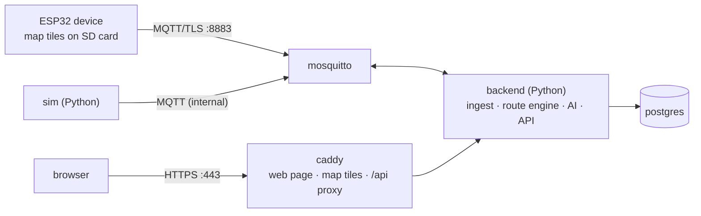

# AeroLink Architecture

Technical design for AeroLink. For the overview, see [README](../README.md). For the build plan, see [PLAN](PLAN.md). For the hackathon fit, see [HACKATHON](HACKATHON.md).

> **Not for flight.** AeroLink is a simulation-based engineering prototype. It is not certified equipment, an FAA-approved service provider, a surveillance system, an ATC service, or a collision avoidance system. Airspace data is processed for modeling and not authoritative. This document summarizes public plans and standards; it is not a legal or regulatory interpretation.

---

## Contents

1. [Scope and principles](#1-scope-and-principles)
2. [Regulatory and operational model](#2-regulatory-and-operational-model)
3. [Region and network](#3-region-and-network)
4. [Vehicle types and fleet](#4-vehicle-types-and-fleet)
5. [Constraints](#5-constraints)
6. [Classical baseline](#6-classical-baseline)
7. [AI components](#7-ai-components)
8. [Route engine](#8-route-engine)
9. [Evaluation](#9-evaluation)
10. [Real-data validation](#10-real-data-validation)
11. [System architecture](#11-system-architecture)
12. [Messaging and contracts](#12-messaging-and-contracts)
13. [Interface](#13-interface)
14. [Device and hardware](#14-device-and-hardware)
15. [Data](#15-data)
16. [Deployment and security](#16-deployment-and-security)
17. [Decisions](#17-decisions)
18. [Out of scope](#18-out-of-scope)
19. [References](#19-references)

---

## 1. Scope and principles

**What AeroLink is:** a **navigation app for Florida's low-altitude air corridors**, like Google Maps or Apple Maps for eVTOL **passenger** and **medical** aircraft. A pilot picks a destination; AeroLink shows the route options on a map with **AI-predicted traffic and arrival times**, and suggests a faster route when traffic builds up.

**What AeroLink is not:** a traffic management system. It never approves, rejects, schedules, or holds a flight. The pilot always chooses.

**The backend still does management-style calculations.** To predict traffic well, the backend's **route engine** (§8) models what a traffic manager would see: every planned flight, landing-pad capacity, junction load, and aircraft drifting off route. Those calculations feed predictions and suggestions only. They are never sent to an aircraft as an instruction.

**Corridors** are modeled on FDOT's Aerial Highway Network, Phase 1A (Central Florida I-4 corridor), extended to Sebring.

**Aerial cargo of any kind is out of scope:** no cargo eVTOL flights, no drone cargo, no drone delivery. (There's also no reliable public data on cargo takeoff/landing sites in the region.)

**Commercial and military aviation are out of scope.** Their airspace is a no-go constraint. AeroLink never routes, predicts, or manages airliners or military aircraft.

Principles:

1. **Advise, never control.** AeroLink outputs route options, predicted arrival times, traffic levels, and suggestions. The pilot decides.
2. **AI predicts; deterministic algorithms build routes.** Routes are always paths in a constraint-checked corridor graph. AI changes the predicted times and the ranking, never the geometry.
3. **Constraints hold by construction.** An invalid corridor cannot exist in the graph.
4. **One device, one vehicle type.** Each device is bound in hardware to the aircraft it is installed in (§14.3). The user cannot change it.
5. **Medical flights go first** in every traffic calculation (§5.3).
6. **The calculation layer is pure** (no database or MQTT access), so every result can be replayed in a test.
7. **One Python backend owns all state** and is the only DB writer.
8. **The device is a thin client.** All calculation runs on the backend; the device draws the map and sends selections.
9. **Silence never means clear.** Missing telemetry raises uncertainty; it never frees capacity in the predictions.
10. **Every AI claim is measured** against the classical baseline (§6).

---

## 2. Regulatory and operational model

How AeroLink relates to public FAA and FDOT concepts. AeroLink borrows the FAA's traffic-management concepts as **calculations inside its route engine**; it does not perform the management role itself.

| Concept (source) | Meaning | In AeroLink |
|---|---|---|
| **Aerial Highway Network** (FDOT) | low-altitude corridors that roughly follow interstate highways, for air taxis, cargo, and emergency flights | corridor graph follows I-4, US-27, and related highways (§3) |
| **Phase 1A: Central Florida I-4 corridor** (FDOT) | first build-out region | modeled region and landing sites |
| **Vertiport** (FAA EB 105A; Florida HB 1093) | a type of heliport serving VTOL aircraft | eVTOL landing sites (§3.2) |
| **UAM corridors** (FAA UAM ConOps 2.0) | defined airspace for UAM traffic | the graph's corridor edges |
| **Operational intent** (ASTM F3548) | a flight's planned route and timing | a **planned flight**: the route a pilot picked plus its predicted arrival windows. Used as input to traffic prediction; never "accepted" or "rejected" |
| **Strategic deconfliction** (ASTM F3548) | checking plans against each other | a **bunching-risk calculation**: the probability two planned flights meet at a junction or pad. Used in ranking (§8) |
| **Demand-capacity balancing** (FAA UAM ConOps 2.0) | matching demand to capacity | a **capacity model** that predicts landing queues and expected waits (§8). No slots are assigned to anyone |
| **Conformance monitoring** (ASTM F3548) | detecting aircraft outside their plan | **off-route detection** (§7.4): "recalculating" on the device, wider uncertainty in the predictions |
| **Constraints** (ASTM F3548) | airspace restrictions | FAA airspace data loaded as no-go volumes (§5) |
| **FDOT AAM Business Plan** (Nov 2025) | Phase 1A city centers, first routes (Orlando–Tampa, Orlando–SunTrax, Tampa–SunTrax), eVTOL operating band of 1,000–3,000 ft, AAM passenger trips forecast at 220 thousand to 1.4 million in 2027 | network, corridor altitudes, and demand scaling (§3, §7.2) |

The FAA keeps authority over airspace and FDOT over infrastructure. Neither is modeled as an actor.

**Reference, not a dependency:** [InterUSS DSS](https://github.com/interuss/dss) is the open-source implementation of the ASTM F3548 synchronization service. AeroLink only borrows terms from it (§12.3) and does not run it.

---

## 3. Region and network

### 3.1 Region

Two nested regions:

| Region | Bounding box | Used for |
|---|---|---|
| **Florida** (context) | lat 24.3–31.1, lon −87.7 to −79.8 | airspace constraints and the map: the whole state's no-go airspace is loaded and shown |
| **Central Florida** (focus) | lat 27.3–28.8, lon −82.8 to −81.1 | the corridor network, simulator, route engine, evaluation, detailed device map tiles, and the device's in-region check |

- Coordinate system for geometry checks: UTM zone 17N (EPSG:32617). It covers the focus region well; the panhandle (zone 16) is only drawn on the map, never routed in.
- Expanding the focus later (e.g. FDOT's other Phase 1 segments) means adding sites and corridors; the statewide constraints are already there.

### 3.2 Landing sites and waypoints

Two landing-site types, from FDOT plans and state aviation data:

| Site type | What it is | Examples | Served vehicle types (default) |
|---|---|---|---|
| `evtol` | eVTOL takeoff/landing sites (vertiports): FDOT Phase 1A sites, SunTrax, and Lakeland Linder | Water Street (downtown Tampa), Parramore (downtown Orlando), Orlando Executive, Lakeland Linder, Sebring Regional, SunTrax | passenger |
| `helipad` | hospital and EMS helipads, from the FDEP Airports layer (FDEM + FDOT merge, FAA identifiers) | Tampa General, Lakeland Regional Health, AdventHealth Sebring, Orlando Health ORMC | medical |
| waypoint | corridor junctions, not landing sites | Plant City, Lakeland, Haines City, Lake Wales, Avon Park, Kissimmee | — |

- A site can have both types (e.g. a vertiport that also has a medical pad).
- Downtown Water Street (Tampa) and Parramore (Orlando) come from news coverage of Phase 1A. The FDOT plan says 15 candidate sites were identified in each of Tampa and Orlando, with feasibility screening to follow, so these two stay modeled until FDOT names sites.
- Each site has an optional `serves` list that overrides the default (e.g. a vertiport that also takes medical flights).
- The device only offers destinations whose `serves` includes its vehicle type (§13.2).
- Capacity is a modeling parameter: `pads` (default 2 for `evtol`, 1 for `helipad`; SunTrax 4).

Sites live in `airspace/network.yaml`. The surveys behind them are `airspace/sites-evtol.geojson` and `airspace/sites-helipads.geojson`; helipads come from the FDEP Airports layer through `aerolink.airspace.sites` (filter to Central Florida, active, non-military, medical; review sheet `sites-review.csv`). Each site records its `source` and a `verified` flag set after checking the position on imagery.

**Collection format** (what the site survey produces, converted into `network.yaml`):

| Field | Example | Notes |
|---|---|---|
| `id` | `hp-61fl` | prefix `ev-` or `hp-`; helipads use the FAA identifier |
| `name` | Tampa General Hospital | |
| `type` | `helipad` | `evtol` or `helipad`; both allowed (`evtol;helipad`) |
| `lat`, `lon` | 27.9381, −82.4597 | WGS84, 4+ decimals |
| `pads` | 1 | if known |
| `source` | URL or document | where the position came from |
| `verified` | yes / no | position checked on imagery |
| `notes` | rooftop pad | free text |

### 3.3 Corridors (hybrid build)

FDOT's Aerial Highway Network follows the interstates, but no corridor geodata is published. The network is therefore built in a hybrid way: **the connections are hand-written, the shapes come from FDOT's official highway GIS.**

| Input | Made by | Contents |
|---|---|---|
| `airspace/network.yaml` | hand-written | sites (type, position, capacity, `serves`), waypoints, edges (`from`, `to`, `highway`), connectors (landing site → corridor node), and which FDOT layer/field identifies each highway |
| `airspace/fdot-highways.geojson` | `aerolink.airspace.fetch_fdot` (once) | I-4, US-27, US-98, SR-60, US-17/92 centerlines from FDOT's Interstates, U.S. Highways and State Roads shapefiles (selected by the `RouteNum` field), reprojected to WGS84 and clipped to the focus region (committed, small) |
| `airspace/constraints-fl.geojson` | §5.1 | no-go volumes |

`aerolink.airspace.build_network` then:
1. **Follows the road for each edge:** FDOT delivers each highway in many pieces (split at county lines and divided sections). The builder turns each highway into a routable graph (vertices snapped to ~10 m, gaps up to 300 m bridged) and takes the shortest path along it between the two end nodes, simplified to ~500 m. A waypoint more than 2 km from its highway, or a road that doesn't connect two nodes, fails the build.
2. **Adds connectors** as straight lines from each landing site to its corridor node.
3. **Chooses altitude bands (FDOT zones, §5.2):** the highest 500 ft band within FDOT's 1,000–3,000 ft eVTOL band that clears all controlled airspace along the edge (300 m lateral buffer). If none does, the highest band that only enters Class D, flagged as needing ATC coordination. On a designated clearance route, a third try accepts Class B, flagged as needing ATC clearance. An edge with no usable band is dropped and reported with the airspace that blocked it.
4. **Exempts a landing site's own airspace:** a connector may enter the Class B/C/D area that contains its own landing site (an approach path), but never restricted, prohibited, or military areas.
5. **Checks the result:** every landing site must be connected to the network, and every pair of `evtol` sites at least 15 km apart must have at least two distinct routes (same-city pairs need one); otherwise the build fails.
6. **Writes** `airspace/central-fl-v1.geojson` (nodes as points, edges and connectors as lines with `highway`, `length_m`, `band_floor_ft`, `band_ceiling_ft`) and `airspace/build-report.txt` (dropped edges, chosen bands, routes per pair).

The network covers FDOT's first planned routes (Orlando–Tampa, Orlando–SunTrax, Tampa–SunTrax) and gives at least two routes per city pair, e.g. Tampa–Orlando via I-4 or via SR-60 → US-27. Central Florida terrain is low, so MSL is used throughout.

**Validation (CI):** `validate()` re-checks the committed network independently: every corridor and connector, at its band, against every blocking volume in 3D (except its recorded `exempt_airspace`). `tests/test_network_committed.py` runs it on every push, together with a reachability check.

A compact copy of the network for the device (`network-device.json`: nodes, simplified edge polylines, focus-region no-go outlines) is generated from the same build and stored on the device's SD card (§14.4).

### 3.4 Definitions

| Term | Definition |
|---|---|
| Time bin | 1 min |
| Pad turn time | one arrival per pad per 5 min (parameter) |
| Junction throughput | 1 aircraft per 60 s per junction (parameter) |
| Spacing | 1 km along-track on the same edge; 60 s at the same junction (modeling parameters, not separation standards) |
| Bunching event | any spacing violation in simulation (the "safer" metric) |
| Traffic level(n, t) | predicted arrivals at node n in bin t ÷ capacity in that bin; shown as low / moderate / heavy |
| Planned flight | the route a pilot picked plus its predicted arrival windows |

### 3.5 Units

| Quantity | Convention |
|---|---|
| Coordinates | WGS84 on the wire; UTM 17N metres inside the models |
| Altitude | metres MSL |
| Speed | ground speed, m/s |
| Direction | course over ground, degrees true |
| Time | UTC, RFC 3339; device clock from GNSS |

---

## 4. Vehicle types and fleet

| Vehicle type | Simulated aircraft | Destinations (site types) | Priority in calculations | Cruise (param) | Demand pattern |
|---|---|---|---|---|---|
| Passenger | 7 | `evtol` | normal | 60 m/s | time-of-day peaks |
| Medical | 3 | `helipad` | **first** | 65 m/s | unscheduled (random rate) |

- **Fleet:** 10 simulated aircraft, plus the physical device as an 11th.
- **One device per aircraft:** a device's vehicle type is fixed in hardware (§14.3). For the demo, a button on the Rev 0 device cycles the type.
- **Range:** a modeling parameter, default 160 km including reserve. Routes longer than the range are not offered.
- **Speeds:** parameters for simulation only, not tied to any specific aircraft.

---

## 5. Constraints

### 5.1 Airspace data

**Source:** the FAA Aeronautical Data Delivery Service open data site (`adds-faa.opendata.arcgis.com`). It's free, needs no account, and offers GeoJSON downloads.

| Dataset | Used for |
|---|---|
| Class Airspace | Class B, C, D (and E, kept but not blocking), with floor and ceiling |
| Special Use Airspace | restricted, prohibited, warning, alert areas, MOAs |

Processing:
- `aerolink.airspace.clip` keeps every area that touches Florida (areas kept whole rather than cut at the edge).
- `aerolink.airspace.convert` converts them to 3D no-go volumes (polygon + floor + ceiling, Z dropped, simplified) in `airspace/constraints-fl.geojson`. Each volume gets an `in_focus_region` flag (true if it touches Central Florida), so the network builder and route engine can skip the rest cheaply.
- Vertical limits come from `LOWER_VAL` / `UPPER_VAL` with their `*_CODE` and `*_UOM` companions. Unreadable limits fall back to the conservative choice (floor at the surface, ceiling at 60,000 ft); AGL ceilings get a 100 m margin.
- Raw nationwide downloads live in `airspace/source/` and are gitignored (they exceed GitHub's file limit); the Florida file is small and committed.
- The data is republished on an eight-week cycle. The snapshot is committed with its cycle date (`data_cycle`).

**Hand-modeled additions**, each labelled `modeled` and only where the FAA data doesn't already cover it:
- MacDill AFB: a polygon covering the base, if the FAA data only shows controlled airspace.
- Flight restrictions that aren't in special-use airspace data (e.g. the Walt Disney World area). Verify before adding.

### 5.2 Hard constraints (deterministic, never learned)

| Constraint | Enforcement |
|---|---|
| Corridor altitude band doesn't intersect any no-go volume in 3D (Class B and C, restricted, prohibited, warning, alert, military) | edge dropped; build fails if a site is cut off (CI test) |
| Class D: passed only with ATC coordination, and only when no clear band exists | edge flagged `coordination_airspace`; listed in the build report |
| Class B: crossed only on designated clearance routes (`clearance_routes` in `network.yaml`), with ATC clearance | edge flagged `clearance_airspace`; every other edge treats Class B as no-go |
| MOAs | avoided by default (treated as no-go); configurable |
| Connector edges into landing sites avoid no-go volumes (own-airport exemption, §3.3) | graph build fails |
| Route length ≤ the range parameter | longer routes are not offered |
| Destination serves the device's vehicle type | other destinations are not offered |

Every returned route is checked against the no-go volumes once more. A failure is treated as a bug: it is logged and the route is dropped.

**FDOT airspace zones.** AeroLink applies the airspace zones in the [FDOT AAM Business Plan (Nov 2025)](https://fdotwww.blob.core.windows.net/sitefinity/docs/default-source/aviation/aam/fdot-aam-business-plan-_nov_2025_final.pdf). FDOT uses them to screen vertiport sites, and says corridors "will be developed to avoid controlled airspace when possible" and "established in coordination with the FAA". AeroLink turns that into deterministic rules:

| FDOT zone | Airspace | FDOT wording (short) | AeroLink corridor rule |
|---|---|---|---|
| Green | uncontrolled, Class E | "minimal regulatory or operational constraints" | no constraint |
| Yellow | Class D (and E) | "suitable with prior planning and coordination" | allowed with ATC coordination, only when no band clears it; flagged in the network and on the map |
| Orange | Class B shelves, 2,000–10,000 ft | "requiring mitigation or special procedures" | fly beneath the shelf floor inside 1,000–3,000 ft; otherwise only on a designated clearance route |
| Pink | Class B surface area (surface to 1,600 ft) | "highly controlled"; vertiports need FAA and airport approval | only a landing site's own approach (connector exemption, §3.3) or a designated clearance route |
| Red | obstruction surfaces, special use airspace | "high-risk or prohibited" | no-go |

Class C isn't in FDOT's zone list, so AeroLink treats it like Class B but without clearance routes (conservative).

**Designated clearance routes** are AeroLink's version of FDOT's "special procedures": a short, named list of legs that may cross Class B with ATC clearance, the way helicopters use published routes and letters of agreement today (FAA UAM ConOps 2.0 expects early air taxis to use existing helicopter routes and ATC services). In the Central Florida network they are the I-4 and SR-60 legs into downtown Tampa, the I-4 and US-17/92 legs into downtown Orlando, and two hospital approaches. Each leg still avoids Class D when it can and never enters restricted, prohibited, or military airspace. The build report lists every such leg, and the maps mark them. Like FDOT's early operations ("essentially like helicopters and small aircraft" under VFR), coordination means a radio call to the tower; AeroLink shows where one is needed but doesn't model it.

### 5.3 Medical-first rule

Medical flights are **calculated first** wherever the route engine shares out capacity:
- In the capacity model (§8), medical planned flights take the earliest predicted pad and junction times; other flights' predicted waits absorb the difference.
- When a medical flight is planned, other aircraft whose predictions change get an updated ETA and, if worthwhile, a route suggestion (§8.1 step 7).
- Nothing is taken away from anyone: this is how the *prediction* is calculated, not an instruction.

---

## 6. Classical baseline

The **classical navigation method**, implemented in full as the evaluation baseline (B1). It uses no AI and represents what a corridor navigation service would do with today's standard rules.

1. **Routes:** k-shortest paths by distance within range.
2. **Arrival times:** distance ÷ the vehicle type's cruise speed, with a fixed window of `[ETA − 60 s, ETA + 60 s]` at each node.
3. **Traffic picture:** only flights that are already planned, assumed to fly their planned timing exactly.
4. **Capacity model:** first come, first served at pads and junctions, medical first (§5.3), using the fixed windows.
5. **Ranking:** shortest predicted time including the predicted wait.
6. **Off-route:** an aircraft is off route if it is >300 m laterally from its route or outside its fixed window at a node.
7. **En route:** no suggestions after departure.

This is the method the AI has to beat. Its weakness is that it assumes aircraft fly their planned timing exactly and that all traffic is known in advance.

In simulation, aircraft physically wait (hold near the site) when a pad is occupied, in every configuration. That wait is what the predictions try to avoid; it is not imposed by AeroLink.

---

## 7. AI components

All AI runs in the calculation layer of `backend` (Python package `aerolink`, §11).

### 7.1 Trajectory forecaster

Two heads behind one interface:

| Head | Predicts | Horizons | Used for |
|---|---|---|---|
| **Position head** | east/north/up displacement, p10/p50/p90 | 30, 60, 120, 300 s | where aircraft will be on the map, off-route detection; validated on real data (§10) |
| **ETA head** | along-route progress, p10/p50/p90 → arrival-time distribution at every node on the route | 5, 10, 20, 30, 45 min | ETA ranges shown to the pilot, traffic levels, expected waits |

Implementations, switchable at runtime:

| ID | Type | Role |
|---|---|---|
| `cv` | constant velocity (position) / constant cruise speed (ETA) | non-AI baseline |
| `chronos` | Chronos-2 pretrained time-series model (Apache-2.0), zero-shot on east/north/up series (position head) and ground-speed series (ETA head). Default weights: `autogluon/chronos-2-small` (≈28M parameters, CPU-friendly); `amazon/chronos-2` (120M) if the VM allows | AI with no training data; comparator |
| `aerolink-gbm` | LightGBM quantile regression, residual over `cv`, one model per horizon and quantile, **calibrated with MAPIE** (below) | **primary ETA model** |

**Why LightGBM is the primary ETA model:** Chronos-2 forecasts time series; it isn't an aircraft trajectory predictor. Per-flight arrival time depends mostly on tabular context (remaining distance, corridor, vehicle type, traffic), which a gradient-boosted model handles better. Chronos-2 stays as the zero-shot comparator and does the work where the problem really is a time series (demand, §7.2). No pretrained, permissively licensed trajectory model for low-altitude aircraft was found.

**Calibrated windows (MAPIE):** the LightGBM quantile model is wrapped in MAPIE's `ConformalizedQuantileRegressor` (BSD-3-Clause). The resulting p10–p90 interval comes with a stated coverage target (80%), and the evaluation reports measured coverage. That's what lets AeroLink show "arrive 14:20, likely 14:17–14:26" instead of the classical fixed ±60 s.

**`aerolink-gbm` features:**
- the last 30 s of kinematics
- vehicle type
- current edge and distance to the next junction
- turn options at the next junction
- remaining route length
- predicted traffic level ahead
- time of day
- the aircraft's historical speed bias

Graph features are empty for real-data samples (§10); LightGBM handles the missing values natively, so one model trains on both simulated and real data.

Fine-tuning Chronos-2 on simulated data is planned; first confirm that the installed `chronos-forecasting` version supports it.

### 7.2 Demand forecaster

Predicts flights that haven't been planned yet (the "traffic that isn't on the map yet"):

| Vehicle type | Prediction | Model | Baseline |
|---|---|---|---|
| Passenger | departures per `evtol` site per 15 min (Chronos-2, time-of-day covariate) + destination probabilities (LightGBM) | Chronos-2 + LightGBM | historical mean rate + uniform destination |
| Medical | dispatches per `helipad` per 15 min, plus likely destinations | Chronos-2 on the dispatch history (time-of-day covariate) | constant mean rate |

Predicted flights become **expected flights**. Their arrivals are added to the traffic forecast, weighted by probability.

**Demand data is synthetic** (no public UAM demand dataset for the region was found). The simulator generates it with diurnal Poisson patterns, scaled from the FDOT AAM Business Plan's 2027 passenger-trip forecast, and it's labelled synthetic everywhere.

### 7.3 Traffic forecast (derived)

```
ExpectedArrivals(node, bin) = Σ over planned flights    P(arrive in bin)        (ETA head, 7.1)
                            + Σ over expected flights   P(flight) × P(arrive)  (7.2)
                            + reachable-set mass of off-route aircraft          (7.4)
TrafficLevel(node, bin)     = ExpectedArrivals / Capacity(node, bin)
```

Edges get a traffic level from the nodes they lead into. Every hot spot can be traced back to the flights causing it. This is the "traffic layer" drawn on the web map and the device.

### 7.4 Off-route detection

No maintained library for aircraft conformance monitoring exists, so this is custom code on standard tools:
- **Band check:** the aircraft is outside its calibrated forecast interval (position head p05–p95, or its ETA window) for ≥3 consecutive samples.
- **Anomaly score:** scikit-learn `IsolationForest` on residual features (cross-track error, speed deviation, vertical-rate deviation), trained on clean real-data legs (§10).

When an aircraft is flagged:
- its device shows **"Off route — recalculating"** and receives fresh route options from its current position
- its possible positions spread over every node it can reach within the horizon, raising traffic levels there
- the web map highlights it

The baseline is the classical fixed bounds (§6).

### 7.5 Route summary (LLM)

An LLM, called through [OpenRouter](https://openrouter.ai) (OpenAI-compatible API, paid from OpenRouter credits), turns a route response into a two-sentence summary, like a navigation app's "Faster route: avoids heavy traffic at Lakeland." The model is set by `LLM_MODEL`.

Guardrails:
- The input is only structured `cost_terms`, ETA windows, traffic levels, and node labels.
- Every number in the output is checked against those fields. Any mismatch discards the text, and a template sentence is shown instead.
- The LLM never influences routing.

---

## 8. Route engine

The backend's calculation core. It uses the classical framework (§6) with predictions:



### 8.1 Steps

1. **Candidates:** up to k = 3 diverse paths with `networkx.shortest_simple_paths`, sharing at most 70% of their edges, all within range, ending at a site that serves the vehicle type.
2. **ETA windows:** each node's window is the calibrated `[ETA p10, ETA p90]` interval from the ETA head (§7.1).
3. **Bunching risk:** the overlap of this candidate's windows with other planned and expected flights at shared junctions and pads gives a probability of bunching.
4. **Capacity model:** predicts the wait at each pad and junction, including expected flights (§7.2), medical first (§5.3). Solved as interval scheduling with Google OR-Tools CP-SAT (Apache-2.0): each landing site and junction is a capacity-limited resource over time, and the objective is priority-weighted delay. The result is a **predicted** wait per flight; nobody is assigned a slot. The classical baseline uses greedy first-come-first-served. Verify the CP-SAT approach early; greedy priority ordering is the fallback.
5. **Ranking:**

   ```
   cost = est_time_s + expected_wait_s + μ × bunching_risk
   expected_wait_s ← capacity model (step 4), p90 traffic at the arrival node
   ```

   μ = 600 s per unit risk by default. The lowest cost is option 1, marked "fastest"; the others show how much slower they are and why.
6. **Planned flight:** when the pilot (or a simulated aircraft) picks an option, it is recorded as a planned flight and feeds every later prediction.
7. **En-route suggestions:** every 2 min, the backend re-runs steps 1–5 from each airborne aircraft's position. If an option beats the current route by more than 10% of cost, the device gets a **"Faster route available"** suggestion. The pilot accepts or ignores it.

### 8.2 Forecast refresh

Every 10 s, the backend's forecast loop runs the forecasters and caches the forecasts and the traffic grid. Route requests, suggestions, and the `traffic` messages (§12.1) reuse the cache. Model inference runs in a worker thread so it never blocks MQTT ingest.

---

## 9. Evaluation

Offline, in one Python process with a simulated clock and deterministic seeds. Results are committed to `backend/eval-results/`.

```bash
cd backend
uv run python -m aerolink.eval --scenario all --seed 42 --ablations
```

### 9.1 Simulator

A custom kinematic simulator: point-mass aircraft along corridor polylines, with per-type cruise speed and range, one set of acceleration and climb limits shared by both types, and noise from a seeded `numpy.random.Generator`. Existing simulators were reviewed and not used: BlueSky (MIT, Python) targets airliner performance and tactical conflict resolution rather than corridor and pad capacity, and MATSim-UAM is Java and agent-based at a much larger scale.

- 10 aircraft with the mix in §4.
- Stochastic cruise speed per aircraft and leg, wind-like speed bias, diversions, and destination changes.
- **Pads are physical:** an aircraft arriving at an occupied pad holds nearby until it frees up. 60 s after touchdown it clears to a stand if one is free (eVTOL sites: one stand per pad; helipads: one), and an aircraft leaving a stand waits for a pad slot no arrival has claimed.
- **Range (interim rule until the E3.3 energy model):** a flight is only started, diverted, or re-planned if its remaining route fits `battery_soc × range`, with no reserve. Medical aircraft only take dispatches they can fly to and then return home from; incidents outside that service area are dropped as `dispatch_unserviceable`.
- **Simplifications (accepted):** wind only changes ground speed along track (crosswind has no effect on speed or heading); telemetry noise is horizontal, speed and dropout only (altitude noise and GPS quality variation come with E5).
- Unscheduled medical dispatches.
- **Traffic realism (simulated world only, PLAN E3.3):** simulated pilots keep a physical minimum (300 m, 150 m vertical; opposite directions at different altitudes) and space arrivals by speed. Simulated vertiport operators book pad slots before departure and hold flights on the ground when none is free. Battery reserve drives diversions. Demand is a shuttle timetable plus random trips, and some background aircraft ignore the system. AeroLink itself still schedules and holds nothing (§18). The §3.4 spacing values are only measured, as bunching.
- **Closed loop:** simulated pilots request routes, pick the top option, fly it, and accept en-route suggestions (acceptance rate is a parameter: default 100%, with a 50% sensitivity run).
- Two modes: **offline** (simulated clock, used for training and evaluation) and **live** (real time over MQTT, used for the demo).

### 9.2 Scenarios (`backend/scenarios/*.yaml`)

| Scenario | Stresses |
|---|---|
| `nominal_day` | mixed traffic, normal demand |
| `i4_peak` | passenger flights converging on Orlando Executive |
| `sebring_race_weekend` | passenger surge into Sebring |
| `medical_dispatch` | unscheduled medical flight through busy corridors |
| `slow_and_diverted` | aircraft deviating from their predicted timing |
| `rogue_aircraft` | injected route deviations, with labelled ground truth |
| `telemetry_dropout` | missing and delayed fixes |

### 9.3 Configurations (ablations)

| # | Configuration |
|---|---|
| B0 | shortest path, no traffic information |
| B1 | **classical navigation** (§6), no AI |
| A1 | B1 + AI ETA windows (`chronos`) |
| A2 | B1 + AI ETA windows (`aerolink-gbm`) |
| A3 | A2 + demand forecaster |
| A4 | A3 + AI off-route detection |
| A5 | **full AeroLink** (A4 + risk ranking + en-route suggestions) |

### 9.4 Metrics

| Area | Metric |
|---|---|
| Efficiency | mean and p95 trip time; mean and p95 wait at pads (holding); time saved by suggestions; requests with no route |
| Prediction quality | ETA error at departure and en route; p10–p90 coverage (target ≈ 80%); traffic-level accuracy (predicted vs actual arrivals per node) |
| Safety (simulated) | bunching events; off-route detection precision/recall and latency |
| Medical (accessibility) | medical wait caused by other traffic, medical time-to-destination |
| Forecasting | position ADE/FDE per horizon; ETA error per horizon |
| Demand | departure-time MAE, destination accuracy, medical rate calibration |
| Summary | share of LLM outputs that pass the number check |

**Reported claim:** A5 vs B1, as measured, across every scenario.

---

## 10. Real-data validation

### 10.1 Source

[adsb.lol historical data](https://www.adsb.lol/docs/open-data/historical/):
- Daily ADS-B dumps published as GitHub releases.
- Free, with no account needed.
- Licensed under the Open Database License (ODbL 1.0).

### 10.2 Pipeline (`backend/src/aerolink/realdata/`)

1. **Download** N daily releases (start at 14 days). Each release is a split tar (`.tar.aa`, `.tar.ab`, …) of several GB. Stream it and extract only the `traces/` files. There is one file per aircraft per day; files may end in `.json` but contain gzip, so always try to decompress.
2. **Parse** with a small custom parser written against the readsb trace format ([README-json](https://github.com/wiedehopf/readsb/blob/dev/README-json.md)). Each trace point is `[seconds_offset, lat, lon, alt_ft or "ground", gs_kt, track, flags, vrate_fpm, details, source_type, geom_alt, geom_rate, ias, roll]`.
3. **Keep only traces inside the Central Florida focus region.**
4. **Keep only AAM analogues and exclude commercial and military traffic:**
   - altitude ≤ 3,000 ft (the top of FDOT's eVTOL operating band)
   - ground speed 40–160 kt
   - rotorcraft (emitter category A7) or light aircraft, from the `details` object where present; fall back to aircraft type, altitude, speed, and callsign rules
   - drop airline callsigns, heavy categories, and military
   - drop points whose `source_type` is `mlat` (prone to outliers)
5. **Segment** at the "start of a new leg" flag and at gaps > 30 s.
6. **Resample** to 1 Hz by linear interpolation (NumPy; track angles unwrapped), dropping segments shorter than 60 s.
7. **Write** one Parquet file of clean segments per day to `backend/data/adsblol/`, plus a per-day report of what each filter removed. The raw day is streamed and never written to disk (`python -m aerolink.realdata.fetch`).

### 10.3 Use

- **Validation:** the position head (`cv` vs `chronos` vs `aerolink-gbm`) on held-out days. Real aircraft don't fly AeroLink corridors, so only the graph-free position head is evaluated on real data.
- **Training:** `aerolink-gbm` trains on simulated data plus the real-data training days (graph features empty for real samples).
- **Framing:** helicopters and light aircraft are the closest operating analogue to eVTOL.

### 10.4 Licence obligations (ODbL)

- **Attribution:** "Contains data from adsb.lol, licensed under ODbL 1.0", shown in the README and the web footer.
- **Share-alike:** any derived database that is published (e.g. the filtered tracks) must be released under ODbL.
- **Raw data:** not redistributed. The pipeline script reproduces it from the source.
- **Cleaned data:** the filtered segments in `backend/data/adsblol/` are a derived database, committed under ODbL with attribution (`backend/data/adsblol/README.md`).

---

## 11. System architecture



**The device does not host or render a website.** It is a native LVGL app (§13.2) that draws its own pannable map from tiles on its SD card and talks to the backend over MQTT. The web page is a separate client of the same backend. Both show the same map style, because both use the same basemap file (§13.3).

**All Python, one backend.** One language, one set of message models, one MQTT client. FastAPI plus [aiomqtt](https://github.com/empicano/aiomqtt) easily handles 11 aircraft at 1 Hz.

| Component | Language | Owns |
|---|---|---|
| `backend` | Python (FastAPI + aiomqtt) | MQTT ingest, live state (latest fix + 30 s history), **device registry**, **planned flights**, forecast and suggestion loops, `traffic` publishing, HTTP API, DB writes and migrations; plus the calculation layer (forecasters, demand, off-route, traffic, candidates, capacity model, ranking, summary, classical baseline) |
| `sim` | Python (same image, different entrypoint) | closed-loop fleet, scenarios |
| `web` | TypeScript (built to static files) | the map page; served by Caddy |
| `firmware` | C / ESP-IDF | GNSS, touch UI, map view, MQTT, vehicle-type key |
| `postgres` | — | telemetry, devices, planned flights, route history, eval runs |
| `caddy` | — | HTTPS, basic auth, static web files, the basemap PMTiles file, `/api` reverse proxy |

**Internal structure (Python package `aerolink`):**

| Layer | Modules | Rule |
|---|---|---|
| Service layer | `aerolink.service` (ingest, devices, flights, loops, API, store) | owns all state and all I/O (MQTT, database, HTTP) |
| Calculation layer | `aerolink.forecast`, `demand`, `offroute`, `traffic`, `routing`, `classical`, `summary`, `graph`, `airspace` | **pure functions:** every call takes its full input (snapshot, planned flights, grid) and returns a result, with no database or MQTT access |
| Offline tools | `aerolink.sim`, `eval`, `realdata`, `train`, `tiles` | reuse the calculation layer directly |

Keeping the calculation layer pure means any live result can be replayed in a unit test, and the offline evaluation calls exactly the same code as the live system.

**Off-the-shelf infrastructure:** Eclipse Mosquitto (broker), PostgreSQL, and Caddy, all from standard Docker images. EMQX was considered and not used: it moved to the Business Source License 1.1 in v5.9.0, and Mosquitto covers the need.

### 11.1 Backend API (behind Caddy at `/api`)

| Endpoint | Method | Purpose |
|---|---|---|
| `/api/state` | GET | aircraft, vehicle types, status, off-route flags |
| `/api/flights` | GET | planned flights and their status |
| `/api/traffic` | GET | traffic levels per node and edge, +0 to +45 min; prediction cones |
| `/api/forecaster` | PUT | switch the forecaster |
| `/api/method` | PUT | switch `classical` / `aerolink` (live comparison) |
| `/api/plan` | POST | route options for any vehicle type and destination, from the web page; never recorded as a planned flight |
| `/api/route-requests/{request_id}` | GET | device request and result |
| `/api/devices` | GET | device registry (id, vehicle type, demo flag, last seen) |
| `/api/eval` | GET | latest ablation results |
| `/api/models` | GET | loaded models, versions, last eval scores |
| `/api/airspace` | GET | corridors, sites, no-go volumes (GeoJSON) |
| `/api/scenario` | PUT | switch the live sim scenario |
| `/api/aircraft/{id}/telemetry` | GET | history |
| `/healthz` | GET | liveness |

### 11.2 Device flow

1. On boot, the device reads its vehicle type from its hardware key (§14.3) and connects with its own MQTT credentials.
2. The device shows the map. The pilot picks a destination from the sites that serve its vehicle type.
3. The device publishes a `route-request`.
4. The backend checks the device registry: the vehicle type in the message must match the registered type (demo devices excepted, §14.3). It is idempotent on `request_id`.
5. The backend runs the route engine on the current snapshot, planned flights, and cached traffic grid, then generates the summary.
6. The backend publishes the options in a `route-response`. The device draws them on the map.
7. The pilot picks one; the device publishes a `route-selection`. The backend records the planned flight and replies with a `flight-status` (`planned`).
8. While the flight is airborne, the backend publishes `traffic` updates every 5 s, `flight-status` changes (`active`, `off_route`, `ended`), and revised `route-response` messages when a faster route is available (§8.1 step 7).

---

## 12. Messaging and contracts

### 12.1 Topics

| Topic | Direction | Retained | Purpose |
|---|---|---|---|
| `aerolink/aircraft/{id}/telemetry` | device → backend | no | 1 Hz position |
| `aerolink/aircraft/{id}/status` | device → backend | yes | online/offline (Last Will) |
| `aerolink/aircraft/{id}/route-request` | device → backend | no | vehicle type + destination |
| `aerolink/aircraft/{id}/route-response` | backend → device | no | route options; revisions are suggestions |
| `aerolink/aircraft/{id}/route-selection` | device → backend | no | the option the pilot picked |
| `aerolink/aircraft/{id}/flight-status` | backend → device | no | planned-flight status (§12.3) |
| `aerolink/aircraft/{id}/traffic` | backend → device | no | nearby aircraft and traffic levels, every 5 s |
| `aerolink/sim/{id}/…` | sim ↔ backend | same | same topics and payloads |

- The backend derives the source (physical or simulated) from the namespace, which the broker ACLs enforce.
- A payload whose `aircraft_id` doesn't match its topic is rejected.
- Delivery is QoS 1, with deduplication on `message_id` and out-of-order telemetry dropped.

### 12.2 Schemas (`contracts/schemas/`, v4.0)

v4.0 replaces v3.0 for the navigation scope: `mission` → `vehicle_type`; `intent` → `route-selection`; `intent-status` → `flight-status`; new `traffic` message.

**Telemetry**

```json
{
  "schema_version": "4.0",
  "message_id": "…",
  "aircraft_id": "dev-001",
  "vehicle_type": "medical",
  "timestamp": "2026-11-17T15:00:00Z",
  "position": { "lat": 28.0395, "lon": -81.9498, "alt_msl_m": 60.0 },
  "motion": { "ground_speed_mps": 0.0, "course_deg": 0.0, "vertical_speed_mps": 0.0 },
  "fix": { "type": "3d", "hdop": 0.9, "satellites": 11, "replayed": false },
  "active_flight_id": null
}
```

Fixes with `type` not `3d` or with `hdop > 5` are discarded. A fix outside the region is flagged `out_of_region`, and that aircraft gets `no_route` answers.

**Route request**

```json
{
  "schema_version": "4.0",
  "message_id": "…",
  "request_id": "…",
  "aircraft_id": "dev-001",
  "vehicle_type": "medical",
  "timestamp": "2026-11-17T15:00:00Z",
  "destination_node": "hp-tgh"
}
```

The origin is the latest accepted fix, snapped to the nearest landing site or waypoint through a constraint-checked connector.

**Route response**

```json
{
  "schema_version": "4.0",
  "message_id": "…",
  "request_id": "…",
  "aircraft_id": "dev-001",
  "revision": 0,
  "status": "ok",
  "method": "aerolink",
  "forecast_time": "2026-11-17T15:00:05Z",
  "expires_at": "2026-11-17T15:01:05Z",
  "forecaster": "aerolink-gbm@1.0",
  "graph_version": "central-fl-v1",
  "constraints_cycle": "2026-10-29",
  "summary": "Fastest route avoids heavy traffic at Lakeland around 15:31.",
  "reason": null,
  "routes": [
    {
      "route_id": "…",
      "rank": 1,
      "label": "fastest",
      "distance_m": 74000,
      "est_time_s": 1140,
      "expected_wait_s": 30,
      "bunching_risk": 0.04,
      "traffic": "moderate",
      "cost_terms": { "est_time_s": 1140, "expected_wait_s": 30, "mu": 600, "bunching_risk": 0.04 },
      "reason": "avoids predicted heavy traffic at wp-lakeland 15:30–15:34",
      "eta": [
        { "node": "wp-lakeland", "eta_p10": "…", "eta_p50": "…", "eta_p90": "…" },
        { "node": "hp-tgh", "eta_p10": "…", "eta_p50": "…", "eta_p90": "…" }
      ],
      "waypoints": [[28.0395, -81.9498, 300.0], [27.94, -82.46, 300.0]]
    }
  ]
}
```

`status` is one of `ok`, `no_route`, `error`; `ok` needs 1–3 routes, the others carry a `reason` and no routes. `revision` > 0 marks an en-route suggestion. Values are illustrative.

**Route selection**

```json
{
  "schema_version": "4.0",
  "message_id": "…",
  "request_id": "…",
  "aircraft_id": "dev-001",
  "route_id": "…",
  "timestamp": "…"
}
```

**Flight status**

```json
{
  "schema_version": "4.0",
  "message_id": "…",
  "aircraft_id": "dev-001",
  "flight_id": "…",
  "status": "planned",
  "reason": null,
  "timestamp": "…"
}
```

**Traffic**

```json
{
  "schema_version": "4.0",
  "message_id": "…",
  "aircraft_id": "dev-001",
  "forecast_time": "2026-11-17T15:00:05Z",
  "aircraft": [
    { "id": "sim-003", "vehicle_type": "passenger", "lat": 28.05, "lon": -81.80, "alt_msl_m": 610.0, "course_deg": 270.0, "off_route": false }
  ],
  "edges": [
    { "edge": "wp-lakeland->wp-plant-city", "now": "moderate", "in_15_min": "heavy", "in_30_min": "moderate" }
  ]
}
```

Only aircraft within a radius (default 30 km) and edges on or near the active route are included, to keep the payload small for the device.

### 12.3 Flight status

| Status | Meaning | F3548 analogue |
|---|---|---|
| `planned` | the pilot picked a route; not yet flying | Accepted |
| `active` | the flight has departed on this route | Activated |
| `off_route` | the aircraft is away from its route (§7.4); new options follow | Nonconforming |
| `replaced` | the pilot took a suggested route; a new planned flight replaces this one | — |
| `ended` | the flight is complete | Ended |

There is no "rejected": AeroLink never refuses a flight. A route that can't be built returns `no_route` with a reason.

---

## 13. Interface

### 13.1 Web map

A custom page: Vite + TypeScript + MapLibre GL JS, built to static files in `web/` and served by Caddy. It polls `/api` every second. It works like a maps app first, with extra panels for operators and judges.

| Feature | Purpose |
|---|---|
| Map | corridors (legs needing Class D coordination or Class B clearance marked), landing sites by type (`evtol` / `helipad`), no-go volumes coloured by type, as 3D `fill-extrusion` layers |
| Traffic layer | corridors coloured low / moderate / heavy, with a time slider (+0 to +45 min) |
| Live aircraft | 10 simulated aircraft + the device, coloured by vehicle type; stale, lost, and off-route aircraft styled differently |
| Directions | pick a vehicle type and destination → route options with predicted times, ETA ranges, reasons, and summary (`/api/plan`) |
| Planned flights | routes pilots picked, with ETA windows; prediction cones |
| **Method toggle** | `classical` vs `aerolink`, compared live |
| Forecaster toggle | `cv` / `chronos` / `aerolink-gbm` |
| Medical view | active medical flights and how other traffic predictions changed around them |
| AI impact panel | B1 vs A5 metrics, live and from committed runs |
| Alerts | off-route, out-of-region |
| Scenario control | switch the live scenario |
| Attribution footer | adsb.lol (ODbL), FAA ADDS, © OpenStreetMap contributors / Protomaps |

### 13.2 Device UI (LVGL, native)

The device's look follows a phone maps app. Menus and buttons are native LVGL widgets; the map is a real pannable, zoomable map (§13.3), not an image of the website.

| Screen | Content |
|---|---|
| **Map (home)** | pannable map with the device position, corridors coloured by traffic, nearby aircraft, landing sites for its vehicle type. Vehicle-type badge (fixed). "Where to?" button. Recenter button. Zoom +/− buttons |
| **Where to?** | list of destinations that serve the vehicle type, nearest first |
| **Route options** | 2–3 routes drawn on the map in different colours; cards with predicted time, ETA range, traffic, and reason; "fastest" label; Go button |
| **Navigate** | map follows the aircraft; next waypoint and its ETA range; traffic ahead; "Faster route available: −4 min" banner with Accept / Ignore; "Off route — recalculating" |
| **Status** | GNSS fix and HDOP, MQTT connection, region check, age of the last response, map tile and network versions |

Interaction:
- **Pan** by dragging. **Zoom** with +/− buttons, and pinch if the touch controller reports two points (the FT6x36 family supports two).
- Map tiles load from the SD card, so the map keeps working when the network drops; only traffic and routes need the backend. Stale data is greyed out after `expires_at`.

### 13.3 Basemap (shared by web and device)

One basemap source for both, so the device looks like the website:

- **Source:** a [Protomaps](https://protomaps.com) basemap extract of Florida as a single PMTiles file (OpenStreetMap data, no account, no API key), made once with the `pmtiles extract` command and kept out of git.
- **Web:** Caddy serves the PMTiles file; MapLibre reads it through the `pmtiles` protocol with a Protomaps style. No third-party tile service is needed at the venue.
- **Device:** the same file and style are rendered to raster tiles once, offline, by [TileServer GL](https://github.com/maptiler/tileserver-gl) (Docker, reads PMTiles), at z5–z6 for all of Florida and z7–z14 for the focus region. The `0015/map_tiles` converter script turns the PNGs into LVGL RGB565 `.bin` tiles for the SD card (~8,300 tiles, ~1.1 GB). The tool lives in `aerolink.tiles` and runs on a dev machine, not on the VM.
- **Overlays are drawn live, never baked into tiles:** corridors, sites, and no-go outlines from `network-device.json` on the SD card; routes from `route-response`; aircraft and traffic from `traffic`.

---

## 14. Device and hardware

The device is the pilot's navigation unit, installed in one aircraft:
- **one vehicle type per device**, fixed by a hardware key (§14.3)
- each unit has its own MQTT credentials
- for the hackathon, one Rev 0 device demonstrates both types with a demo button

### 14.1 Rev 0: breadboard device (the MVP device)

| Part | Notes |
|---|---|
| ESP32-S3-DevKitC-1, N8R8 variant | ESP32-S3-WROOM-1-N8R8 module (8 MB flash, 8 MB PSRAM) |
| 3.5″ SPI display module with capacitive touch | prefer ST7796 (RGB565 over SPI) + FT6x36 touch; many modules include a microSD slot |
| microSD card (8 GB or more) | map tiles and `network-device.json`; use the display module's slot if it has one, otherwise a separate SPI microSD breakout |
| ATGM336H GNSS breakout + active antenna | UART |
| Momentary push button | **demo only:** cycles the vehicle type (§14.3) |
| USB-C power through the devkit | check the 3.3 V budget for backlight + GNSS + SD |

### 14.2 Wiring schematic and datasheets (`hardware/`)

| Item | Location |
|---|---|
| KiCad schematic of the Rev 0 wiring + exported PDF | `hardware/kicad/rev0-wiring/` |
| Datasheets for every part | `hardware/datasheets/` |
| Tray for carrying Rev 0 | `hardware/cad/` |

Rules:
- **The schematic is the source of truth for wiring.** Rev 0 is wired exactly to it, and the firmware board config (`firmware/components/board/`) matches it. Discrepancies are fixed in the schematic.
- Avoid GPIO35–37 (used by the octal PSRAM) and take care with strapping pins (0, 3, 45, 46).
- Put the SD card on its own SPI host if pins allow, so tile reads don't stall display writes; otherwise share the bus with separate chip selects.
- Keep the SPI wires short and start the display clock at 20–26 MHz, raising it once stable.
- For carrying it around: a soldered protoboard, or secured jumpers on the 3D-printed tray.

### 14.3 Vehicle-type key

The vehicle type is part of the device's identity, not a setting.

| Layer | Production design | Hackathon demo (Rev 0) |
|---|---|---|
| **Hardware key** | a `VEHICLE_TYPE` field in the ESP32-S3's user eFuse block (`EFUSE_BLK3`, a.k.a. `BLOCK_USR_DATA`), written once at provisioning. eFuse bits can only go from 0 to 1, so the value can't be changed afterwards | eFuse **not** written; firmware built with `CONFIG_AEROLINK_DEMO_MODE` reads the type from NVS instead |
| **Changing it** | impossible on the device | the demo button toggles passenger ↔ medical; the device re-requests destinations |
| **Backend check** | device registry maps each MQTT credential to one vehicle type; messages with another type are rejected | registry entry has `demo: true`, so the backend accepts any type from that device and logs each change |

The backend registry is authoritative in both cases: even a modified firmware can't claim a different type, because the credential is tied to the registered type.

**Warning:** writing an eFuse is permanent. Never burn `VEHICLE_TYPE` on the Rev 0 demo board. The provisioning script (`firmware/tools/provision.py`) refuses to burn unless given an explicit `--burn-efuse` flag and the device's MAC address.

### 14.4 Firmware

Built mostly from existing ESP-IDF components:

| Need | Component |
|---|---|
| ST7796 display | `espressif/esp_lcd_st7796` (ESP Component Registry). v1.5.0's licence shows as "Custom" while earlier versions are Apache-2.0; check it or pin an earlier version |
| Capacitive touch (FT6236 / FT6x36) | `espressif/esp_lcd_touch_ft5x06` + `esp_lcd_touch`. If the module turns out to use resistive XPT2046 touch, use `atanisoft/esp_lcd_touch_xpt2046` instead (no pinch) |
| LVGL integration | `espressif/esp_lvgl_port` (display/touch registration, tick, LVGL task) |
| **Map view** | [`0015/map_tiles`](https://components.espressif.com/components/0015/map_tiles) (MIT): LVGL 9 map from 256×256 RGB565 tiles on SD, GPS-to-screen conversion, smooth panning, route drawing, follow mode. Includes the PNG → LVGL tile converter script |
| SD card | ESP-IDF `sdspi` + FATFS |
| GNSS (NMEA) | ESP-IDF's `nmea0183_parser` example; `minmea` as an alternative |
| MQTT over TLS | `esp-mqtt` (built into ESP-IDF), starting from its `mqtt/ssl` example, with the CA certificate embedded via `EMBED_TXTFILES` |
| eFuse | ESP-IDF eFuse Manager with a custom table (`esp_efuse_custom_table.csv`) |
| Starting template | [sukesh-ak/BSP-IDF5-ESP_LCD-LVGL9](https://github.com/sukesh-ak/BSP-IDF5-ESP_LCD-LVGL9): ST7796 + FT5x06 touch + LVGL 9 via `esp_lvgl_port` on an ESP32-S3 |

- ESP-IDF, C, and LVGL 9.
- Telemetry at 1 Hz, with a Last Will on `status`.
- Route options and traffic are marked stale after `expires_at`.
- The project CA is pinned.
- **GNSS replay mode** plays a recorded NMEA track from flash and sets `fix.replayed = true`, for indoor demos.
- **Expected map performance:** a full-screen redraw over SPI is 480 × 320 × 16 bit ≈ 2.5 Mbit, so panning runs at roughly 8–15 frames per second depending on the SPI clock. Usable, not phone-smooth. Tiles are cached in PSRAM.

### 14.5 Custom PCB (post-MVP)

A custom PCB (Rev A) is planned after the MVP, starting from the Rev 0 schematic: ESP32-S3-WROOM-1-N8R8, display + touch, microSD, ATGM336H, USB-C, AP63203 3.3 V buck. No demo button on production boards. See [PLAN](PLAN.md#post-mvp-backlog).

### 14.6 Indoor demo notes

- Put the active antenna in a window, or run a cable outside. Power up early: a cold fix can take 30 s or more.
- The handheld moves at walking speed. Present it as an aircraft on the ground at its origin, about to depart.
- Bring a phone hotspot in case venue Wi-Fi blocks port 8883. The map still works offline from the SD card.

---

## 15. Data

PostgreSQL 16 without PostGIS. The backend owns the schema; migrations live in `backend/migrations/`.

| Table | Contents |
|---|---|
| `devices` | id, MQTT username, vehicle type, `demo` flag, last seen |
| `aircraft` | id, namespace, vehicle type (devices and simulated aircraft) |
| `telemetry` | accepted fixes; index `(aircraft_id, ts)` |
| `route_requests` | request, snapshot hash, method, latency |
| `route_results` | route options (jsonb), summary, versions |
| `flights` | planned flights: route, ETA windows, status, revisions |
| `eval_runs` | ablation results |

- **Volume:** 11 aircraft at 1 Hz ≈ 1 M rows/day. Telemetry is kept 7 days.
- **Simulated training data and models:** versioned in `backend/models/` with their seeds.
- **Real data:** local only (§10).
- **Basemap:** the Florida PMTiles file and the device tile set are build artifacts, kept out of git and reproducible with one command.

---

## 16. Deployment and security

One GCP Compute Engine VM (school-provided credits) runs everything in Docker Compose with five containers: `caddy` (also serving the static web page and the PMTiles basemap), `backend`, `mosquitto`, `postgres`, and `sim`. Device tile rendering runs once on a dev machine and doesn't need a container on the VM.

**VM size:** start at 4 vCPU / 16 GB, then resize to the smallest size that keeps the 10 s forecast refresh, based on the E4.2 measurement.

| Port | Service | Notes |
|---|---|---|
| 443 / 80 | caddy | automatic HTTPS; basic auth on everything except `/healthz` |
| 8883 | mosquitto | TLS with the project CA |
| — | backend, postgres, sim | internal network only |

- Chronos-2 runs on the VM's CPU inside the `backend` container, defaulting to `autogluon/chronos-2-small`. Weights are downloaded at image build time.
- The LLM summary is the only external AI service (OpenRouter).
- **Containers:** pinned images, non-root where practical, health checks, `restart: unless-stopped`, logs to stdout.
- **Backups:** nightly `pg_dump` to Cloud Storage, kept 14 days, with one restore drill.
- **MQTT:**
  - self-managed project CA, pinned on the device
  - each device gets its own credentials, with the ACL `pattern readwrite aerolink/aircraft/%u/#`
  - the `sim` account is limited to `aerolink/sim/#`
  - anonymous access is off
- **Secrets:** stored in `.env` (never committed), including the LLM API key.

---

## 17. Decisions

| Decision | Chosen | Rejected | Why |
|---|---|---|---|
| Product | navigation app with AI traffic prediction | full traffic management system | the pilot decides; scope fits a hackathon; the AI value (prediction) stays the same |
| Management concepts | used as calculations inside the route engine | performing approvals, slots, holds | needed for good predictions; no authority implied |
| Scope | low-altitude AAM: passenger and medical | adding cargo | no reliable public cargo-site data; passenger + medical still cover all three theme pillars |
| Commercial/military | no-go constraints only | modeling their traffic | keeps the scope clear |
| Landing sites | two types: `evtol` (FDOT plans), `helipad` (FDEP/FDOT aviation data) | one generic type; hand-picking helipads | each vehicle type gets its own destinations; helipads traceable to official records |
| Device binding | one vehicle type per device, eFuse key + backend registry | user picks the type | a device belongs to an aircraft; can't be misused |
| Corridors | follow highways (Aerial Highway Network), hybrid build | free routing; hand-drawn shapes | matches FDOT's plan; shapes from FDOT's own GIS |
| Airspace rules | FDOT AAM Business Plan zones: Class D with coordination; Class B only on designated clearance routes; Class C and special use no-go | all controlled airspace no-go; all controlled airspace allowed | follows Florida's own plan; avoids controlled airspace when possible, as FDOT says |
| Main baseline | classical navigation (fixed windows, filed traffic only) | shortest path only | measures AI against a reasonable non-AI service |
| AI role | ETA ranges, demand, off-route detection, risk ranking | AI generates routes | route geometry stays deterministic and constraint-checked |
| Pretrained model | Chronos-2 (`chronos-2-small` on CPU) | TimesFM 3.0, TiRex v1 | Apache-2.0, zero-shot quantiles; TimesFM 3.0 weights are non-commercial and TiRex v1 uses a community licence |
| Primary ETA model | LightGBM quantiles + MAPIE conformal calibration | Chronos-2 alone | per-flight ETA is tabular; conformal intervals give a stated coverage |
| Capacity model solver | OR-Tools CP-SAT (verify early; greedy fallback) | hand-written heuristics only | priority-weighted interval scheduling is what CP-SAT is built for |
| Simulator | custom kinematic simulator | BlueSky, MATSim-UAM | BlueSky targets airliners and tactical conflicts; MATSim is Java and agent-based |
| Standards implementation | InterUSS as a naming reference | running InterUSS DSS | AeroLink doesn't synchronize providers |
| MQTT broker | Mosquitto | EMQX | EMQX moved to BSL 1.1 in v5.9.0; Mosquitto covers the need |
| Device display | native LVGL UI + on-device map from SD tiles | screenshots of the website; rendering HTML on the ESP32 | the ESP32 can't run a browser; screenshots lag ~1 s per tap and can't pan smoothly |
| Device map | `0015/map_tiles` (MIT) | custom tile renderer | panning, GPS conversion, route drawing already exist for LVGL 9 |
| Basemap | self-hosted Protomaps PMTiles, shared by web and device | OpenFreeMap (vector only, can't feed the device); keyed tile services | one file, one style, no account, works at the venue |
| Device tiles | rendered once with TileServer GL, stored on SD | streamed over Wi-Fi | ~128 KB per RGB565 tile is too much to stream; SD works offline |
| Firmware drivers | ESP-IDF registry components + an existing ST7796/LVGL template | custom drivers | display, touch, LVGL, GNSS, and MQTT/TLS all exist |
| Real data | adsb.lol (ODbL, no account), filtered to helicopters and light aircraft | OpenSky (history needs an account) | free with no account; real Central Florida tracks |
| Airspace data | FAA open data | hand-drawn polygons | official and free |
| Fleet | 10 simulated (7 passenger / 3 medical) + device | 50+ | prototype scale; still produces traffic at pads and junctions |
| Hardware | Rev 0 breadboard + KiCad wiring schematic and datasheets; custom PCB post-MVP | custom PCB in the MVP | focus on the software and AI |
| Backend language | all Python (one backend) | Go core + Python AI service | time constraints |
| Calculation layer | pure functions inside the backend | separate stateless HTTP service | same replayability without a second service |
| Frontend | Vite + TS static page served by Caddy | Next.js | one page; no Node runtime on the VM; the device never loads it |
| Map | custom MapLibre page | TAK | TAK can't show the AI panels; a custom map is simpler |

---

## 18. Out of scope

Traffic management authority (approving, rejecting, scheduling, or holding flights); real flight operations; certification; acting as an FAA-approved service provider; FAA/ATC integration or authorization; commercial or military traffic; authoritative surveillance; collision avoidance or detect-and-avoid; autopilot; separation assurance; weather; noise modeling; aerial cargo of any kind (cargo eVTOL, drone cargo, drone delivery); drones/UAS generally; regions beyond Central Florida (Tampa – Orlando – Sebring) for routing; cellular connectivity; on-device inference; rendering web pages on the device; reinforcement learning; an LLM making routing decisions; user management beyond basic auth; Kubernetes; high availability.

---

## 19. References

- FDOT Aerial Highway Network and Phase 1A sites: [Florida Trend, Nov 2026](https://www.floridatrend.com/feature/2026/11/11/vertical-integration)
- Florida HB 1093 (Advanced Air Mobility Competitiveness and Infrastructure Act): [Holland & Knight summary](https://www.hklaw.com/en/insights/publications/2026/04/new-legislation-clears-the-runway-for-vertiport-development-in-florida)
- Sebring vertiport planning: [Sebring Airport Authority](https://sebring-airport.com/?p=4963)
- FAA UAM ConOps 2.0: [FAA PDF](https://www.faa.gov/sites/faa.gov/files/Urban%20Air%20Mobility%20(UAM)%20Concept%20of%20Operations%202.0_0.pdf), [Halldale summary](https://www.halldale.com/civil-aviation/21140-cat-faa-considering-air-taxi-corridors-passing-lanes)
- ASTM F3548-21: [ASTM](https://store.astm.org/f3548-21.html)
- FAA Engineering Brief 105A, Vertiport Design: [FAA](https://www.faa.gov/airports/engineering/engineering_briefs/eb_105a_vertiports)
- FAA airspace open data: [FAA ADDS](https://adds-faa.opendata.arcgis.com/), [ADDS readme](https://adds-faa.opendata.arcgis.com/pages/adds-readme)
- FDOT AAM Business Plan (Nov 2025): [FDOT PDF](https://fdotwww.blob.core.windows.net/sitefinity/docs/default-source/aviation/aam/fdot-aam-business-plan-_nov_2025_final.pdf), [Urban Air Mobility News summary](https://www.urbanairmobilitynews.com/new-city-projects/florida-dot-publishes-its-aam-network-development-plan/)
- adsb.lol historical data (ODbL): [adsb.lol](https://www.adsb.lol/docs/open-data/historical/)
- readsb trace format: [README-json](https://github.com/wiedehopf/readsb/blob/dev/README-json.md)
- `traffic` library: [xoolive/traffic](https://github.com/xoolive/traffic)
- Chronos-2: [Hugging Face](https://huggingface.co/amazon/chronos-2), [chronos-forecasting README](https://github.com/amazon-science/chronos-forecasting/blob/main/README.md)
- MAPIE (conformal prediction): [docs](https://mapie.readthedocs.io/en/stable/api/)
- InterUSS DSS: [interuss/dss](https://github.com/interuss/dss)
- aiomqtt: [empicano/aiomqtt](https://github.com/empicano/aiomqtt)
- BlueSky (reviewed, not used): [TUDelft-CNS-ATM/bluesky](https://github.com/TUDelft-CNS-ATM/bluesky)
- Map tiles component for LVGL 9: [0015/map_tiles](https://components.espressif.com/components/0015/map_tiles)
- TileServer GL (PMTiles input, raster output): [usage](https://tileserver.readthedocs.io/en/latest/usage.html), [maptiler/tileserver-gl](https://github.com/maptiler/tileserver-gl)
- Protomaps basemaps and PMTiles: [protomaps.com](https://protomaps.com)
- ESP32-S3 eFuse Manager: [Espressif docs](https://docs.espressif.com/projects/esp-idf/en/v5.3/esp32s3/api-reference/system/efuse.html)
- ESP-IDF LCD touch components: [Espressif docs](https://docs.espressif.com/projects/esp-iot-solution/en/latest/display/lcd/lcd_touch.html)
- ESP32-S3 + ST7796 + LVGL template: [sukesh-ak/BSP-IDF5-ESP_LCD-LVGL9](https://github.com/sukesh-ak/BSP-IDF5-ESP_LCD-LVGL9)
- ESP-IDF NMEA example: [nmea0183_parser](https://github.com/espressif/esp-idf/blob/master/examples/peripherals/uart/nmea0183_parser/README.md)
