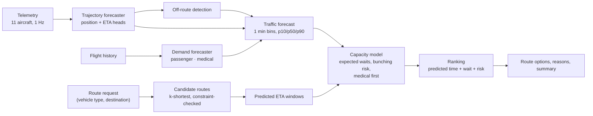
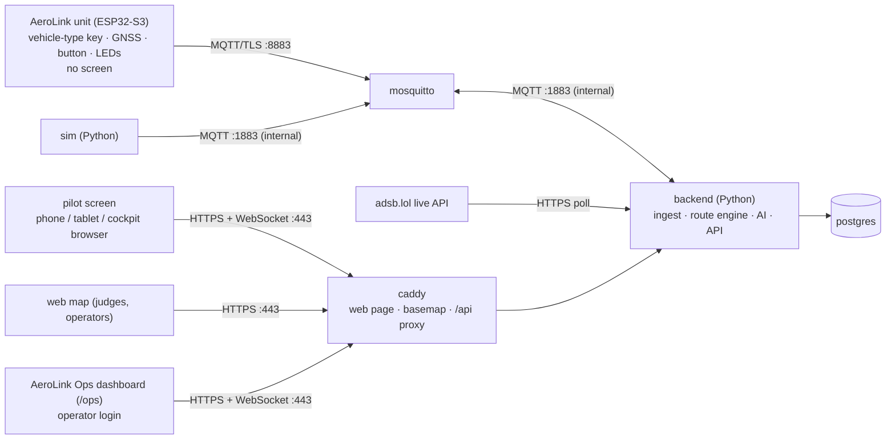

# AeroLink Architecture

Technical design for AeroLink. For the overview, see [README](../README.md). For the build plan, see [PLAN](PLAN.md). For the hackathon fit, see [HACKATHON](HACKATHON.md).

> **Not for flight.** AeroLink is a simulation-based engineering prototype. It is not certified equipment, an FAA-approved service provider, a surveillance system, an ATC service, or a collision avoidance system. It is not affiliated with the FAA, FDOT or any airport. Airspace data is processed for modeling and not authoritative. This document summarizes public plans and standards; it is not a legal or regulatory interpretation.

---

## Contents

1. [Scope and principles](#1-scope-and-principles)
2. [Regulatory and operational model](#2-regulatory-and-operational-model)
3. [Region and network](#3-region-and-network)
4. [Vehicle types and fleet](#4-vehicle-types-and-fleet)
5. [Constraints](#5-constraints)
6. [Classical baseline](#6-classical-baseline)
7. [AI components](#7-ai-components)
8. [Route engine](#8-route-engine)
9. [Evaluation](#9-evaluation)
10. [Real-data validation](#10-real-data-validation)
11. [System architecture](#11-system-architecture)
12. [Messaging and contracts](#12-messaging-and-contracts)
13. [Interface](#13-interface)
14. [Device and hardware](#14-device-and-hardware)
15. [Data](#15-data)
16. [Deployment and security](#16-deployment-and-security)
17. [Decisions](#17-decisions)
18. [Out of scope](#18-out-of-scope)
19. [References](#19-references)

---

## 1. Scope and principles

**What AeroLink is:** a **navigation app for Florida's low-altitude air corridors**, like Google Maps or Apple Maps for eVTOL **passenger** and **medical** aircraft. A pilot picks a destination; AeroLink shows the route options on a map with **AI-predicted traffic and arrival times**, and suggests a faster route when traffic builds up.

**What AeroLink is not:** an authority. AeroLink itself never approves, rejects, schedules, or holds a flight. The pilot always chooses.

**Air traffic control stays in the loop, by radio, as today** (decision 2026-11-26). Each route a pilot accepts is published to a shared picture. **AeroLink Ops**, used by AeroLink or vertiport operations staff (not FAA air traffic control), sees every active route, the live positions (AeroLink units, simulated aircraft, and live ADS-B traffic), predicted congestion and conflicts, and AeroLink's AI suggestions on an **operations dashboard** (§13.4). When real ATC wants a pilot to reroute or hold (an emergency, a developing conflict, a pilot not watching their display), ATC says so over the aircraft's existing radio; the pilot decides, updates the route in AeroLink, and the shared picture updates. Ops can also send the pilot an advisory reroute: Ops approves an AI-proposed reroute, the pilot's screen shows it, and the pilot may accept or decline. The route switches only on accept. In Class G airspace pilots go without ATC involvement; Class D needs two-way radio contact, Class C also a transponder, and Class B an explicit clearance (14 CFR 91.129–91.131; powered-lift follow the same airspace rules under SFAR 120). The corridor network marks the legs that need Class D coordination or Class B clearance (§3.3).

**Clearance status is informational.** For each active route the backend works out what ATC involvement it needs from those per-leg flags: none (Class G only), contact the tower (Class D), contact approach (Class C), or clearance (Class B). A landing site's own airspace counts, so landing inside Class B needs a clearance. The pilot handles the call by radio with real ATC. Ops staff then note on the dashboard that the flight is **cleared** or **contacted** (§13.4); the pilot's screen then shows "Ops noted: ATC clearance obtained" (or "Ops noted: tower contacted"), with the sub-line "Confirm with ATC by radio". Until then it shows what is still needed, for example "Clearance needed (Class B)". This is a status the pilot can see, never a gate: Go always works, AeroLink never blocks a flight, and the note is not a clearance.

**The backend still does management-style calculations.** To predict traffic well, the backend's **route engine** (§8) models what a traffic manager would see: every planned flight, landing-pad capacity, junction load, and aircraft drifting off route. Those calculations feed predictions and suggestions only. A suggestion reaches a pilot only as an advisory reroute that the pilot may accept or decline; it is never an instruction.

**Corridors** are modeled on FDOT's Aerial Highway Network, Phase 1A (Central Florida I-4 corridor), extended to Sebring.

**Aerial cargo of any kind is out of scope:** no cargo eVTOL flights, no drone cargo, no drone delivery. (There's also no reliable public data on cargo takeoff/landing sites in the region.)

**Commercial and military aviation are out of scope.** Their airspace is a no-go constraint. AeroLink never routes, predicts, or manages airliners or military aircraft.

Principles:

1. **Advise, never control.** AeroLink outputs route options, predicted arrival times, traffic levels, and suggestions. The pilot decides and remains pilot in command; real ATC advises or instructs by radio. AeroLink sends only advisory reroutes, which the pilot may accept or decline, and never an instruction.
2. **AI predicts; deterministic algorithms build routes.** Routes are always paths in a constraint-checked corridor graph. AI changes the predicted times and the ranking, never the geometry.
3. **Constraints hold by construction.** An invalid corridor cannot exist in the graph.
4. **One unit, one vehicle type.** Each AeroLink unit is bound in hardware to the aircraft it is installed in (§14.3). The pilot cannot change it.
5. **Medical flights go first** in every traffic calculation (§5.3).
6. **The calculation layer is pure** (no database or MQTT access), so every result can be replayed in a test.
7. **One Python backend owns all state** and is the only DB writer.
8. **The unit is screenless and thin.** The AeroLink unit supplies identity, position, and the vehicle-type key. Any screen the pilot already has (a phone, a tablet, a cockpit display with a browser) shows the map; an optional Display Pack adds a dedicated screen later (§14). All calculation runs on the backend.
9. **Silence never means clear.** Missing telemetry raises uncertainty; it never frees capacity in the predictions.
10. **Every AI claim is measured** against the classical baseline (§6), and reported as measured, including where the AI changes nothing (§9.3).
11. **Minimal screens.** The pilot and the Ops operator see what they need now and nothing that distracts: one primary thing per state, progressive disclosure, colour only where it carries meaning (red only for a problem), alerts only when someone can act on them.

---

## 2. Regulatory and operational model

How AeroLink relates to public FAA and FDOT concepts. AeroLink borrows the FAA's traffic-management concepts as **calculations inside its route engine**; it does not perform the management role itself.

| Concept (source) | Meaning | In AeroLink |
|---|---|---|
| **Aerial Highway Network** (FDOT) | low-altitude corridors that roughly follow interstate highways, for air taxis, cargo, and emergency flights | corridor graph follows I-4, US-27, and related highways (§3) |
| **Phase 1A: Central Florida I-4 corridor** (FDOT) | first build-out region | modeled region and landing sites |
| **Vertiport** (FAA EB 105A; Florida s. 330.27(3), F.S.) | a type of heliport serving VTOL aircraft | eVTOL landing sites (§3.2) |
| **UAM corridors** (FAA UAM ConOps 2.0) | defined airspace for UAM traffic | the graph's corridor edges |
| **Operational intent** (ASTM F3548) | a flight's planned route and timing | a **planned flight**: the route a pilot picked plus its predicted arrival windows. Used as input to traffic prediction; never "accepted" or "rejected" |
| **Strategic deconfliction** (ASTM F3548) | checking plans against each other | a **bunching-risk calculation**: the probability two planned flights meet at a junction or pad. Used in ranking (§8) |
| **Demand-capacity balancing** (FAA UAM ConOps 2.0) | matching demand to capacity | a **capacity model** that predicts landing queues and expected waits (§8). No slots are assigned to anyone |
| **Conformance monitoring** (ASTM F3548) | detecting aircraft outside their plan | **off-route detection** (§7.4): "recalculating" on the pilot screen, wider uncertainty in the predictions |
| **Constraints** (ASTM F3548) | airspace restrictions | FAA airspace data loaded as no-go volumes (§5) |
| **FDOT AAM Business Plan** (Nov 2025) | Phase 1A city centers, first routes (Orlando–Tampa, Orlando–SunTrax, Tampa–SunTrax), eVTOL operating band of 1,000–3,000 ft, AAM passenger trips forecast at 220 thousand to 1.4 million in 2027 | network, corridor altitudes, and demand scaling (§3, §7.2) |

The FAA keeps authority over airspace and FDOT over infrastructure. Neither is modeled as an actor.

**Reference, not a dependency:** [InterUSS DSS](https://github.com/interuss/dss) is the open-source implementation of the ASTM F3548 synchronization service. AeroLink only borrows terms from it (§12.3) and does not run it.

---

## 3. Region and network

### 3.1 Region

Two nested regions:

| Region | Bounding box | Used for |
|---|---|---|
| **Florida** (context) | lat 24.3–31.1, lon −87.7 to −79.8 | airspace constraints and the map: the whole state's no-go airspace is loaded and shown |
| **Central Florida** (focus) | lat 27.3–28.8, lon −82.8 to −81.1 | the corridor network, simulator, route engine, evaluation, and the unit's in-region check |

- Coordinate system for geometry checks: UTM zone 17N (EPSG:32617). It covers the focus region well; the panhandle (zone 16) is only drawn on the map, never routed in.
- Expanding the focus later (e.g. FDOT's other Phase 1 segments) means adding sites and corridors; the statewide constraints are already there.

### 3.2 Landing sites and waypoints

Two landing-site types, from FDOT plans and state aviation data:

| Site type | What it is | Examples | Served vehicle types (default) |
|---|---|---|---|
| `evtol` | eVTOL takeoff/landing sites (vertiports): FDOT Phase 1A sites, SunTrax, and Lakeland Linder | Water Street (downtown Tampa, modelled site), Parramore (downtown Orlando, modelled site), Orlando Executive, Lakeland Linder, Sebring Regional, SunTrax | passenger |
| `helipad` | hospital and EMS helipads, from the FDEP Airports layer (FDEM + FDOT merge, FAA identifiers) | Tampa General, Lakeland Regional Health, AdventHealth Sebring, Orlando Health ORMC | medical |
| waypoint | corridor junctions, not landing sites | Plant City, Lakeland, Haines City, Lake Wales, Avon Park, Kissimmee | — |

- A site can have both types (e.g. a vertiport that also has a medical pad).
- **Modelled sites:** downtown Water Street (Tampa) and Parramore (Orlando) come from news coverage of Phase 1A. The FDOT plan says 15 candidate sites were identified in each of Tampa and Orlando, with feasibility screening to follow, so these two stay modeled until FDOT names sites.
- Each site has an optional `serves` list that overrides the default (e.g. a vertiport that also takes medical flights).
- The pilot screen only offers destinations whose `serves` includes the unit's vehicle type (§13.2).
- Capacity is a modeling parameter: `pads` (default 2 for `evtol`, 1 for `helipad`; SunTrax 4).

Sites live in `airspace/network.yaml`. The surveys behind them are `airspace/sites-evtol.geojson` and `airspace/sites-helipads.geojson`; helipads come from the FDEP Airports layer through `aerolink.airspace.sites` (filter to Central Florida, active, non-military, medical; review sheet `sites-review.csv`). Each site records its `source` and a `verified` flag set after checking the position on imagery.

**Collection format** (what the site survey produces, converted into `network.yaml`):

| Field | Example | Notes |
|---|---|---|
| `id` | `hp-61fl` | prefix `ev-` or `hp-`; helipads use the FAA identifier |
| `name` | Tampa General Hospital | |
| `type` | `helipad` | `evtol` or `helipad`; both allowed (`evtol;helipad`) |
| `lat`, `lon` | 27.9381, −82.4597 | WGS84, 4+ decimals |
| `pads` | 1 | if known |
| `source` | URL or document | where the position came from |
| `verified` | yes / no | position checked on imagery |
| `notes` | rooftop pad | free text |

### 3.3 Corridors (hybrid build)

FDOT's Aerial Highway Network follows the interstates, but no corridor geodata is published. The network is therefore built in a hybrid way: **the connections are hand-written, the shapes come from FDOT's official highway GIS.**

| Input | Made by | Contents |
|---|---|---|
| `airspace/network.yaml` | hand-written | sites (type, position, capacity, `serves`), waypoints, edges (`from`, `to`, `highway`), connectors (landing site → corridor node), and which FDOT layer/field identifies each highway |
| `airspace/fdot-highways.geojson` | `aerolink.airspace.fetch_fdot` (once) | I-4, US-27, US-98, SR-60, US-17/92 centerlines from FDOT's Interstates, U.S. Highways and State Roads shapefiles (selected by the `RouteNum` field), reprojected to WGS84 and clipped to the focus region (committed, small) |
| `airspace/constraints-fl.geojson` | §5.1 | no-go volumes |

`aerolink.airspace.build_network` then:
1. **Follows the road for each edge:** FDOT delivers each highway in many pieces (split at county lines and divided sections). The builder turns each highway into a routable graph (vertices snapped to ~10 m, gaps up to 300 m bridged) and takes the shortest path along it between the two end nodes, simplified to ~500 m. A waypoint more than 2 km from its highway, or a road that doesn't connect two nodes, fails the build.
2. **Adds connectors** as straight lines from each landing site to its corridor node.
3. **Chooses altitude bands (FDOT zones, §5.2):** the highest 500 ft band within FDOT's 1,000–3,000 ft eVTOL band that clears all controlled airspace along the edge (300 m lateral buffer). If none does, the highest band that only enters Class D, flagged as needing ATC coordination. On a designated clearance route, a third try accepts Class B, flagged as needing ATC clearance. An edge with no usable band is dropped and reported with the airspace that blocked it.
4. **Exempts a landing site's own airspace:** a connector may enter the Class B/C/D area that contains its own landing site (an approach path), but never restricted, prohibited, or military areas.
5. **Checks the result:** every landing site must be connected to the network, and every pair of `evtol` sites at least 15 km apart must have at least two distinct routes (same-city pairs need one); otherwise the build fails.
6. **Writes** `airspace/central-fl-v1.geojson` (nodes as points, edges and connectors as lines with `highway`, `length_m`, `band_floor_ft`, `band_ceiling_ft`) and `airspace/build-report.txt` (dropped edges, chosen bands, routes per pair).

The network covers FDOT's first planned routes (Orlando–Tampa, Orlando–SunTrax, Tampa–SunTrax) and gives at least two routes per city pair, e.g. Tampa–Orlando via I-4 or via SR-60 → US-27. Central Florida terrain is low, so MSL is used throughout.

**Validation (CI):** `validate()` re-checks the committed network independently: every corridor and connector, at its band, against every blocking volume in 3D (except its recorded `exempt_airspace`). `tests/test_network_committed.py` runs it on every push, together with a reachability check.

A compact copy of the network for the Display Pack (`network-device.json`: nodes, simplified edge polylines, focus-region no-go outlines) will be generated from the same build and stored on its SD card (post-MVP, §14.7).

### 3.4 Definitions

| Term | Definition |
|---|---|
| Time bin | 1 min |
| Pad turn time | one arrival per pad per 5 min (parameter) |
| Junction throughput | 1 aircraft per 60 s per junction (parameter) |
| Spacing | 1 km along-track on the same edge; 60 s at the same junction (modeling parameters, not separation standards) |
| Bunching event | any spacing violation in simulation (the "safer" metric) |
| Traffic level(n, t) | predicted arrivals at node n in bin t ÷ capacity in that bin; shown as low / moderate / heavy |
| Planned flight | the route a pilot picked plus its predicted arrival windows |

### 3.5 Units

| Quantity | Convention |
|---|---|
| Coordinates | WGS84 on the wire; UTM 17N metres inside the models |
| Altitude | metres MSL |
| Speed | ground speed, m/s |
| Direction | course over ground, degrees true |
| Time | UTC, RFC 3339; unit clock from GNSS |

---

## 4. Vehicle types and fleet

| Vehicle type | Simulated aircraft | Destinations (site types) | Priority in calculations | Cruise (param) | Demand pattern |
|---|---|---|---|---|---|
| Passenger | 7 | `evtol` | normal | 60 m/s | time-of-day peaks |
| Medical | 3 | `helipad` | **first** | 65 m/s | unscheduled (random rate) |

- **Fleet:** 10 simulated aircraft, plus the physical AeroLink unit as an 11th.
- **One unit per aircraft:** a unit's vehicle type is fixed in hardware (§14.3). For the demo, a button on the Rev 0 unit cycles the type.
- **Range:** a modeling parameter, default 160 km including reserve. Routes longer than the range are not offered.
- **Speeds:** parameters for simulation only, not tied to any specific aircraft.

---

## 5. Constraints

### 5.1 Airspace data

**Source:** the FAA Aeronautical Data Delivery Service open data site (`adds-faa.opendata.arcgis.com`). It's free, needs no account, and offers GeoJSON downloads.

| Dataset | Used for |
|---|---|
| Class Airspace | Class B, C, D (and E, kept but not blocking), with floor and ceiling |
| Special Use Airspace | restricted, prohibited, warning, alert areas, MOAs |

Processing:
- `aerolink.airspace.clip` keeps every area that touches Florida (areas kept whole rather than cut at the edge).
- `aerolink.airspace.convert` converts them to 3D no-go volumes (polygon + floor + ceiling, Z dropped, simplified) in `airspace/constraints-fl.geojson`. Each volume gets an `in_focus_region` flag (true if it touches Central Florida), so the network builder and route engine can skip the rest cheaply.
- Vertical limits come from `LOWER_VAL` / `UPPER_VAL` with their `*_CODE` and `*_UOM` companions. Unreadable limits fall back to the conservative choice (floor at the surface, ceiling at 60,000 ft); AGL ceilings get a 100 m margin.
- Raw nationwide downloads live in `airspace/source/` and are gitignored (they exceed GitHub's file limit); the Florida file is small and committed.
- The data is republished on an eight-week cycle. The snapshot is committed with its cycle date (`data_cycle`).

**Hand-modeled additions**, each labelled `modeled` and only where the FAA data doesn't already cover it:
- MacDill AFB: a polygon covering the base, if the FAA data only shows controlled airspace.
- Flight restrictions that aren't in special-use airspace data (e.g. the Walt Disney World area). Verify before adding.

### 5.2 Hard constraints (deterministic, never learned)

| Constraint | Enforcement |
|---|---|
| Corridor altitude band doesn't intersect any no-go volume in 3D (Class B and C, restricted, prohibited, warning, alert, military) | edge dropped; build fails if a site is cut off (CI test) |
| Class D: passed only with ATC coordination, and only when no clear band exists | edge flagged `coordination_airspace`; listed in the build report |
| Class B: crossed only on designated clearance routes (`clearance_routes` in `network.yaml`), with ATC clearance | edge flagged `clearance_airspace`; every other edge treats Class B as no-go |
| MOAs | avoided by default (treated as no-go); configurable |
| Connector edges into landing sites avoid no-go volumes (own-airport exemption, §3.3) | graph build fails |
| Route length ≤ the range parameter | longer routes are not offered |
| Destination serves the unit's vehicle type | other destinations are not offered |

Every returned route is checked against the no-go volumes once more. A failure is treated as a bug: it is logged and the route is dropped.

**FDOT airspace zones.** AeroLink applies the airspace zones in the [FDOT AAM Business Plan (Nov 2025)](https://fdotwww.blob.core.windows.net/sitefinity/docs/default-source/aviation/aam/fdot-aam-business-plan-_nov_2025_final.pdf). FDOT uses them to screen vertiport sites, and says corridors "will be developed to avoid controlled airspace when possible" and "established in coordination with the FAA". AeroLink turns that into deterministic rules:

| FDOT zone | Airspace | FDOT wording (short) | AeroLink corridor rule |
|---|---|---|---|
| Green | uncontrolled, Class E | "minimal regulatory or operational constraints" | no constraint |
| Yellow | Class D (and E) | "suitable with prior planning and coordination" | allowed with ATC coordination, only when no band clears it; flagged in the network and on the map |
| Orange | Class B shelves, 2,000–10,000 ft | "requiring mitigation or special procedures" | fly beneath the shelf floor inside 1,000–3,000 ft; otherwise only on a designated clearance route |
| Pink | Class B surface area (surface to 1,600 ft) | "highly controlled"; vertiports need FAA and airport approval | only a landing site's own approach (connector exemption, §3.3) or a designated clearance route |
| Red | obstruction surfaces, special use airspace | "high-risk or prohibited" | no-go |

Class C isn't in FDOT's zone list, so AeroLink treats it like Class B but without clearance routes (conservative).

**Designated clearance routes** are AeroLink's version of FDOT's "special procedures": a short, named list of legs that may cross Class B with ATC clearance, the way helicopters use published routes and letters of agreement today (FAA UAM ConOps 2.0 expects early air taxis to use existing helicopter routes and ATC services). In the Central Florida network they are the I-4 and SR-60 legs into downtown Tampa, the I-4 and US-17/92 legs into downtown Orlando, and two hospital approaches. Each leg still avoids Class D when it can and never enters restricted, prohibited, or military airspace. The build report lists every such leg, and the maps mark them. Like FDOT's early operations ("essentially like helicopters and small aircraft" under VFR), coordination means a radio call to the tower; AeroLink shows where one is needed but doesn't model it.

### 5.3 Medical-first rule

Medical flights are **calculated first** wherever the route engine shares out capacity:
- In the capacity model (§8), medical planned flights take the earliest predicted pad and junction times; other flights' predicted waits absorb the difference.
- When a medical flight is planned, other aircraft whose predictions change get an updated ETA and, if worthwhile, a route suggestion (§8.1 step 7).
- Nothing is taken away from anyone: this is how the *prediction* is calculated, not an instruction.

---

## 6. Classical baseline

The **classical navigation method**, implemented in full as the evaluation baseline (B1). It uses no AI and represents what a corridor navigation service would do with today's standard rules.

1. **Routes:** k-shortest paths by distance within range.
2. **Arrival times:** distance ÷ the vehicle type's cruise speed, with a fixed window of `[ETA − 60 s, ETA + 60 s]` at each node.
3. **Traffic picture:** only flights that are already planned, assumed to fly their planned timing exactly.
4. **Capacity model:** first come, first served at pads and junctions, medical first (§5.3), using the fixed windows.
5. **Ranking:** shortest predicted time including the predicted wait.
6. **Off-route:** an aircraft is off route if it is >300 m laterally from its route or outside its fixed window at a node.
7. **En route:** no suggestions after departure.

This is the method the AI has to beat (in the live system it is selected with `PUT /api/method`, §11.1). Its weakness is that it assumes aircraft fly their planned timing exactly and that all traffic is known in advance.

In simulation, aircraft physically wait (hold near the site) when a pad is occupied, in every configuration. That wait is what the predictions try to avoid; it is not imposed by AeroLink.

---

## 7. AI components

All AI runs in the calculation layer of `backend` (Python package `aerolink`, §11).

### 7.1 Trajectory forecaster

Two heads behind one interface:

| Head | Predicts | Horizons | Used for |
|---|---|---|---|
| **Position head** | east/north/up displacement, p10/p50/p90 | 30, 60, 120, 300 s | where aircraft will be on the map, off-route detection; validated on real data (§10) |
| **ETA head** | along-route progress, p10/p50/p90 → arrival-time distribution at every node on the route | 5, 10, 20, 30, 45 min | ETA ranges shown to the pilot, traffic levels, expected waits |

Implementations, switchable at runtime:

| ID | Type | Role |
|---|---|---|
| `cv` | constant velocity (position) / constant cruise speed (ETA) | non-AI baseline |
| `chronos` | Chronos-2 pretrained time-series model (Apache-2.0), zero-shot on east/north/up series (position head) and ground-speed series (ETA head). Default weights: `autogluon/chronos-2-small` (≈28M parameters, CPU-friendly); `amazon/chronos-2` (120M) if the VM allows | AI with no training data; comparator |
| `aerolink-gbm` | LightGBM quantile regression, residual over `cv`, one model per horizon and quantile, **calibrated with MAPIE** (below) | **primary ETA model** |

**Why LightGBM is the primary ETA model:** Chronos-2 forecasts time series; it isn't an aircraft trajectory predictor. Per-flight arrival time depends mostly on tabular context (remaining distance, corridor, vehicle type, traffic), which a gradient-boosted model handles better. Chronos-2 stays as the zero-shot comparator and does the work where the problem really is a time series (demand, §7.2). No pretrained, permissively licensed trajectory model for low-altitude aircraft was found.

**Calibrated windows (MAPIE):** the LightGBM quantile model is wrapped in MAPIE's `ConformalizedQuantileRegressor` (BSD-3-Clause). The resulting p10–p90 interval comes with a stated coverage target (80%), and the evaluation reports measured coverage. That's what lets AeroLink show "arrive 14:20, likely 14:17–14:26" instead of the classical fixed ±60 s.

**`aerolink-gbm` features:**
- the last 30 s of kinematics
- vehicle type
- current edge and distance to the next junction
- turn options at the next junction
- remaining route length
- predicted traffic level ahead
- time of day
- the aircraft's historical speed bias
- whether the query is a departure (`from_rest`) or in flight, and the aircraft's ground speed when it is in flight

Graph features are empty for real-data samples (§10); LightGBM handles the missing values natively, so one model trains on both simulated and real data.

**Departure-time ETAs.** A route is asked for at departure, when no speed has been observed yet. The ETA head is trained on departure samples as well as mid-flight snapshots, takes the `from_rest` feature (1 for a departure query, 0 in flight), and is conformally calibrated twice, once for departure queries and once for in-flight ones. A single pooled calibration would be set by the in-flight residuals, because departures are a small share of the training rows, and would miss at departure, the only place routes ask. In-flight queries pass the aircraft's ground speed; a departure query assumes cruise speed. Measured on simulated held-out flights (`backend/eval-results/aerolink-gbm-e5.3.json`):

| Query | Held-out n | `cv` mean error | `aerolink-gbm` mean error | `aerolink-gbm` p10-p90 coverage (target 0.80) |
|---|---|---|---|---|
| departure | 333 | 116 s | 74 s | **0.748** (`cv`: 0.40) |
| in flight, ≤ 5 to ≤ 45 min ahead | 561 to 4,440 per horizon | 35 to 404 s | 10 to 42 s | 0.78 to 0.81 |

The departure calibration set is small (207 rows from 1,034 departure samples), so 0.748 is a coarse estimate and below target; it is listed as a known limitation (PLAN post-MVP). The ablation runs (§9.3) score the same thing end to end on whole scenarios and measure 84% window coverage.

Fine-tuning Chronos-2 on simulated data is planned; first confirm that the installed `chronos-forecasting` version supports it.

### 7.2 Demand forecaster

Predicts flights that haven't been planned yet (the "traffic that isn't on the map yet"):

| Vehicle type | Prediction | Model | Baseline |
|---|---|---|---|
| Passenger | departures per `evtol` site per 15 min (Chronos-2, time-of-day covariate) + destination probabilities (LightGBM) | Chronos-2 + LightGBM | historical mean rate + uniform destination |
| Medical | dispatches per `helipad` per 15 min, plus likely destinations | Chronos-2 on the dispatch history (time-of-day covariate) | constant mean rate |

Predicted flights become **expected flights**. Their arrivals are added to the traffic forecast, weighted by probability.

**Demand data is synthetic** (no public UAM demand dataset for the region was found). The simulator generates it with diurnal Poisson patterns, scaled from the FDOT AAM Business Plan's 2027 passenger-trip forecast, and it's labelled synthetic everywhere. Scale: FDOT's low 2027 figure (220,000 trips) × a 27% Central Florida share (assumed, from population) ≈ 163 passenger departures per day (`aerolink.demand.synthetic`).

### 7.3 Traffic forecast (derived)

```
ExpectedArrivals(node, bin) = Σ over planned flights    P(arrive in bin)        (ETA head, 7.1)
                            + Σ over expected flights   P(flight) × P(arrive)  (7.2)
                            + reachable-set mass of off-route aircraft          (7.4)
                            + live ADS-B background traffic                     (11.4)
TrafficLevel(node, bin)     = ExpectedArrivals / Capacity(node, bin)
```

Edges get a traffic level from the nodes they lead into. Every hot spot can be traced back to the flights causing it. This is the "traffic layer" drawn on the web map and the pilot screen.

### 7.4 Off-route detection

No maintained library for aircraft conformance monitoring exists, so this is custom code on standard tools:
- **Band check:** the aircraft is outside its calibrated forecast interval for ≥3 consecutive checks, one check every 10 s (1 Hz samples are not independent): the position head's p01–p99 box from 30 s earlier, a learned route tolerance (LightGBM p99 of how far clean flights stray, given speed and the turn ahead) instead of a fixed 300 m, or its ETA window (it can no longer arrive inside its p99 arrival time). An aircraft is flagged when the route tolerance or ETA window check fires, or when the position band and the anomaly score agree.
- **Anomaly score:** scikit-learn `IsolationForest` on residual features (cross-track error, speed deviation, vertical-rate deviation), trained on clean real-data legs (§10).

When an aircraft is flagged:
- its pilot screen shows **"Off route — recalculating"** and receives fresh route options from its current position
- its possible positions spread over every node it can reach within the horizon, raising traffic levels there
- the web map highlights it

The baseline is the classical fixed bounds (§6). In the live system the classical method flags off-route aircraft with B1's fixed rule (300 m, ±60 s), so alerts work under either method; only the AeroLink method uses the learned detector.

Measured on `rogue_aircraft` (59 flights, 32 injected deviations, 20 held-out seeds, `offroute-e5.5.json`): the AI detector reached precision 1.00 and recall 0.875 (median latency 27.5 s); the fixed bounds reached precision 1.00 and recall 0.81 (median latency 11 s). Neither caught slow deviations well (recall 0.33 and 0.00).

### 7.5 Route summary (LLM)

An LLM turns a route response into a two-sentence summary, like a navigation app's "Recommended route: avoids heavy traffic at Lakeland." It is called through any OpenAI-compatible chat endpoint: `LLM_BASE_URL`, `LLM_MODEL`, `LLM_API_KEY`, and `LLM_REASONING_EFFORT` (default `none`, which stops reasoning models from spending the token budget thinking; set it empty for a provider that rejects the parameter). The measured server is a self-hosted Ollama (`qwen3-14b-turbo`); OpenRouter works the same way. The live backend only calls the LLM when both `LLM_BASE_URL` and `LLM_MODEL` are set; otherwise, and whenever a call fails, it uses the template summary.

The route options always go out first with the template summary, so the LLM never delays them. An LLM summary that passes the check follows as the next revision of the same options.

Guardrails:
- The input is only structured `cost_terms`, ETA windows, traffic levels, and node labels.
- Every number in the output is checked against those fields. Any mismatch discards the text, and a template sentence is shown instead. Any `<think>` block is stripped.
- The LLM never influences routing.

Measured (`summary-e5.6.json`, 50 cases): 47 passed the check (94%), 3 were rejected for a number mismatch and fell back to the template, 0 API errors, 0 mismatched numbers shown to users.

---

## 8. Route engine

The backend's calculation core. It uses the classical framework (§6) with predictions:



### 8.1 Steps

1. **Candidates:** up to k = 3 diverse paths with `networkx.shortest_simple_paths`, sharing at most 70% of their edges, all within range, ending at a site that serves the vehicle type.
2. **ETA windows:** each node's window is the calibrated `[ETA p10, ETA p90]` interval from the ETA head (§7.1).
3. **Bunching risk:** the overlap of this candidate's windows with other planned and expected flights at shared junctions and pads gives a probability of bunching.
4. **Capacity model:** predicts the wait at each pad and junction, including expected flights (§7.2), medical first (§5.3). Solved as interval scheduling with Google OR-Tools CP-SAT (Apache-2.0): each landing site and junction is a capacity-limited resource over time, and the objective is priority-weighted delay. The result is a **predicted** wait per flight; nobody is assigned a slot. The classical baseline uses greedy first-come-first-served. Verify the CP-SAT approach early; greedy priority ordering is the fallback.
5. **Ranking:**

   ```
   cost = est_time_s + expected_wait_s + μ × bunching_risk
   expected_wait_s ← capacity model (step 4), p90 traffic at the arrival node
   ```

   μ = 600 s per unit risk by default. The lowest cost is option 1 (`rank` 1; the contract `label` is `fastest` for it and `alternative` for the others, §12.2). The screens word it differently, because a slightly slower route with much less congestion can have the lowest cost: option 1 shows **"Recommended"**, and the route with the shortest predicted time (cruise time plus expected wait) shows **"Fastest"**. Usually that is the same route and it carries both badges. The others show how much slower they are and why.
6. **Planned flight:** when the pilot (or a simulated aircraft) picks an option, it is recorded as a planned flight and feeds every later prediction.
7. **En-route suggestions:** every 2 min, the backend re-runs steps 1–5 from each airborne aircraft's position. If an option beats the current route by more than 10% of cost, the pilot screen gets a **"Faster route available"** suggestion. The pilot accepts or ignores it.

### 8.2 Forecast refresh

Every 10 s, the backend's forecast loop runs the forecasters and caches the forecasts and the traffic grid. Route requests, suggestions, and the `traffic` messages (§12.1) reuse the cache. Model inference runs in a worker thread so it never blocks MQTT ingest.

---

## 9. Evaluation

Offline, in one Python process with a simulated clock and deterministic seeds. Results are committed to `backend/eval-results/`.

```bash
cd backend
uv run python -m aerolink.eval.ablations --update-docs
```

### 9.1 Simulator

A custom kinematic simulator: point-mass aircraft along corridor polylines, with per-type cruise speed and range, one set of acceleration and climb limits shared by both types, and noise from a seeded `numpy.random.Generator`. Existing simulators were reviewed and not used: BlueSky (MIT, Python) targets airliner performance and tactical conflict resolution rather than corridor and pad capacity, and MATSim-UAM is Java and agent-based at a much larger scale.

- 10 aircraft with the mix in §4.
- Stochastic cruise speed per aircraft and leg, wind-like speed bias, diversions, and destination changes.
- **Pads are physical:** an aircraft arriving at an occupied pad holds nearby until it frees up. 60 s after touchdown it clears to a stand if one is free (eVTOL sites: one stand per pad; helipads: one), and an aircraft leaving a stand waits for a pad slot no arrival has claimed.
- **Range (interim rule until the E3.3 energy model):** a flight is only started, diverted, or re-planned if its remaining route fits `battery_soc × range`, with no reserve. Medical aircraft only take dispatches they can fly to and then return home from; incidents outside that service area are dropped as `dispatch_unserviceable`.
- **Simplifications (accepted):** wind only changes ground speed along track (crosswind has no effect on speed or heading); telemetry noise is horizontal, speed and dropout only (altitude noise and GPS quality variation come with E5).
- Unscheduled medical dispatches.
- **Traffic realism (simulated world only, PLAN E3.3):** simulated pilots keep a physical minimum (300 m, 150 m vertical; opposite directions at different altitudes) and space arrivals by speed. Simulated vertiport operators book pad slots before departure and hold flights on the ground when none is free. Battery reserve drives diversions. Demand is a shuttle timetable plus random trips, and some background aircraft ignore the system. AeroLink itself still schedules and holds nothing (§18). The §3.4 spacing values are only measured, as bunching.
- **Closed loop:** simulated pilots request routes, pick the top option, fly it, and accept en-route suggestions (acceptance rate is a parameter: default 100%, with a 50% sensitivity run).
- Two modes: **offline** (simulated clock, used for training and evaluation) and **live** (real time over MQTT, used for the demo).

### 9.2 Scenarios (`backend/scenarios/*.yaml`)

| Scenario | Stresses |
|---|---|
| `nominal_day` | mixed traffic, normal demand |
| `i4_peak` | passenger flights converging on Orlando Executive |
| `sebring_race_weekend` | passenger surge into Sebring |
| `medical_dispatch` | unscheduled medical flight through busy corridors |
| `slow_and_diverted` | aircraft deviating from their predicted timing |
| `rogue_aircraft` | injected route deviations, with labelled ground truth |
| `telemetry_dropout` | missing and delayed fixes |
| `i4_corridor_rush` | scheduled shuttles in both directions along I-4 on a weekday morning (22 passenger + 3 medical aircraft; ~38 departures an hour including random trips) |
| `orlando_event_egress` | a downtown Orlando arena event ends: 20 departures in 30 minutes to Lakeland and SunTrax, plus two scripted medical emergencies on the corridor (Tampa-bound passengers are not modelled: those legs exceed a full battery) |
| `fdot_high_peak` | the top of the FDOT plan's 2027 range (1.4 M trips) in the simulator's own busiest hour: ~91 departures an hour, 50 passenger + 4 medical aircraft, 10 stands per site |

The three congestion scenarios were added because no earlier scenario was crowded enough for route choice to matter. Each YAML states its premise, every parameter and why, fixed before any comparison run and never changed after seeing results. Demand scale comes from FDOT's 220,000 to 1,400,000 AAM trips in 2027, times an assumed 27% Central Florida share.

### 9.3 Configurations (ablations)

| # | Configuration |
|---|---|
| B0 | shortest path, no traffic information |
| B1 | **classical navigation** (§6), no AI |
| A1 | B1 + AI ETA windows (`chronos`) |
| A2 | B1 + AI ETA windows (`aerolink-gbm`) |
| A3 | A2 + demand forecaster |
| A4 | A3 + AI off-route detection |
| A5 | **full AeroLink** (A4 + risk ranking + en-route suggestions) |

<!-- ablation-table:start -->
Measured over 10 scenarios, each scenario's own seed (`python -m aerolink.eval.ablations`, `backend/eval-results/m5-ablations.json`). Times in seconds; trips = completed flights. Door-to-door = trip request to landing; ground delay = request to departure (pad-slot holds); ETA error and coverage compare the landing with the prediction made at departure (B1: fixed ±60 s window; A: p10-p90; B0 predicts nothing); the prediction is the ETA plus the waits the advisor predicts, and the cruise-only column scores the ETA alone; suggestion saving is the advisor's predicted saving of the accepted ones.

| # | Configuration | Trips | Mean trip | Door-to-door mean | Door-to-door p95 | Ground delay | Holding / trip | ETA error mean | ETA error p90 | Cruise-only ETA error mean | Window coverage | Suggestions offered / accepted | Predicted saving | No route | Bunching | Medical response |
|---|---|---|---|---|---|---|---|---|---|---|---|---|---|---|---|---|
| B0 | shortest path, no traffic information | 161 | 1,187 | 1,210 | 2,056 | 23.6 | 0.0 | – | – | – | – | 0 / 0 | 0 | 0 | 223 | 717 |
| B1 | **classical navigation** (§6), no AI | 161 | 1,187 | 1,210 | 2,056 | 23.6 | 0.0 | 104 | 188 | 108 | 39% | 0 / 0 | 0 | 0 | 223 | 717 |
| A1 | B1 + AI ETA windows (`cv` ETAs in simulation, see PLAN E4.2) | 161 | 1,187 | 1,210 | 2,056 | 23.6 | 0.0 | 105 | 189 | 108 | 41% | 0 / 0 | 0 | 0 | 223 | 717 |
| A2 | B1 + AI ETA windows (`aerolink-gbm`) | 161 | 1,187 | 1,210 | 2,056 | 23.6 | 0.0 | 61 | 135 | 62 | 84% | 0 / 0 | 0 | 0 | 223 | 717 |
| A3 | A2 + demand forecaster | 161 | 1,187 | 1,210 | 2,056 | 23.6 | 0.0 | 61 | 135 | 62 | 84% | 0 / 0 | 0 | 0 | 223 | 717 |
| A4 | A3 + AI off-route detection | 161 | 1,187 | 1,210 | 2,056 | 23.6 | 0.0 | 61 | 135 | 62 | 84% | 0 / 0 | 0 | 0 | 223 | 717 |
| A5 | **full AeroLink** (A4 + risk ranking + en-route suggestions) | 161 | 1,187 | 1,210 | 2,056 | 23.6 | 0.0 | 61 | 135 | 62 | 84% | 0 / 0 | 0 | 0 | 223 | 717 |
| A5@50% | A5, half of the suggestions accepted (sensitivity) | 161 | 1,187 | 1,210 | 2,056 | 23.6 | 0.0 | 61 | 135 | 62 | 84% | 0 / 0 | 0 | 0 | 223 | 717 |

**B1 vs A5 (as measured):** mean door-to-door time +0 s (+0.0%), holding per trip +0.0 s, bunching events +0.
<!-- ablation-table:end -->

**Reading the table (as measured, nothing tuned):**

- **Same routes, same outcomes.** On this network B1 and every A configuration choose the same routes: trips, mean trip time, ground delay, holding, bunching and medical response are identical, and no configuration offered a suggestion in any committed scenario. The AI changes the predictions, not what happens. The reason found in the E1 investigation: the network has few sites and the alternate routes cost more extra flight time than the predicted waits they avoid, even in `fdot_high_peak` (PLAN post-MVP: network densification). The suggestion path itself is exercised by an end-to-end test that builds traffic until a suggestion fires. For the same reason `A5@50%` equals A5: there is nothing to accept.
- **Better ETAs.** Mean ETA error at departure is 61 s for A2 to A5 against 104 s for B1 (p90 135 s against 188 s). B1's fixed ±60 s window covers the landing 39% of the time; the calibrated p10-p90 window covers it 84% (target 80%). A1 (the `cv` ETAs, §7.1) is 105 s and 41%, which shows the gain comes from the trained model and not from the window format.
- **Safety numbers are the simulator's.** The 223 bunching events are spacing violations of the §3.4 parameters, the same in every configuration because no route changed. There are 0 loss-of-separation events and 0 no-route answers in every configuration.
- **Known limitations.** (1) Departure coverage on the held-out departures is 0.748, below target (§7.1). (2) The predicted wait can be counted twice: the capacity model's wait is added to an ETA that already contains some waiting, about 5 s per flight on average (13 s in `fdot_high_peak`); reported, not changed. (3) The `traffic_ahead` feature is an approximation: the number of planned flights sharing any node with the route.
- **A known simulator limit.** In a stress setup used only in tests ("egress without destination parking") one 0.24 m, 1 s vertical shortfall against the 150 m separation rule appears at a corridor crossing, attributed to separation-probe latency. The committed scenarios have none.

### 9.4 Metrics

| Area | Metric |
|---|---|
| Efficiency | mean and p95 trip time; mean and p95 wait at pads (holding); time saved by suggestions; requests with no route |
| Prediction quality | ETA error at departure and en route; p10–p90 coverage (target ≈ 80%); traffic-level accuracy (predicted vs actual arrivals per node) |
| Safety (simulated) | bunching events; off-route detection precision/recall and latency |
| Medical (accessibility) | medical wait caused by other traffic, medical time-to-destination |
| Forecasting | position ADE/FDE per horizon; ETA error per horizon |
| Demand | departure-time MAE, destination accuracy, medical rate calibration |
| Summary | share of LLM outputs that pass the number check |

**Reported claim:** A5 vs B1, as measured, across every scenario.

---

## 10. Real-data validation

### 10.1 Source

[adsb.lol historical data](https://www.adsb.lol/docs/open-data/historical/):
- Daily ADS-B dumps published as GitHub releases.
- Free, with no account needed.
- Licensed under the Open Database License (ODbL 1.0).

### 10.2 Pipeline (`backend/src/aerolink/realdata/`)

1. **Download** N daily releases (start at 14 days). Each release is a split tar (`.tar.aa`, `.tar.ab`, …) of several GB. Stream it and extract only the `traces/` files. There is one file per aircraft per day; files may end in `.json` but contain gzip, so always try to decompress.
2. **Parse** with a small custom parser written against the readsb trace format ([README-json](https://github.com/wiedehopf/readsb/blob/dev/README-json.md)). Each trace point is `[seconds_offset, lat, lon, alt_ft or "ground", gs_kt, track, flags, vrate_fpm, details, source_type, geom_alt, geom_rate, ias, roll]`.
3. **Keep only traces inside the Central Florida focus region.**
4. **Keep only AAM analogues and exclude commercial and military traffic:**
   - altitude ≤ 3,000 ft (the top of FDOT's eVTOL operating band)
   - ground speed 40–160 kt
   - rotorcraft (emitter category A7) or light aircraft, from the `details` object where present; fall back to aircraft type, altitude, speed, and callsign rules
   - drop airline callsigns, heavy categories, and military
   - drop points whose `source_type` is `mlat` (prone to outliers)
5. **Segment** at the "start of a new leg" flag and at gaps > 30 s.
6. **Resample** to 1 Hz by linear interpolation (NumPy; track angles unwrapped), dropping segments shorter than 60 s.
7. **Write** one Parquet file of clean segments per day to `backend/data/adsblol/`, plus a per-day report of what each filter removed. The raw day is streamed and never written to disk (`python -m aerolink.realdata.fetch`).

### 10.3 Use

- **Validation:** the position head (`cv` vs `chronos` vs `aerolink-gbm`) on held-out days. Real aircraft don't fly AeroLink corridors, so only the graph-free position head is evaluated on real data.
- **Training:** `aerolink-gbm` trains on simulated data plus the real-data training days (graph features empty for real samples).
- **Framing:** helicopters and light aircraft are the closest operating analogue to eVTOL.

**Measured** (`backend/eval-results/realdata-e5.2.json`: 10 training days 2026-11-09 to 11-18, 4 held-out days 11-19 to 11-22, 5,000 scored samples; position head, mean final displacement error and horizontal p10-p90 coverage, target 0.80):

| Horizon | `cv` error / coverage | `chronos` error / coverage | `aerolink-gbm` error / coverage |
|---|---|---|---|
| 30 s | 287 m / 0.11 | 371 m / 0.50 | **225 m** / 0.77 |
| 60 s | 868 m / 0.11 | 1,008 m / 0.49 | **708 m** / 0.79 |
| 120 s | 2,348 m / 0.10 | 3,003 m / 0.41 | **1,901 m** / 0.80 |
| 300 s | 8,264 m / 0.05 | 9,761 m / 0.20 | **6,479 m** / 0.78 |

Zero-shot Chronos-2 is worse than constant velocity on this data; the trained model beats both and is calibrated near the target. The same results are produced by `python -m aerolink.realdata.benchmark --forecasters cv chronos aerolink-gbm`.

**Live ADS-B (§11.4):** the same adsb.lol source, queried live with the same filters, feeds the background traffic on the operations dashboard and the traffic forecast.

### 10.4 Licence obligations (ODbL)

- **Attribution:** "Contains data from adsb.lol, licensed under ODbL 1.0", shown in the README and the web footer.
- **Share-alike:** any derived database that is published (e.g. the filtered tracks) must be released under ODbL.
- **Raw data:** not redistributed. The pipeline script reproduces it from the source.
- **Cleaned data:** the filtered segments in `backend/data/adsblol/` are a derived database, committed under ODbL with attribution (`backend/data/adsblol/README.md`). The files contain real aircraft identifiers (ICAO addresses, callsigns, registrations); pseudonymization is pending a user decision.

---

## 11. System architecture



**The AeroLink unit has no screen.** It is a small, portable box carried in the aircraft with no connection to the aircraft itself: it holds the aircraft's vehicle type in hardware (§14.3), reads GNSS, and talks to the backend over MQTT/TLS. Production units plan a mesh radio uplink instead of cellular, reaching the backend via a ground gateway (design to be decided; §14.8). Its position is the trusted one, because the unit stays with the aircraft while screens come and go.

**Any screen can be the pilot's display.** The pilot pairs a screen they already have with the unit by scanning the QR code on its label (§14.5). The screen opens the pilot page of the web app (`/device/<id>`, §13.2) and talks to the backend over HTTPS and a WebSocket; it is never an MQTT client and can't change the vehicle type. The same pattern as portable ADS-B receivers (Stratux, Sentry) that feed a pilot's existing tablet. An optional **Display Pack** (a unit with a built-in touchscreen) comes after the MVP (§14.7).

**All Python, one backend.** One language, one set of message models, one MQTT client. FastAPI plus [aiomqtt](https://github.com/empicano/aiomqtt) easily handles 11 aircraft at 1 Hz.

| Component | Language | Owns |
|---|---|---|
| `backend` | Python (FastAPI + aiomqtt) | MQTT ingest, live state (latest fix + 30 s history), **device registry** (with callsigns), **screen pairing**, **operator accounts and sessions**, **planned flights**, forecast and suggestion loops, `traffic` publishing, unit health and watchdogs, the event log, the live ADS-B feed, HTTP API + WebSockets, DB writes and migrations; plus the calculation layer (forecasters, demand, off-route, traffic, candidates, capacity model, ranking, summary, classical baseline) |
| `sim` | Python (same image, different entrypoint) | the simulated fleet, replayed live over MQTT (§9.1) |
| `web` | TypeScript (built to static files) | the web map (§13.1), the pilot page (§13.2), and the AeroLink Ops dashboard and its login page (§13.4); served by Caddy |
| `firmware` | C / ESP-IDF | the unit: GNSS, MQTT/TLS, vehicle-type key, demo button, status LEDs |
| `postgres` | — | devices, route requests, planned flights, telemetry, eval runs |
| `caddy` | — | HTTPS, basic auth for the web map (§16 lists which paths are open), static web files, the basemap PMTiles file, `/api` and `/ws` reverse proxy |

**Internal structure (Python package `aerolink`):**

| Layer | Modules | Rule |
|---|---|---|
| Service layer | `aerolink.service`: `topics`, `live`, `planner`, `core`, `mqtt`, `store`, `db`, `api`, `app`, `devices`, `pilot`, `pairing`, `hub`, `health`, `watchdogs`, `events`, `auth`, `operators`, `ops`, `ops_traffic`, `clearance`, `adsb`; plus `aerolink.adsb_live` (the feed client) | owns all state and all I/O (MQTT, database, HTTP) |
| Calculation layer | `aerolink.forecast`, `demand`, `offroute`, `traffic`, `routing`, `navigation` (classical), `summary`, `network`, `airspace` | **pure functions:** every call takes its full input (snapshot, planned flights, grid) and returns a result, with no database or MQTT access |
| Offline tools | `aerolink.sim` (incl. `sim.live`), `eval`, `realdata`, `forecast.train_gbm` | reuse the calculation layer directly (`tiles` for the Display Pack comes after the MVP) |

Keeping the calculation layer pure means any live result can be replayed in a unit test, and the offline evaluation calls exactly the same code as the live system.

**Service layer design (E6):**

| Module | Role |
|---|---|
| `core.Service` | `handle(topic, payload)` → list of messages to publish. Telemetry, status, route request, route selection, the flight status machine, and `traffic_messages()`. No MQTT client inside, so the whole flow is unit-tested without a broker |
| `mqtt.MqttLink` | aiomqtt transport: subscribes, feeds `Service.handle`, publishes the result; reconnects with backoff. Telemetry and status are handled inline; route requests and selections go to a worker queue so a slow forecast never stalls 1 Hz ingest |
| `planner.Planner` | adapter from the A1 / B1 advisors to v4.0 `RouteResponse`; origin snapping; traffic levels. Runs in a worker thread (`asyncio.to_thread`) |
| `live.LiveState` | in-memory latest fix + 30 s history per aircraft; drops duplicates (`message_id`), out-of-order fixes, and poor fixes |
| `store.Store` / `db` | SQLAlchemy Core (async), Alembic migrations; PostgreSQL in production, SQLite in tests |
| `api` | HTTP API (§11.1) |
| `devices` | registry CLI: `python -m aerolink.service.devices add dev-001 medical --callsign N123AL [--demo]`; also `rotate`, `set-callsign`, `list` |
| `pilot`, `pairing`, `hub` | the paired screen's API and WebSocket (§11.2, §14.5); `hub` is the in-process pub/sub that carries a unit's messages to its screens and the operations channel to `/ws/ops` |
| `health`, `watchdogs`, `events` | unit health and status, the six server watchdogs, and the event log (§11.3); `python -m aerolink.service.events purge` clears old events |
| `auth`, `operators` | Ops operator login and sessions; CLI `python -m aerolink.service.operators add\|passwd\|disable\|enable\|list` (§13.4) |
| `ops`, `ops_traffic`, `clearance` | the dashboard's read-only picture (routes, conflicts, what-if, congestion) and the Ops cleared / contacted note (§13.4) |
| `adsb` (with `aerolink.adsb_live`) | live ADS-B background traffic (§11.4) |

**Off-the-shelf infrastructure:** Eclipse Mosquitto (broker), PostgreSQL, and Caddy, all from standard Docker images. EMQX was considered and not used: it moved to the Business Source License 1.1 in v5.9.0, and Mosquitto covers the need.

### 11.1 Backend API (behind Caddy at `/api`)

Every endpoint below exists in `backend/src/aerolink/service/`; the docstrings of `api.py`, `pilot.py`, `ops.py`, `clearance.py` and `auth.py` give the response shapes. The Access column says who may call it (§16 has the Caddy side): **web** = the Caddy basic-auth login, or an operator session; **operator** = an operator session (401 `session_required` without); **pilot** = the unit's screen session cookie from pairing; **open** = no login.

| Endpoint | Method | Access | Purpose |
|---|---|---|---|
| `/healthz` | GET | open | liveness, MQTT connection, message counters, overall watchdog state; `?deep=1` re-runs and lists every watchdog (§11.3) |
| `/api/state` | GET | web | aircraft (callsign, source, vehicle type, position, status, off-route, stale, `on_ground`) and the active method |
| `/api/flights` | GET | web | planned flights and their status, with ETA windows and the prediction history |
| `/api/traffic` | GET | web | traffic levels per node and edge, +0 to +45 min in 5-minute steps; prediction cones |
| `/api/forecaster` | GET, PUT | web, operator for PUT | read or switch the forecaster (`cv` / `chronos` / `aerolink-gbm`) |
| `/api/method` | GET, PUT | web, operator for PUT | read or switch `classical` / `aerolink` (live comparison) |
| `/api/plan` | POST | web | route options for any vehicle type and destination, from the web page; never recorded as a planned flight |
| `/api/route-requests/{request_id}` | GET | web | device request and result |
| `/api/devices` | GET | web | device registry (id, callsign, vehicle type, demo flag, online, last seen, health status) |
| `/api/aircraft/{id}/telemetry` | GET | web | history, with `segment_id` |
| `/api/eval` | GET | web | latest ablation results |
| `/api/models` | GET | web | loaded models, versions, last eval scores |
| `/api/airspace` | GET | open | corridors, sites, no-go volumes (GeoJSON) |
| `/api/scenarios` | GET | web | the available scenarios and the current one |
| `/api/scenario` | GET, PUT | web, operator for PUT | read or switch the live sim scenario |
| `/api/adsb` | GET | web | live ADS-B aircraft, feed state, attribution (§11.4) |
| `/api/devices/{id}/pair` | POST | open (needs the code) | exchange the unit's pairing code for a screen session (§14.5) |
| `/api/devices/{id}` | GET | pilot | one unit: callsign, vehicle type, online, latest fix, current flight with its ATC status, latest route response |
| `/api/devices/{id}/route-request` | POST | pilot | pilot page asks for routes for the paired unit (same handler as the MQTT `route-request`) |
| `/api/devices/{id}/route-selection` | POST | pilot | pilot page picks a route (same handler as the MQTT `route-selection`) |
| `/api/devices/{id}/flight/end` | POST | pilot | the pilot ends the flight; `flight-status` `ended` goes to MQTT and the screens, and Ops sees it end |
| `/api/devices/{id}/atc-requirement` | GET | pilot | `?path=n1,n2,...`: what a candidate route would need from ATC; informational |
| `/ws/devices/{id}` | WebSocket | pilot | pushes the unit's messages and events to its paired screens (§12.4) |
| `/api/auth/login`, `/api/auth/logout`, `/api/auth/me` | POST, POST, GET | open (login), then session | operator login (§13.4) |
| `/api/ops/routes` | GET | operator | every planned or active flight, with ETA windows, cones, position and ATC state |
| `/api/ops/conflicts` | GET | operator | predicted junction, pad, opposing and ADS-B conflicts, ranked; `?horizon_min=45` |
| `/api/ops/whatif/{flight_id}` | GET | operator | the route engine's alternatives from the flight's current position, never applied |
| `/api/ops/congestion` | GET | operator | per-site load now to +45 min and the busiest corridor edges |
| `/api/ops/flights/{flight_id}/clearance` | POST | operator | `{"action": "cleared" \| "contacted" \| "revoke"}`; the Ops note (§13.4) |
| `/api/alerts` | GET | operator | the event log, newest first; `?since=`, `?kind=`, `?unacked=1`, `?limit=` |
| `/api/alerts/{id}/ack` | POST | operator | acknowledge an event (audit-logged) |
| `/ws/ops` | WebSocket | operator | `state`, `alert`, `ack`, `watchdog`, `clearance`, `heartbeat` (§12.4) |

Switching the method, the forecaster or the scenario is operator-only, so a judge cannot change the demo from the web map without signing in; the web map shows those controls disabled, with a sign-in line, until the operator signs in.
### 11.2 Device flow

1. On boot, the unit reads its vehicle type from its hardware key (§14.3), shows it on the type LED, and connects with its own MQTT credentials. It publishes `status` = `online` (retained), with a Last Will of `offline`.
2. The unit publishes telemetry at 1 Hz. The backend checks the device registry: the vehicle type in each message must match the registered type (demo units excepted, §14.3).
3. The pilot pairs a screen by scanning the unit's QR code (§14.5). The pilot page shows the unit's position, its fixed vehicle type, and the map.
4. The pilot picks a destination from the sites that serve the unit's type. The page posts a route request for the unit; the backend handles it exactly like an MQTT `route-request` from the unit, using the **registered** vehicle type, never one sent by the screen. It is idempotent on `request_id`.
5. The backend runs the route engine on the current snapshot, planned flights, and cached traffic grid, then generates the summary.
6. The backend publishes the options as a `route-response` on the unit's topic and pushes them to the paired screens over the WebSocket. The screen draws them on the map.
7. The pilot picks one; the page posts the selection. The backend records the planned flight and sends `flight-status` (`planned`) the same two ways.
8. While the flight is airborne, the backend sends `traffic` every 5 s, `flight-status` changes (`active`, `off_route`, `ended`), and revised `route-response` messages when a faster route is available (§8.1 step 7). When Ops notes the flight cleared or contacted (§13.4), the screen gets a `clearance` message; the unit does not.
9. If the unit goes offline, the screen shows "Unit not connected" and routing is disabled until it's back. Offline means the MQTT Last Will fired or the unit was silent for more than 3 s (§11.3). The unit, not the screen, is what the backend trusts.
10. The pilot ends the flight with "End" (`POST /api/devices/{id}/flight/end`); the flight becomes `ended` for the screens, the unit's topic and ATC.

Demo units (§14.3): pressing the button changes the type on the unit; its next telemetry carries the new type, the backend updates the registry and logs it, and the paired screen's destination list switches within 2 s.

The MQTT `route-request` and `route-selection` topics remain in the contract for the Display Pack (§14.7) and test clients.

### 11.3 Health, liveness, watchdogs, segments and the event log

**Unit liveness.** Every inbound message from a unit (telemetry, even one with no fix or a bad fix, `status`, `health`) counts as a heartbeat. A unit silent for more than `UNIT_SILENCE_SECONDS` (3 s) is marked offline and routing is locked, because the MQTT Last Will alone fires only after about 1.5 × the keepalive when a unit is unplugged (about 3 min with the ESP-IDF default). The backend's own broker connection uses a 10 s keepalive. Paired screens get a WebSocket heartbeat every `WS_HEARTBEAT_SECONDS` (5 s) and declare the link dead after about 12 s without one.

**Unit health states** (from the 10 s `health` message, §12.2):

| State | Meaning |
|---|---|
| `healthy` | everything else, including a unit that has never sent a `health` message (v4.0 firmware is not judged) |
| `degraded` | connected but impaired: no GNSS fix for more than 10 s, Wi-Fi weaker than −80 dBm, or the health heartbeat older than 30 s while telemetry still flows |
| `offline` | not connected: Last Will, or silent for more than 3 s |

A unit with no GNSS fix is therefore degraded, not offline. `GET /api/devices` carries each unit's `status`, `status_reasons`, latest `health`, and ages; the dashboard's fleet table reads them.

**Server watchdogs.** Six checks, re-evaluated every `WATCHDOG_INTERVAL_SECONDS` (5 s) and cached, each with a value, a threshold and a state (`ok` / `warn` / `fail`):

| Watchdog | Fails when |
|---|---|
| `mqtt` | the backend is not connected to the broker |
| `forecast` | the forecast refresh is older than 6 × the refresh interval (warn at 3 ×) |
| `simulator` | no simulator message for more than 20 s (warn at 10 s); fine while no simulator has ever connected |
| `adsb` | no good ADS-B poll for more than 20 s beyond the current polling interval (warn at 10 s beyond it) while the feed is enabled |
| `database` | the write probe fails (warn above 2 s) |
| `models` | the default forecaster is not loaded |

`/healthz` stays cheap (cached overall state); `/healthz?deep=1` re-runs and lists every check. A state change is written to the event log and pushed to `/ws/ops`. Stale inputs are flagged in API responses, never silently shown.

**Track segments.** A new segment starts after a reconnect, a telemetry gap over 30 s, or a GNSS fix recovery. Trails and history never join across a segment (`segment_id` on telemetry rows), and off-route detection waits for 5 samples after a break before judging.

**Event log** (`events` table, `GET /api/alerts`): unit online / offline / no signal / degraded / healthy, GNSS fix lost / gained, vehicle-type change, callsign mismatch, off route, low-energy emergency, medical dispatch, watchdog change, alert acknowledgement and ATC clearance marks. An alert is an event nobody has acknowledged yet; acknowledging records the operator and is audit-logged.

### 11.4 Live ADS-B traffic

Real aircraft over Central Florida appear as background traffic: shown on the AeroLink Ops dashboard, counted as traffic mass in the forecast (§7.3), and never routed or predicted individually; no instruction or reroute is ever sent to them.

- **Source:** the public adsb.lol live API (`GET {ADSB_URL}/v2/point/{lat}/{lon}/{radius_nm}`, default `https://api.adsb.lol`), no key. Aircraft are filtered with the E5.1 rules (§10.2): altitude ≤ 3,000 ft, ground speed 40–160 kt, rotorcraft or light aircraft, no airline, heavy or military traffic. An aircraft with no report for 90 s leaves the set.
- **Adaptive polling,** because the public API allows 500 requests per 24 h: every 30 s (`ADSB_POLL_ACTIVE_SECONDS`) while someone is using `/api/adsb`, `/api/ops/*` or `/ws/ops` (in the last 2 min), every 5 min (`ADSB_POLL_IDLE_SECONDS`) otherwise, and never more than 450 requests (`ADSB_DAILY_BUDGET`) per rolling 24 h; the interval stretches as the budget runs down and after errors.
- **Feed states:** `ok`, `stale`, `down`, `rate_limited`, `disabled` (with `last_ok_at`, `age_s`, `budget_remaining`, `poll_interval_s`). When the feed is not `ok` the dashboard's system panel shows its state and the `adsb` watchdog turns; nothing else breaks.
- **Attribution:** "Aircraft data from adsb.lol, licensed under the Open Database License (ODbL) 1.0" is returned with every `/api/adsb` response and shown on the pages that use it (§10.4).

---

## 12. Messaging and contracts

### 12.1 Topics

| Topic | Direction | Retained | Purpose |
|---|---|---|---|
| `aerolink/aircraft/{id}/telemetry` | unit → backend | no | 1 Hz position |
| `aerolink/aircraft/{id}/status` | unit → backend | yes | plain text `online` / `offline` (Last Will) |
| `aerolink/aircraft/{id}/health` | unit → backend | no | unit health heartbeat every 10 s (v4.1, §12.2) |
| `aerolink/aircraft/{id}/route-request` | Display Pack → backend | no | vehicle type + destination (the pilot page uses `/api/devices/{id}/route-request`) |
| `aerolink/aircraft/{id}/route-response` | backend → unit / Display Pack | no | route options; revisions are suggestions. Also pushed to paired screens |
| `aerolink/aircraft/{id}/route-selection` | Display Pack → backend | no | the option the pilot picked (pilot page: HTTPS) |
| `aerolink/aircraft/{id}/flight-status` | backend → unit / Display Pack | no | planned-flight status (§12.3) |
| `aerolink/aircraft/{id}/traffic` | backend → unit / Display Pack | no | nearby aircraft and traffic levels, every 5 s |
| `aerolink/sim/{id}/…` | sim ↔ backend | same | the same topics and payloads, plus the two simulator-only ones below |
| `aerolink/sim/{id}/flight-plan` | sim → backend | no | simulator only (not part of the device contract): the path a simulated aircraft actually flies, when none of its offered options matches, so the backend still records the planned flight |
| `aerolink/sim/control/scenario` | backend → sim | no | simulator only: `{"scenario": name}`, published by `PUT /api/scenario` |

- The backend derives the source (physical or simulated) from the namespace, which the broker ACLs enforce.
- A payload whose `aircraft_id` doesn't match its topic is rejected.
- Delivery is QoS 1, with deduplication on `message_id` and out-of-order telemetry dropped.
- **Simulator `status`:** besides `online` / `offline`, the simulator may publish `landed` on its `status` topic (sim only). The backend ends that aircraft's flight (`ended`, reason "landed") while the aircraft stays on the map, parked. A simulated aircraft that goes `offline` is removed from the live state. Units never send `landed`.
- **Listeners:** 8883 with TLS for units (project CA, §16); 1883 without TLS for `backend` and `sim` on the Compose network only (bound to the host's loopback for debugging, never exposed).
- **Accounts:** one MQTT username per unit, equal to its `aircraft_id`; `backend` (all of `aerolink/#`); `sim` (`aerolink/sim/#` only). The ACL (`mosquitto/acl`) lets a unit write only its own `telemetry`, `status`, `health`, `route-request`, `route-selection` and read only its own `route-response`, `flight-status`, `traffic`.

### 12.2 Schemas (`contracts/schemas/`, v4.0 and v4.1)

v4.0 replaces v3.0 for the navigation scope: `mission` → `vehicle_type`; `intent` → `route-selection`; `intent-status` → `flight-status`; new `traffic` message.

v4.1 is additive and leaves every v4.0 message valid: a new `health` message, and an optional `callsign` on `telemetry` (its `schema_version` is `4.0`, or `4.1` when it carries one). The other messages stay at 4.0.

**Telemetry**

```json
{
  "schema_version": "4.0",
  "message_id": "…",
  "aircraft_id": "dev-001",
  "vehicle_type": "medical",
  "timestamp": "2026-11-17T15:00:00Z",
  "position": { "lat": 28.0395, "lon": -81.9498, "alt_msl_m": 60.0 },
  "motion": { "ground_speed_mps": 0.0, "course_deg": 0.0, "vertical_speed_mps": 0.0 },
  "fix": { "type": "3d", "hdop": 0.9, "satellites": 11, "replayed": false },
  "active_flight_id": null,
  "callsign": "N123AL"
}
```

`callsign` is optional (v4.1; 2–10 characters of A–Z, 0–9, `-`). The registry's callsign wins when they differ (the backend logs a `callsign_mismatch` event); a unit's callsign is set at provisioning, never by the pilot (§14.3). **`on_ground` is not in the schema:** the backend derives it (a parked aircraft: stationary, level, with no active flight) and returns it in `/api/state`.

Fixes with `type` not `3d` or with `hdop > 5` are discarded, but such a message still counts as a heartbeat for unit liveness (§11.3). A fix outside the region is flagged `out_of_region`, and that aircraft gets `no_route` answers.

**Health** (v4.1, every 10 s on `aerolink/aircraft/{id}/health`)

```json
{
  "schema_version": "4.1",
  "message_id": "…",
  "aircraft_id": "dev-001",
  "timestamp": "2026-11-17T15:00:10Z",
  "uptime_s": 3600,
  "reset_reason": "power_on",
  "wifi_rssi_dbm": -61,
  "gnss": { "fix": "3d", "satellites": 11, "hdop": 0.9 },
  "free_heap_bytes": 180000,
  "firmware_version": "0.1.0",
  "supply_mv": 4980
}
```

`reset_reason` is a short lower-case word (`power_on`, `software`, `watchdog`, `brownout`, `panic`, …); `supply_mv` is optional. Values are illustrative.

**Route request**

```json
{
  "schema_version": "4.0",
  "message_id": "…",
  "request_id": "…",
  "aircraft_id": "dev-001",
  "vehicle_type": "medical",
  "timestamp": "2026-11-17T15:00:00Z",
  "destination_node": "hp-tgh"
}
```

The origin is the latest accepted fix, snapped to the nearest landing site or waypoint through a constraint-checked connector.

**Route response**

```json
{
  "schema_version": "4.0",
  "message_id": "…",
  "request_id": "…",
  "aircraft_id": "dev-001",
  "revision": 0,
  "status": "ok",
  "method": "aerolink",
  "forecast_time": "2026-11-17T15:00:05Z",
  "expires_at": "2026-11-17T15:01:05Z",
  "forecaster": "aerolink-gbm@1.0",
  "graph_version": "central-fl-v1",
  "constraints_cycle": "2026-10-29",
  "summary": "Recommended route avoids heavy traffic at Lakeland around 15:31.",
  "reason": null,
  "routes": [
    {
      "route_id": "…",
      "rank": 1,
      "label": "fastest",
      "distance_m": 74000,
      "est_time_s": 1140,
      "expected_wait_s": 30,
      "bunching_risk": 0.04,
      "traffic": "moderate",
      "cost_terms": { "est_time_s": 1140, "expected_wait_s": 30, "mu": 600, "bunching_risk": 0.04 },
      "reason": "avoids predicted heavy traffic at wp-lakeland 15:30–15:34",
      "eta": [
        { "node": "wp-lakeland", "eta_p10": "…", "eta_p50": "…", "eta_p90": "…" },
        { "node": "hp-tgh", "eta_p10": "…", "eta_p50": "…", "eta_p90": "…" }
      ],
      "waypoints": [[28.0395, -81.9498, 300.0], [27.94, -82.46, 300.0]]
    }
  ]
}
```

`status` is one of `ok`, `no_route`, `error`; `ok` needs 1–3 routes, the others carry a `reason` and no routes. `revision` > 0 marks an en-route suggestion, or the same options with an LLM summary that passed the number check (§7.5). `label` is `fastest` for rank 1 and `alternative` for the rest; screens turn that into the "Recommended" and "Fastest" badges described in §8.1. Values are illustrative.

**Route selection**

```json
{
  "schema_version": "4.0",
  "message_id": "…",
  "request_id": "…",
  "aircraft_id": "dev-001",
  "route_id": "…",
  "timestamp": "…"
}
```

**Flight status**

```json
{
  "schema_version": "4.0",
  "message_id": "…",
  "aircraft_id": "dev-001",
  "flight_id": "…",
  "status": "planned",
  "reason": null,
  "timestamp": "…"
}
```

**Traffic**

```json
{
  "schema_version": "4.0",
  "message_id": "…",
  "aircraft_id": "dev-001",
  "forecast_time": "2026-11-17T15:00:05Z",
  "aircraft": [
    { "id": "sim-003", "vehicle_type": "passenger", "lat": 28.05, "lon": -81.80, "alt_msl_m": 610.0, "course_deg": 270.0, "off_route": false }
  ],
  "edges": [
    { "edge": "wp-lakeland->wp-plant-city", "now": "moderate", "in_15_min": "heavy", "in_30_min": "moderate" }
  ]
}
```

Only aircraft within a radius (default 30 km) and edges on or near the active route are included, to keep the payload small for the unit and the pilot screen.

### 12.3 Flight status

| Status | Meaning | F3548 analogue |
|---|---|---|
| `planned` | the pilot picked a route; not yet flying | Accepted |
| `active` | the flight has departed on this route | Activated |
| `off_route` | the aircraft is away from its route (§7.4); new options follow | Nonconforming |
| `replaced` | the pilot took a suggested route; a new planned flight replaces this one | — |
| `ended` | the flight is complete | Ended |

There is no "rejected": AeroLink never refuses a flight. A route that can't be built returns `no_route` with a reason.

### 12.4 WebSocket messages

Both sockets send JSON `{"type", "payload"}`; the client sends nothing (anything it sends is ignored).

**`/ws/devices/{id}`** (paired screens; the first message is `state`, which repairs any gap after a reconnect):

| `type` | Payload |
|---|---|
| `state` | the `GET /api/devices/{id}` body |
| `route-response`, `flight-status`, `traffic` | the contract message, as published to the unit (§12.2) |
| `online`, `offline` | `{at}`; `offline` may carry `reason: "no_signal"` (silence watchdog). Routing is locked while offline |
| `vehicle-type` | `{vehicle_type, demo}`: a demo unit's button changed the type |
| `health` | `{status: healthy\|degraded\|offline, status_reasons, health, health_age_s, age_s, stale}` on each health message and whenever the status changes |
| `clearance` | `{flight_id, requirement, airspaces, status: pending\|done\|not_needed, action: cleared\|contacted\|null, by_role: "ops", at}`: Ops noted that the flight's ATC step was handled by radio (or undid the note). Informational; never sent over MQTT, and the operator's identity stays out of it |
| `heartbeat` | `{t, online}` every 5 s; a screen with no message for about 12 s treats the link as dead and polls `GET /api/devices/{id}` while it reconnects |

A rotated pairing code closes open sockets (code 4401); a missing or wrong session refuses the handshake.

**`/ws/ops`** (operator session; without one the handshake closes with code 4401): `state` first (`{unacked, watchdogs}`), then `alert` (a new event), `ack` (an event acknowledged), `watchdog` (a watchdog changed state), `clearance` (`{flight_id, aircraft_id, atc}`), and `heartbeat`. Everything else on the dashboard is polled from `/api/ops/*` and `/api/*`.

---

## 13. Interface

### 13.1 Web map

A custom page: Vite + TypeScript + MapLibre GL JS, built to static files in `web/` and served by Caddy. It polls `/api` every second. It works like a maps app first, with extra panels for operators and judges. It sits behind the site's basic auth (§16). **Operator sign-in:** reading is open to anyone past that login; the controls that change the server (method toggle, forecaster toggle, scenario control) work only with an operator session. Signed out, they are disabled and one line, "Operator sign-in required", links to `/login`.

| Feature | Purpose |
|---|---|
| Map | corridors (legs needing Class D coordination or Class B clearance marked), landing sites by type (`evtol` / `helipad`), no-go volumes coloured by type, as 3D `fill-extrusion` layers |
| Traffic layer | corridors coloured low / moderate / heavy, with a time slider (+0 to +45 min) |
| Live aircraft | the 10 simulated aircraft + the unit, coloured by vehicle type, labelled with their callsign; aircraft parked on a pad (`on_ground`) are drawn as small grey dots; stale, lost, and off-route aircraft styled differently |
| Directions | pick a vehicle type and destination → route options with predicted times, ETA ranges, reasons, and summary (`/api/plan`) |
| Planned flights | routes pilots picked, with ETA windows; prediction cones |
| **Method toggle** | `classical` vs `aerolink`, compared live |
| Forecaster toggle | `cv` / `chronos` / `aerolink-gbm` |
| Medical view | active medical flights and how other traffic predictions changed around them |
| AI impact panel | B1 vs A5 metrics, live and from committed runs |
| Alerts | off-route, lost (no signal), out-of-region |
| Scenario control | switch the live scenario |
| Live ADS-B | real low-altitude aircraft from `/api/adsb` as quiet grey markers with a heading tick and callsign (layer toggle, on by default); never routed or alerted on; nothing drawn when the feed is down (a small "ADS-B unavailable" note in the layers panel) |
| Attribution footer | adsb.lol (ODbL), FAA ADDS, © OpenStreetMap contributors / Protomaps (the ADS-B feed's ODbL attribution appears once) |

### 13.2 Pilot screen (`/device/<id>`)

The pilot's view of a paired unit: a page of the same web app, opened by scanning the unit's QR code on a phone, tablet, or any cockpit display with a browser. It follows the look of a car-navigation app (Day, Night or Auto theme, Auto being night from 19:00 to 06:00 local time; map first; large touch targets) without using any Apple assets, fonts or icons, and it is **landscape-first**: in landscape a panel fills the left column and the map the rest, as on a phone or tablet mounted in the cockpit; in portrait the panel is a bottom sheet. It is **minimal on purpose** (§1 principle 11): one primary thing per state, neutral site markers (red only for a problem), airspace drawn only where the chosen route crosses it, short site names. MapLibre gives smooth pan and pinch zoom.

| Screen | Content |
|---|---|
| **Map (home)** | the unit's position, corridors coloured by traffic, nearby aircraft, landing sites for its vehicle type. Vehicle-type label (fixed; set by the unit). A "Where to?" search. Recenter button; North up / Heading up |
| **Where to?** | destinations that serve the unit's vehicle type, nearest first |
| **Route options** | 2–3 routes drawn on the map in different colours; cards with predicted time, ETA range, traffic, and reason; badges **Recommended** (lowest cost, rank 1) and **Fastest** (shortest predicted time), usually both on one card; a Go button. A card whose route crosses controlled airspace carries one small line, such as "Clearance needed (Class B)" or "Contact tower (Class D)"; it never disables Go |
| **Navigate** | map follows the aircraft; next waypoint and its ETA range; traffic ahead; "Faster route available: −4 min" banner with Accept / Ignore; "Off route — recalculating"; **"Ops noted: ATC clearance obtained"** (or **"Ops noted: tower contacted"**), with the sub-line "Confirm with ATC by radio", once Ops has noted the flight (§13.4); an **End** button (tap twice) that ends the flight |
| **Status** | unit online/offline, callsign, GNSS fix and HDOP, region check, age of the last response, network version, theme and map-orientation settings |

Rules:
- Updates arrive over the WebSocket (§12.4); the page falls back to polling `/api/devices/{id}` if the socket drops.
- Stale data is greyed out after `expires_at`.
- **Unit offline → routing locked:** the page shows "Unit not connected" and disables "Where to?" until the unit's `status` is `online` again.
- The page can't choose or change the vehicle type or the callsign; it only displays them.
- The Ops note is informational: AeroLink never blocks a flight, and the pilot decides.
- Keep-awake: the page requests a screen wake lock while navigating.
- The page needs no site login (§16): the pairing session is its only credential.

### 13.3 Basemap

One basemap source for the web map, the pilot screen, and (post-MVP) the Display Pack:

- **Source:** a [Protomaps](https://protomaps.com) basemap extract of Florida as a single PMTiles file (OpenStreetMap data, no account, no API key), made once with the `pmtiles extract` command and kept out of git.
- **Web map and pilot screen:** Caddy serves the PMTiles file; MapLibre reads it through the `pmtiles` protocol with a Protomaps style. No third-party tile service is needed at the venue.
- **Display Pack (post-MVP):** the same file and style rendered to raster tiles once, offline, by [TileServer GL](https://github.com/maptiler/tileserver-gl), converted to LVGL RGB565 tiles with the `0015/map_tiles` script for its SD card (§14.7).
- **Overlays are drawn live, never baked into tiles:** corridors, sites, and no-go outlines from `/api/airspace`; routes from `route-response`; aircraft and traffic from `traffic`.

### 13.4 AeroLink Ops dashboard (`/ops`)

The operations view of the whole low-altitude picture (decision 2026-11-26), used by AeroLink or vertiport operations staff. It is **not an FAA air traffic control system**. It **monitors and helps operators plan**. Rerouting or holding by real ATC is spoken over the radio, and the pilot updates the route in AeroLink. Ops can send an advisory reroute to a pilot's screen, which the pilot may accept or decline. The only things an operator changes in the system are acknowledging alerts, the cleared / contacted note below, and the system switches (§11.1).

It is the same CarPlay-style design as the pilot screen, with a **Light** theme by default and a Light / Dark / Auto setting remembered per browser; minimal, with colour only where it means something (red only for a missing clearance or a conflict).

| Feature | Purpose |
|---|---|
| Flight sidebar | every active flight (callsign, route, ETA window) with an **airspace requirement pill**: **No ATC** (Class G only), **Contact tower** (Class D), **Contact approach** (Class C), **Clearance needed** (Class B), turning to **Contacted** or **Cleared** with the operator's initials once noted. Flights that need action sort first; filters All / Needs action / Medical; selecting one opens its detail card |
| Mark cleared / contacted | after the radio call an operator notes it on the flight (`POST /api/ops/flights/{flight_id}/clearance`, or undoes the note). The action must match the requirement (cleared for Class B, contacted for Class D or C); a flight that needs nothing refuses a mark. Each mark is audit-logged and stored as an event. **The pilot sees it** as "Ops noted: ATC clearance obtained" (§13.2). It is informational and never a gate, and a mark counts only while its requirement equals the flight's current one, so a revised route that crosses other airspace starts pending again |
| All traffic | AeroLink units, simulated aircraft, and live ADS-B traffic (adsb.lol, low-altitude filtered as in E5.1), styled by source and vehicle type; a source filter |
| All routes | every accepted route with its ETA windows and prediction cones, plus status (planned, active, off route, ended) |
| Predicted congestion | corridor and site load from now to +45 min; where and when traffic will build up |
| Conflicts | predicted bunching and loss-of-separation risks between routes, and between a route and live ADS-B traffic, ranked most urgent first |
| What-if routing | for any flight, the route engine's alternatives from its current position, with predicted time saved. Never applied to a flight: an alternative reaches the pilot only when Ops approves it as an advisory reroute, which the pilot may accept or decline; the route switches only on accept (§13.2) |
| Fleet health | every unit's heartbeat: status (healthy / degraded / offline), last seen, GNSS fix and HDOP, Wi-Fi signal, uptime, last reset reason, firmware version |
| Alerts and event log | off route, unit offline or no signal, GNSS lost, emergencies, medical dispatches, watchdog changes; acknowledge per operator |
| System health | MQTT link, forecast freshness, simulator, live ADS-B feed, database, loaded models (the six watchdogs, §11.3) |

**Access:** operator accounts. `/login` signs in with a username and password (`POST /api/auth/login`) and sets an HTTP-only, SameSite=Strict session cookie (`aerolink_ops`, 12 h); `/ops`, `/api/ops/*`, `/api/alerts*` and `/ws/ops` need it (401, or a refused WebSocket handshake). Accounts are created with `python -m aerolink.service.operators add <username>` (the password is asked for twice and never taken from the command line; stored only as a salted scrypt hash; 10 to 256 characters). Wrong passwords never say which part was wrong, and attempts are limited (5 per 60 s per username, 20 per 60 s per address). Pilots never sign in: they pair a screen to a unit (§14.5). Operator actions are audit-logged.

---

## 14. Device and hardware

The **AeroLink unit** is a screenless, portable box carried in one aircraft, with no connection to the aircraft (portable first):
- **one vehicle type per unit**, fixed by a hardware key (§14.3)
- its own GNSS, so the position comes from the aircraft, not from whichever screen is paired
- its own MQTT credentials
- status LEDs for the vehicle type and connection
- for the hackathon, one Rev 0 unit demonstrates both types with a demo button

The pilot uses a screen they already have (§13.2). Two product packages:

| Package | Contents | For |
|---|---|---|
| **AeroLink Unit** (base, MVP) | vehicle-type key, GNSS, connectivity, LEDs | pilots with a phone, tablet/EFB, or cockpit display |
| **Display Pack** (post-MVP) | the unit + a dedicated touchscreen | pilots without a screen, or fleets wanting a fixed mount (§14.7) |

### 14.1 Rev 0: breadboard unit (the MVP device)

| Part | Notes |
|---|---|
| ESP32-S3-DevKitC-1-N8R8 | built-in PCB antenna (WROOM-1); N16R8 also fine; avoid N8 (no PSRAM) and WROOM-1U (needs an external antenna) |
| ATGM336H GNSS module + active patch antenna | UART, 9600 baud NMEA; loose header pins need soldering; power from **3V3** |
| Momentary push button (6×6 mm) | **demo only:** toggles the vehicle type (§14.3); internal pull-up |
| Red + blue LEDs, 220 Ω + 100 Ω | type indicator (red = medical, blue = passenger); blink = not connected |
| Half-size breadboard, jumper wires (M-M, F-M) | |
| USB-C data cable + USB power bank | power and flashing; the bank makes it portable |
| QR label | the pairing link (§14.5) |

Connectivity for the demo is Wi-Fi to a phone hotspot (2.4 GHz only; on iPhone turn on "Maximize Compatibility"). Later units may use other links (for example a mesh radio instead of LTE or cellular); that is still to be decided (§14.8).

### 14.2 Wiring schematic and datasheets (`hardware/`)

| Item | Location |
|---|---|
| KiCad schematic of the Rev 0 wiring + exported PDF | `hardware/kicad/rev0-wiring/` |
| Datasheets for every part | `hardware/datasheets/` |
| Tray for carrying Rev 0 | `hardware/cad/` |

**Pin map** (the firmware board config, `firmware/components/board/`, must match):

| GPIO | Function |
|---|---|
| 17 | UART1 TX → GNSS RXD |
| 18 | UART1 RX ← GNSS TXD (9600 baud) |
| 8 | GNSS PPS (optional) |
| 4 | demo button to GND (internal pull-up; pressed = low) |
| 5 | red LED via 220 Ω (medical) |
| 6 | blue LED via 100 Ω (passenger) |
| 3V3 / GND | GNSS power (jumper JP1 also allows 5 V for modules that need it) |

Rules:
- **The schematic is the source of truth for wiring.** Rev 0 is wired exactly to it, and the firmware board config matches it. Discrepancies are fixed in the schematic.
- Avoided: GPIO35–37 (octal PSRAM), strapping pins 0, 3, 45, 46, USB 19/20, UART0 43/44 (console), and 38/48 (onboard RGB LED, v1.1 / v1.0).
- For carrying it around: a soldered protoboard, or secured jumpers on the 3D-printed tray.

### 14.3 Vehicle-type key

The vehicle type is part of the unit's identity, not a setting.

| Layer | Production design | Hackathon demo (Rev 0) |
|---|---|---|
| **Hardware key** | a `VEHICLE_TYPE` field in the ESP32-S3's user eFuse block (`EFUSE_BLK3`, a.k.a. `BLOCK_USR_DATA`), written once at provisioning. eFuse bits can only go from 0 to 1, so the value can't be changed afterwards | eFuse **not** written; firmware built with `CONFIG_AEROLINK_DEMO_MODE` reads the type from NVS instead |
| **Changing it** | impossible, on the unit or from any screen | the demo button toggles passenger ↔ medical; the paired screen's destinations switch |
| **Backend check** | device registry maps each MQTT credential to one vehicle type; messages with another type are rejected | registry entry has `demo: true`, so the backend accepts a type change from that unit and logs it |
| **Callsign** | held by the registry (`devices add --callsign`), 2–10 characters of A–Z, 0–9, `-`, unique; the unit may echo it in telemetry (v4.1) but the registry wins and a mismatch is logged | same |

The backend registry is authoritative in both cases: even a modified firmware can't claim a different type, because the credential is tied to the registered type. A paired screen never sends a type at all, and the callsign the pilot sees and ATC reads over the radio comes from the registry the same way (simulated aircraft get `SIM-…` callsigns).

**Warning:** writing an eFuse is permanent. Never burn `VEHICLE_TYPE` on the Rev 0 demo board. The provisioning script (`firmware/tools/provision.py`) refuses to burn unless given an explicit `--burn-efuse` flag and the unit's MAC address.

### 14.4 Firmware

ESP-IDF and C, built from existing components. No display, touch, LVGL, or SD card on the unit.

| Need | Component |
|---|---|
| Wi-Fi | ESP-IDF `esp_wifi`; credentials from menuconfig/NVS for the demo |
| MQTT over TLS | `esp-mqtt` (built into ESP-IDF), from its `mqtt/ssl` example; the project CA embedded via `EMBED_TXTFILES` and pinned |
| GNSS (NMEA) | ESP-IDF's `nmea0183_parser` example; `minmea` as an alternative |
| Button | GPIO interrupt + debounce (or `espressif/button`) |
| LEDs | GPIO, or LEDC for blink patterns |
| Vehicle type | eFuse Manager with a custom table (`esp_efuse_custom_table.csv`); NVS in demo mode |

Behaviour:
- Telemetry at 1 Hz with the vehicle type from the key; `status` `online` retained, Last Will `offline`.
- LEDs: steady = connected (colour = type); slow blink = no MQTT; fast blink = no GNSS fix.
- **GNSS replay mode** plays a recorded NMEA track from flash and sets `fix.replayed = true`, for indoor demos.
- Out-of-region fixes are still sent; the backend flags them (§12.2).
- What the backend needs from the firmware (§11.3): a `health` message every 10 s; telemetry even with no fix (fix type `none`), so the unit still counts as alive; an MQTT keepalive of about 5 s as defence in depth (the backend's 3 s silence watchdog is the primary check); a task watchdog that reboots a hung unit and reports the last reset reason in `health`.

### 14.5 Provisioning and pairing a screen

Provisioning a unit takes two commands (the MQTT login, then the registry entry and label):

```bash
mosquitto/add-device.sh dev-001                                     # MQTT login (username = aircraft id); prints id:password
docker compose kill -s SIGHUP mosquitto                             # the broker re-reads its password file
docker compose exec backend python -m aerolink.service.devices add dev-001 passenger --callsign N123AL --demo
```

- Each unit gets a **pairing code** at provisioning; the backend stores only its scrypt hash. The command prints the code once and prints the pairing link and writes the unit's QR label (SVG and PNG, with the callsign printed under the code) to `labels/` (git-ignored: it contains pairing codes). Run through `docker compose exec`, the label lands inside the container (`/app/labels`); copy it out with `docker compose cp backend:/app/labels ./labels`. `devices rotate <id>` makes a new code and ends every screen session; `devices set-callsign <id> <callsign>` changes the callsign.
- The label's QR code is `https://<site>/device/<id>?code=<pairing code>`, where `<site>` is `--site` or `AEROLINK_SITE`.
- Scanning it opens the pilot page, which exchanges the code for a screen session (`POST /api/devices/{id}/pair`, an HTTP-only, Secure, SameSite=Lax cookie per unit, 7 days). One browser can be paired to several units; several screens may be paired to one unit. Wrong codes are limited to 5 per 60 s per unit.
- **No site login for pilots.** The pilot paths are exempt from the Caddy basic auth (§16): the pairing code and the per-unit session cookie are their only credentials. The web map keeps the site's basic auth.
- The `--burn-efuse` step for the production vehicle-type key belongs to the firmware provisioning script (§14.3, M8), not to this command.

### 14.6 Indoor demo notes

- Put the GNSS antenna in a window (label side up), or use replay mode. Power up early: a cold fix can take 30 s or more.
- Use a phone hotspot: venue Wi-Fi with a login page doesn't work for the unit, and the ESP32 only sees 2.4 GHz.
- Keep the pilot screen awake; present the unit as an aircraft on the ground at its origin, about to depart.

### 14.7 Display Pack (post-MVP)

A unit with a built-in touchscreen, for pilots without a screen. It is just another screen client that speaks MQTT: it uses the `route-request` / `route-selection` topics directly.
- 3.5″ ST7796 + FT6336U capacitive touch SPI module with a microSD slot; native LVGL 9 UI with the same screens as §13.2.
- Map from raster tiles on the SD card via [`0015/map_tiles`](https://components.espressif.com/components/0015/map_tiles), rendered from the shared basemap (§13.3); `network-device.json` for overlays.
- Expected panning: 8–15 frames per second over SPI.

### 14.8 Production connectivity and avionics (post-MVP)

- **Possible later option, not decided (mesh radio instead of cellular):** an unlicensed ISM-band mesh radio (LoRa-style) instead of an LTE-M / NB-IoT modem and data SIM; no cellular connection. Airborne use of an unlicensed Part 15 radio under 14 CFR 91.21 and Part 15 is pending counsel's review. Aircraft have no Wi-Fi. Range at 1,000–3,000 ft is not yet measured, so the unit buffers telemetry and syncs on reconnect.
- **GDL 90 output:** the unit could also broadcast its position in GDL 90, the format ForeFlight and Garmin Pilot already read, so existing EFB apps show it with no AeroLink app.

### 14.9 Custom PCB (post-MVP)

A custom PCB (Rev A) starting from the Rev 0 schematic: ESP32-S3-WROOM-1-N8R8, ATGM336H, LEDs, USB-C, AP63203 3.3 V buck, optional mesh radio module in place of LTE. No demo button on production boards. See [PLAN](PLAN.md#post-mvp-backlog).

---

## 15. Data

PostgreSQL 16 without PostGIS. The backend owns the schema: `backend/src/aerolink/service/db.py`, migrations in `backend/migrations/` (Alembic, currently up to `0006_clearances`).

| Table | Contents |
|---|---|
| `devices` | id (= MQTT username = `aircraft_id`), vehicle type, `demo` flag, callsign, registered at, last seen, online, pairing-code hash and salt |
| `screen_sessions` | a paired screen's session: SHA-256 of the cookie token, unit id, created and expiry (only the hash is stored) |
| `operators`, `operator_sessions` | Ops operator accounts (scrypt hash and salt, enabled flag) and their sessions (SHA-256 of the token) |
| `route_requests` | request id (primary key: idempotency), aircraft, source (`aircraft` / `sim`), vehicle type, origin node, destination, the `RouteResponse` sent (JSON) |
| `route_revisions` | every revised response (suggestions, LLM summaries), so selecting a revision works after a restart |
| `planned_flights` | flight id, aircraft, request and route ids, vehicle type, node path, destination, departure, p50 ETA per node, status, updated at |
| `telemetry` | accepted fixes with `segment_id`; index `(aircraft_id, timestamp)` |
| `events` | the event log and alerts (§11.3): time, kind, severity, aircraft, message, detail, acknowledged at / by |
| `clearances` | the Ops cleared / contacted note per flight (§13.4); nothing in routing reads it |

- **Volume:** 11 aircraft at 1 Hz ≈ 1 M rows/day. The intended retention is 7 days (`TELEMETRY_RETENTION_DAYS` in `.env.example`), but no job enforces it yet (PLAN post-MVP).
- **Ablation results** are files (`backend/eval-results/`, served by `/api/eval`), not a table.
- **Simulated training data and models:** versioned in `backend/models/` with their seeds.
- **Real data:** daily segment files local only; a small replay sample is committed (§10).
- **Basemap:** the Florida PMTiles file is a build artifact, kept out of git and reproducible with one command (`scripts/basemap.sh`).

---

## 16. Deployment and security

One GCP Compute Engine VM (school-provided credits) runs everything in Docker Compose (`compose.yaml`) with five containers: `caddy` (also serving the static web page and the PMTiles basemap), `backend`, `mosquitto`, `postgres`, and `sim`. The `backend` image runs `alembic upgrade head` and then the service; `sim` uses the same image. Locally the same compose file runs on Docker or OrbStack (`docker compose up -d --build`).

**VM size:** start at 4 vCPU / 16 GB, then resize to the smallest size that keeps the 10 s forecast refresh, based on the E4.2 measurement.

| Port | Service | Notes |
|---|---|---|
| 443 / 80 | caddy | automatic HTTPS (`AEROLINK_DOMAIN`: `localhost`, a real domain, or `:80` behind `tailscale serve`); access rules below |
| 8883 | mosquitto | TLS with the project CA (units) |
| 1883 | mosquitto | internal listener for `backend` and `sim`; bound to host loopback only |
| — | backend, postgres, sim | internal network only (backend's 8000 on host loopback for debugging) |

**Who needs a login (Caddy, `caddy/Caddyfile`):**

| Paths | Access | Why |
|---|---|---|
| `/healthz` | open | uptime checks |
| `/device/*`, `/assets/*`, `/favicon.svg`, `/basemap/*`, `/api/airspace`, `/api/devices/*`, `/ws/devices/*` | open, no site login | the pilot screen a phone opens from a QR code; the unit's pairing code and per-unit session cookie protect the API calls (`/api/devices/*` does not match the registry list `/api/devices`; static files and the airspace layer are public data) |
| `/login*`, `/ops*`, `/api/auth/*`, `/api/ops/*`, `/api/alerts*`, `/ws/ops` | no basic auth; the backend requires an operator session (cookie `aerolink_ops`) on every request | the AeroLink Ops dashboard |
| everything else (the web map `/`, `/api/state`, `/api/traffic`, …) | basic auth (`DASHBOARD_USER`, `DASHBOARD_PASSWORD_HASH`), **or** a request with an operator cookie that the backend confirms through `forward_auth` to `/api/auth/me` | the web map for the hackathon; the cookie lets the dashboard read the shared endpoints without a second prompt |

The two path lists in the Caddyfile must stay identical (a test checks it).

- **Images:** two images, built for linux/amd64 by `.github/workflows/images.yml` on every PR and on pushes to `main`: `aerolink-backend` (also run as `sim`) and `aerolink-caddy` (the web page baked in; the basemap is mounted from `./basemap`, never baked in). On `main` they are pushed to GHCR (`ghcr.io/jr-cho/aerolink-backend`, `…-caddy`, tags: the git sha and `main`); pushes to Google Artifact Registry are optional and skipped while the repository variables are unset. On a server: `IMAGE_REGISTRY=ghcr.io/jr-cho IMAGE_TAG=<sha> docker compose pull && … up -d`. The backend image installs the CPU-only torch build, to avoid ~3 GB of CUDA wheels. There is no automatic deployment yet.
- **Phone over HTTPS (demo):** `tailscale serve` terminates TLS with the tailnet's real certificate and forwards to Caddy on plain HTTP :80 (`scripts/phone-https.sh start`, with `AEROLINK_DOMAIN=:80`). Set `AEROLINK_SITE` to the tailnet URL so the QR codes point there; the phone must be on the tailnet.
- **`OMP_NUM_THREADS=1`:** torch (Chronos) and LightGBM each ship an OpenMP runtime; loading both in one process hangs or crashes on macOS unless OpenMP is single-threaded. `compose.yaml` sets it for the backend; set it yourself when running the backend on the host (the test suite sets a default).
- Chronos-2 runs on the VM's CPU inside the `backend` container, defaulting to `autogluon/chronos-2-small`. Weights are downloaded on first use into the `model-cache` volume (`HF_HOME`), so a restart does not download them again.
- External services: **live ADS-B** from adsb.lol (§11.4) and the optional **LLM summary** from any OpenAI-compatible server, for example a self-hosted Ollama (§7.5). Both are optional and the system runs without them (ADS-B feed shown as not `ok`; template summaries).
- **Containers:** pinned images, non-root where practical, health checks, `restart: unless-stopped`, logs to stdout.
- **Backups:** nightly `pg_dump` to Cloud Storage, kept 14 days, with one restore drill (M9).
- **MQTT** (`mosquitto/`):
  - self-managed project CA (`make-ca.sh`, P-256), pinned on the unit; `ca.key` kept offline
  - each unit gets its own credentials (`add-device.sh`), username = `aircraft_id`; ACL `pattern` rules give it only its own topics (§12.1)
  - the `sim` account is limited to `aerolink/sim/#`; `backend` has `aerolink/#`
  - anonymous access is off
  - a payload whose `aircraft_id` differs from its topic is rejected by the backend too
- **Secrets:** stored in `.env` (never committed; template `.env.example`), including the MQTT passwords, the web map's basic-auth password hash, and the LLM API key. `scripts/dev-setup.sh` fills in the empty ones. Operator accounts live in the database (salted scrypt hashes), not in `.env`. `mosquitto/passwd` and `mosquitto/certs/` are git-ignored.

---

## 17. Decisions

| Decision | Chosen | Rejected | Why |
|---|---|---|---|
| Product | navigation app with AI traffic prediction | full traffic management system | the pilot decides; scope fits a hackathon; the AI value (prediction) stays the same |
| Management concepts | used as calculations inside the route engine | performing approvals, slots, holds | needed for good predictions; no authority implied |
| Real ATC in the loop | ATC instructs by radio; Ops monitors the dashboard and may send advisory reroutes; the pilot decides and updates the route; an Ops cleared / contacted note is shown to the pilot as information | AeroLink issuing holds or instructions; AeroLink approving flights | matches how Class D / C / B airspace works today; AeroLink never controls |
| Dashboard access | operator accounts with sessions, separate from pilot pairing | one shared basic-auth login for the dashboard | an audit trail per operator; pilots never need a login |
| UI design | minimal, CarPlay-style for pilot and Ops; no Apple assets | dense STARS-style scope (tried, replaced) | the pilot and Ops operator need the next decision, not every datum |
| Pilot paths and site login | pilot paths open, protected by the pairing code and a per-unit cookie; basic auth stays on the web map | basic auth on everything | a pilot scans a QR code and goes; no second credential to type in the cockpit |
| Live ADS-B | adsb.lol public API with adaptive polling (30 s viewed, 5 min idle, 450 requests per 24 h) | a keyed or self-hosted feed (post-MVP); fixed-rate polling | no key or account; stays under the 500 per 24 h limit |
| Route labels | rank 1 shown as "Recommended"; shortest predicted time shown as "Fastest" | calling rank 1 "fastest" | a slower but much less congested route can have the lowest cost, so "fastest" would contradict the times on screen |
| Route summary LLM | any OpenAI-compatible endpoint, self-hosted Ollama measured; template fallback | OpenRouter only | the user's own server; the number check (§7.5) lets any model be tried safely |
| Container images | GHCR from CI (Artifact Registry optional), Compose on the VM | Kubernetes, automatic deployment | the VM already exists; deployment method is an M9 decision |
| Scope | low-altitude AAM: passenger and medical | adding cargo | no reliable public cargo-site data; passenger + medical still cover all three theme pillars |
| Commercial/military | no-go constraints only | modeling their traffic | keeps the scope clear |
| Landing sites | two types: `evtol` (FDOT plans), `helipad` (FDEP/FDOT aviation data) | one generic type; hand-picking helipads | each vehicle type gets its own destinations; helipads traceable to official records |
| Device binding | one vehicle type per unit, eFuse key + backend registry | user picks the type | a unit belongs to an aircraft; can't be misused |
| Device form factor | **screenless unit + any screen** (phone, tablet/EFB, cockpit browser); Display Pack post-MVP | integrated touchscreen device in the MVP | pilots already carry screens (the Stratux/Sentry pattern); the display module couldn't arrive in time; the unit stays simple and cheap |
| Pilot screen | mobile web page paired by QR, HTTPS + WebSocket | native mobile app; phone as an MQTT client | no app store; same code as the web map; the phone never holds MQTT credentials or the vehicle type |
| Position source | the unit's GNSS | the phone's GPS | the unit stays with the aircraft and is the trusted identity; screens come and go |
| Corridors | follow highways (Aerial Highway Network), hybrid build | free routing; hand-drawn shapes | matches FDOT's plan; shapes from FDOT's own GIS |
| Airspace rules | FDOT AAM Business Plan zones: Class D with coordination; Class B only on designated clearance routes; Class C and special use no-go | all controlled airspace no-go; all controlled airspace allowed | follows Florida's own plan; avoids controlled airspace when possible, as FDOT says |
| Main baseline | classical navigation (fixed windows, filed traffic only) | shortest path only | measures AI against a reasonable non-AI service |
| AI role | ETA ranges, demand, off-route detection, risk ranking | AI generates routes | route geometry stays deterministic and constraint-checked |
| Pretrained model | Chronos-2 (`chronos-2-small` on CPU) | TimesFM 3.0, TiRex v1 | Apache-2.0, zero-shot quantiles; TimesFM 3.0 weights are non-commercial and TiRex v1 uses a community licence |
| Primary ETA model | LightGBM quantiles + MAPIE conformal calibration | Chronos-2 alone | per-flight ETA is tabular; conformal intervals give a stated coverage |
| Capacity model solver | OR-Tools CP-SAT (verify early; greedy fallback) | hand-written heuristics only | priority-weighted interval scheduling is what CP-SAT is built for |
| Simulator | custom kinematic simulator | BlueSky, MATSim-UAM | BlueSky targets airliners and tactical conflicts; MATSim is Java and agent-based |
| Standards implementation | InterUSS as a naming reference | running InterUSS DSS | AeroLink doesn't synchronize providers |
| MQTT broker | Mosquitto | EMQX | EMQX moved to BSL 1.1 in v5.9.0; Mosquitto covers the need |
| Internal MQTT | backend and sim on a plain 1883 listener inside the Compose network | TLS everywhere | no certificates inside the cluster; 1883 is never exposed; units still use TLS |
| Service layer shape | `Service.handle()` returns messages; a thin aiomqtt layer publishes them | handlers that call the MQTT client directly | the device flow is unit-tested without a broker |
| Persistence | SQLAlchemy Core + Alembic; PostgreSQL in production, SQLite in tests | ORM; raw SQL | portable schema; tests need no services |
| Display Pack display (post-MVP) | native LVGL UI + on-device map from SD tiles | screenshots of the website; rendering HTML on the ESP32 | the ESP32 can't run a browser; screenshots lag ~1 s per tap and can't pan smoothly |
| Display Pack map (post-MVP) | `0015/map_tiles` (MIT) | custom tile renderer | panning, GPS conversion, route drawing already exist for LVGL 9 |
| Basemap | self-hosted Protomaps PMTiles, shared by the web map, pilot screen, and Display Pack | OpenFreeMap (vector only, can't feed the Display Pack); keyed tile services | one file, one style, no account, works at the venue |
| Display Pack tiles (post-MVP) | rendered once with TileServer GL, stored on SD | streamed over Wi-Fi | ~128 KB per RGB565 tile is too much to stream; SD works offline |
| Firmware | ESP-IDF components (`esp-mqtt`, NMEA parser, eFuse Manager) | custom drivers; Arduino | GNSS and MQTT/TLS already exist; eFuse support is first-class in ESP-IDF |
| Real data | adsb.lol (ODbL, no account), filtered to helicopters and light aircraft | OpenSky (history needs an account) | free with no account; real Central Florida tracks |
| Airspace data | FAA open data | hand-drawn polygons | official and free |
| Fleet | 10 simulated (7 passenger / 3 medical) + the unit | 50+ | prototype scale; still produces traffic at pads and junctions |
| Hardware | Rev 0 breadboard + KiCad wiring schematic and datasheets; custom PCB post-MVP | custom PCB in the MVP | focus on the software and AI |
| Backend language | all Python (one backend) | Go core + Python AI service | time constraints |
| Calculation layer | pure functions inside the backend | separate stateless HTTP service | same replayability without a second service |
| Frontend | Vite + TS static page served by Caddy (web map, pilot page, AeroLink Ops dashboard) | Next.js | no Node runtime on the VM; the unit never loads it |
| Map | custom MapLibre page | TAK | TAK can't show the AI panels; a custom map is simpler |

---

## 18. Out of scope

Traffic management authority (approving, rejecting, scheduling, or holding flights); real flight operations; certification; acting as an FAA-approved service provider; FAA/ATC integration or authorization; acting as air traffic control; commercial or military traffic; authoritative surveillance; collision avoidance or detect-and-avoid; autopilot; separation assurance; weather; noise modeling; aerial cargo of any kind (cargo eVTOL, drone cargo, drone delivery); drones/UAS generally; regions beyond Central Florida (Tampa – Orlando – Sebring) for routing; cellular connectivity and GDL 90 output in the MVP (mesh radio and GDL 90 are post-MVP, §14.8); a native mobile app (the pilot screen is a web page); a screen on the MVP unit (Display Pack is post-MVP); on-device inference; rendering web pages on the unit; reinforcement learning; an LLM making routing decisions; user management beyond operator accounts (no roles, SSO or self-service sign-up); Kubernetes; high availability.

---

## 19. References

- FDOT Aerial Highway Network and Phase 1A sites: [Florida Trend, Nov 2026](https://www.floridatrend.com/feature/2026/11/11/vertical-integration)
- Florida s. 330.27(3), F.S. (vertiports as airports): [Holland & Knight summary](https://www.hklaw.com/en/insights/publications/2026/04/new-legislation-clears-the-runway-for-vertiport-development-in-florida)
- Sebring vertiport planning: [Sebring Airport Authority](https://sebring-airport.com/?p=4963)
- FAA UAM ConOps 2.0: [FAA PDF](https://www.faa.gov/sites/faa.gov/files/Urban%20Air%20Mobility%20(UAM)%20Concept%20of%20Operations%202.0_0.pdf), [Halldale summary](https://www.halldale.com/civil-aviation/21140-cat-faa-considering-air-taxi-corridors-passing-lanes)
- ASTM F3548-21: [ASTM](https://store.astm.org/f3548-21.html)
- FAA Engineering Brief 105A, Vertiport Design: [FAA](https://www.faa.gov/airports/engineering/engineering_briefs/eb_105a_vertiports)
- FAA airspace open data: [FAA ADDS](https://adds-faa.opendata.arcgis.com/), [ADDS readme](https://adds-faa.opendata.arcgis.com/pages/adds-readme)
- FDOT AAM Business Plan (Nov 2025): [FDOT PDF](https://fdotwww.blob.core.windows.net/sitefinity/docs/default-source/aviation/aam/fdot-aam-business-plan-_nov_2025_final.pdf), [Urban Air Mobility News summary](https://www.urbanairmobilitynews.com/new-city-projects/florida-dot-publishes-its-aam-network-development-plan/)
- adsb.lol historical data (ODbL): [adsb.lol](https://www.adsb.lol/docs/open-data/historical/)
- readsb trace format: [README-json](https://github.com/wiedehopf/readsb/blob/dev/README-json.md)
- `traffic` library: [xoolive/traffic](https://github.com/xoolive/traffic)
- Chronos-2: [Hugging Face](https://huggingface.co/amazon/chronos-2), [chronos-forecasting README](https://github.com/amazon-science/chronos-forecasting/blob/main/README.md)
- MAPIE (conformal prediction): [docs](https://mapie.readthedocs.io/en/stable/api/)
- InterUSS DSS: [interuss/dss](https://github.com/interuss/dss)
- aiomqtt: [empicano/aiomqtt](https://github.com/empicano/aiomqtt)
- Eclipse Mosquitto configuration (listeners, ACL patterns): [mosquitto.conf(5)](https://mosquitto.org/man/mosquitto-conf-5.html)
- Alembic: [docs](https://alembic.sqlalchemy.org/)
- BlueSky (reviewed, not used): [TUDelft-CNS-ATM/bluesky](https://github.com/TUDelft-CNS-ATM/bluesky)
- Map tiles component for LVGL 9 (Display Pack): [0015/map_tiles](https://components.espressif.com/components/0015/map_tiles)
- TileServer GL (PMTiles input, raster output; Display Pack): [usage](https://tileserver.readthedocs.io/en/latest/usage.html), [maptiler/tileserver-gl](https://github.com/maptiler/tileserver-gl)
- Protomaps basemaps and PMTiles: [protomaps.com](https://protomaps.com)
- ESP32-S3 eFuse Manager: [Espressif docs](https://docs.espressif.com/projects/esp-idf/en/v5.3/esp32s3/api-reference/system/efuse.html)
- ESP-IDF LCD touch components (Display Pack): [Espressif docs](https://docs.espressif.com/projects/esp-iot-solution/en/latest/display/lcd/lcd_touch.html)
- ESP32-S3 + ST7796 + LVGL template (Display Pack): [sukesh-ak/BSP-IDF5-ESP_LCD-LVGL9](https://github.com/sukesh-ak/BSP-IDF5-ESP_LCD-LVGL9)
- ESP-IDF NMEA example: [nmea0183_parser](https://github.com/espressif/esp-idf/blob/master/examples/peripherals/uart/nmea0183_parser/README.md)
