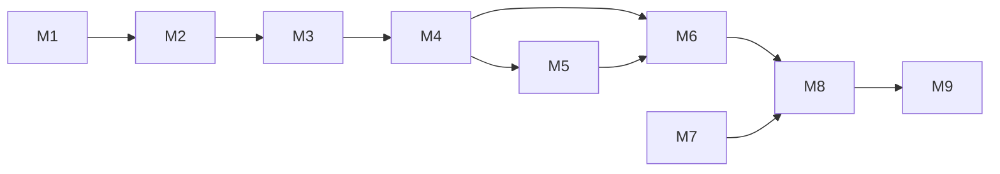

# AeroLink: Delivery Plan

Milestones, epics, and acceptance criteria. Design: [ARCHITECTURE](ARCHITECTURE.md). Overview: [README](../README.md).

**Product:** a navigation app for Florida's low-altitude air corridors with AI traffic prediction (ARCHITECTURE §1). The backend's route engine uses traffic-management calculations to make its predictions; it never approves, rejects, or holds a flight. Air traffic control stays in the loop by radio (ARCHITECTURE §1, §13.4).

**Reuse first:** the [decisions table](ARCHITECTURE.md#17-decisions) picks off-the-shelf tools wherever they exist. Stories name them; custom code is limited to the route engine, the corridor network, the simulator, off-route detection, and the adsb.lol parser.

**Stack:** all Python for the backend (ARCHITECTURE §11), TypeScript for the web map and pilot screen, C for the unit's firmware.

**Device:** a screenless AeroLink unit (vehicle-type key, GNSS, button, LEDs) plus any screen the pilot already has, paired by QR code (ARCHITECTURE §14). A Display Pack with its own touchscreen is post-MVP.

**How to read this**
- **Milestone:** a checkpoint that produces something working and demonstrable. Closed only when its exit criteria are met.
- **Epic:** a body of work inside a milestone, with a description, stories, and acceptance criteria.
- **Story:** a single task, written as an action.

---

## Milestones

| ID | Milestone | Goal | Depends on |
|---|---|---|---|
| M1 | Foundations | Repo, CI, and message contracts every service shares | — |
| M2 | Airspace and Network | Landing sites and a corridor network proven clear of no-go airspace | M1 |
| M3 | Simulator and Classical Baseline | A measurable non-AI navigation baseline running in simulation | M2 |
| M4 | AI Forecasting and Route Engine | AeroLink's AI route engine measured against the baseline | M3 |
| M5 | Real Data and Trained Models | Trained models, real-data validation, full ablation results | M4 |
| M6 | Live System and Web Map | The full system running live with a usable web map, the pilot screen, the AeroLink Ops dashboard, and the shared basemap | M4, M5 |
| M7 | Unit Hardware Design | A reviewed wiring schematic and datasheets for the AeroLink unit | — |
| M8 | Unit and Pilot Screen | The AeroLink unit running the full flow with a paired phone | M6, M7 |
| M9 | Deploy and Demo | The system deployed and the demo rehearsed | M8 |

M7 has no dependencies and can run in parallel with M1–M6.

---

## M1: Foundations

**Goal:** Every service has a home, CI runs on every push, and all components agree on message formats.
**Exit criteria:** CI is green; the v4.0 contract tests accept every valid example and reject every invalid one.

### E1.1 Repository and CI ✅

Set up the repo structure and automated testing so every later epic has a place to land.

**Stories**
- [x] Create the folder layout defined in the README
- [x] Initialize the Python project in `backend/` (uv), package `aerolink`
- [x] Initialize the web page project in `web/` (Vite + TypeScript)
- [x] Add a CI workflow: `pytest` + `ty check` for the backend, type-check + build for the web page
- [x] Add `.env.example` and `.gitignore` (including `backend/data/realdata/`)

**Acceptance criteria**
- A fresh clone builds and tests pass with documented commands
- CI runs automatically and reports status on every push

### E1.2 Message Contracts v3.0 ✅

The first five messages (telemetry, route request, route response, intent, intent status) with schemas, examples, contract tests, Pydantic models, and a schema/model agreement test. Superseded in content by E1.3; the tooling carries over.

### E1.3 Message Contracts v4.0 (navigation scope) ✅

Update the contracts to the navigation scope (ARCHITECTURE §12). Reopens M1.

**Stories**
- [x] Rename `mission` → `vehicle_type` (`passenger`, `medical`) in telemetry and route request
- [x] Replace `intent` with `route-selection` and `intent-status` with `flight-status` (`planned`, `active`, `off_route`, `replaced`, `ended`); remove `rejected`
- [x] Route response: `expected_wait_s`, `bunching_risk`, `eta`, `summary`, `label`, `traffic`; `ok` needs 1–3 routes, `no_route`/`error` carry a reason and no routes
- [x] Add the `traffic` schema (nearby aircraft, edge traffic levels now / +15 / +30 min)
- [x] `schema_version` 4.0; 12 valid and 26 invalid examples across 6 messages
- [x] Pydantic models in `aerolink.contracts`; contract, model, mutation, and docs-example tests pass

**Acceptance criteria**
- All valid examples pass and all invalid examples fail
- Schemas match ARCHITECTURE §12.2

---

## M2: Airspace and Network

**Goal:** Real landing sites and a corridor network that is provably clear of commercial, military, and restricted airspace.
**Exit criteria:** The surveyed sites are in `network.yaml`; the network builds; the constraint check passes; a deliberately invalid corridor makes the build fail.

### E2.1 FAA Airspace Import ✅

Turn FAA open data into 3D no-go volumes (shape + floor + ceiling) for Florida.

**Stories**
- [x] Download the FAA Class Airspace and Special Use Airspace datasets (ADDS GeoJSON, no account)
- [x] Keep every area that touches Florida (`aerolink.airspace.clip --region florida`); raw downloads stay in gitignored `airspace/source/`
- [x] Convert each area into a no-go volume with floor and ceiling (`aerolink.airspace.convert`), flagged `in_focus_region`
- [x] Commit the snapshot with the FAA data cycle date (2026-10-29)
- [x] Add hand-modeled areas the data doesn't cover (e.g. the full MacDill base), labelled `modeled`

**Acceptance criteria**
- `airspace/constraints-fl.geojson` covers all of Florida and contains the TPA and MCO controlled airspace, MacDill, and the Avon Park range, flagged as in the focus region
- Every volume has a type, floor, ceiling, and source (`faa` or `modeled`)
- The import is reproducible with one command

### E2.2 Landing Site Survey

Find and map the real landing sites for both site types (ARCHITECTURE §3.2). Aerial cargo (cargo eVTOL, drone cargo, drone delivery) is out of scope.

**Stories**
- [x] Collect eVTOL takeoff/landing sites from FDOT's Phase 1A list (`airspace/sites-evtol.geojson`)
- [x] Collect helipads from the FDEP Airports layer (FDEM + FDOT merge)
- [x] `aerolink.airspace.sites`: filter to Central Florida, active, non-military, medical; review sheet with nearest waypoint and distance
- [x] Clean names and write `airspace/sites-helipads.geojson` (48 medical pads, 22 near a corridor)
- [x] Confirm current hospital names
- [x] Check every position on aerial imagery; mark `verified`
- [x] Copy the sites into the `nodes:` section of `airspace/network.yaml` (5 surveyed eVTOL sites + SunTrax, 22 helipads) with a connector each; remove the placeholder hospitals
- [x] Add a downtown Tampa waypoint (I-4/I-275) for Tampa General, Water Street (modelled site), and the EMS pad

**Acceptance criteria**
- Every site has a type, position, source, and verified flag
- Passenger and medical each have at least two destinations in the focus region
- The sites build into the network without `bad types` errors

### E2.3 Corridor Network (hybrid build)

Hand-write the connections; take the corridor shapes from FDOT's official highway GIS (ARCHITECTURE §3.3).

**Stories**
- [x] `fetch_fdot inspect`: print the route fields and sample values of FDOT's Interstates, U.S. Highways and State Roads shapefiles
- [x] Confirm the field/value that identifies I-4, US-27, US-98, SR-60 (`RouteNum`) and set them in `network.yaml`
- [x] `fetch_fdot extract`: write `airspace/fdot-highways.geojson` (one feature per highway; committed)
- [x] Snap junction waypoints onto the highways; add edges and a connector for every surveyed site
- [x] `build_network`: follow each highway as a routable graph (bridges FDOT's gaps), add connectors, choose altitude bands, apply the landing-site airspace exemption
- [x] Apply the FDOT AAM Business Plan airspace zones: Class D with ATC coordination (avoided when possible); Class B only on designated clearance routes; Class C and special use no-go
- [x] Add US-17/92 as a second corridor into downtown Orlando
- [x] Build against the real `constraints-fl.geojson`; commit `airspace/central-fl-v1.geojson` and `airspace/build-report.txt`
- [x] Review the result on a map (geojson.io)

**Acceptance criteria**
- One command rebuilds the network from `network.yaml`, the FDOT highways, and the constraints
- Every pair of `evtol` sites at least 15 km apart has at least two distinct routes; every site is connected
- Every edge follows its FDOT highway; every site has a type and capacity
- The network covers Orlando–Tampa, Orlando–SunTrax, and Tampa–SunTrax

### E2.4 Network Validation

Make it impossible to ship a network that touches no-go airspace.

**Stories**
- [x] Do all geometry checks in UTM zone 17N (metres)
- [x] Check every edge, at its altitude band, against every blocking volume in 3D, using a spatial index (`STRtree`)
- [x] Drop and report edges with no clear band; fail if an `evtol` pair loses its second route or a site is unconnected
- [x] Re-check the committed network in a CI test against `constraints-fl.geojson` (`tests/test_network_committed.py`)
- [x] Add tests with a deliberately invalid edge (restricted area dropped and named; violation added after the build caught by `validate`)

**Acceptance criteria**
- The committed network passes the 3D check in CI
- The invalid test edge is dropped and named in the report

---

## M3: Simulator and Classical Baseline

**Goal:** Simulated traffic running on the network, routed by the classical (non-AI) navigation method, with results we can measure.
**Exit criteria:** Every scenario runs deterministically from a seed; B0 and B1 results are committed.

### E3.1 Vehicle Types ✅

Define how passenger and medical aircraft differ.

**Stories**
- [x] Define cruise speed, range, and calculation priority per vehicle type
- [x] Offer only destinations whose `serves` includes the vehicle type
- [x] Offer only routes within range

**Files**
- `backend/src/aerolink/vehicle.py`: static `VehicleCfg` for passenger and medical
- `backend/src/aerolink/network.py`: network loader with `nodes_for`, `shortest_paths`, range filtering, and ETA estimate
- `backend/tests/test_vehicle.py`, `backend/tests/test_network_routing.py`: acceptance tests

**Acceptance criteria**
- A passenger aircraft is never offered a helipad, and a medical aircraft is never offered an eVTOL site (unless `serves` says so)
- A route longer than the range is never offered

### E3.2 Simulator ✅

Generate realistic, repeatable traffic: 10 aircraft (7 passenger, 3 medical).

**Stories**
- [x] Build a custom kinematic simulator (BlueSky and MATSim-UAM reviewed and not used; see ARCHITECTURE §9.1)
- [x] Model aircraft movement along corridors with variable speed, using a seeded `numpy.random.Generator`
- [x] Model pads physically: an aircraft arriving at an occupied pad holds until it frees up
- [x] Add diversions and destination changes
- [x] Add unscheduled medical dispatches
- [x] Close the loop: simulated pilots request routes, pick the top option, fly it, and accept suggestions (acceptance rate parameter)
- [x] Run on a simulated clock (offline mode)
- [x] Make every run reproducible from a seed
- [x] Hardening ([E3.2-hardening-plan.md](E3.2-hardening-plan.md)): invariant checker and stress matrix; every flight fits the battery and medical aircraft can always get home (interim range rule, no reserve); stands so parked aircraft free the pad; optional medical dispatch timeout

**Files**
- `backend/src/aerolink/sim/clock.py`: immutable fixed-step simulated clock (no float drift)
- `backend/src/aerolink/sim/state.py`: `WorldState`, `AircraftState`, `PadState`, `FlightPlan`, `FlightLeg`, `WindField`
- `backend/src/aerolink/sim/physics.py`: direction-aware edge interpolation, wind, accel/decel, climb/descent, glide path, braking to hold points
- `backend/src/aerolink/sim/pads.py`: pad slots from clearance until the aircraft clears to a stand (or departs), FIFO queues, stands
- `backend/src/aerolink/sim/fleet.py`: fleet creation on home stands/pads, per-aircraft RNG streams, reachable destination selection
- `backend/src/aerolink/sim/reach.py`: range rules (`fits`, `can_get_home`, medical service area)
- `backend/src/aerolink/sim/demand.py`: diurnal passenger demand (thinned Poisson), medical dispatches, nearest idle aircraft
- `backend/src/aerolink/sim/telemetry.py`: contract-valid v4.0 `Telemetry` records with seeded noise and dropout
- `backend/src/aerolink/sim/controller.py`: `RouteAdvisor` protocol, `ShortestPathAdvisor`, per-step orchestration
- `backend/src/aerolink/sim/pilot.py`: pilot agent (departures, suggestions, destination changes, holding, diversions, stands)
- `backend/src/aerolink/sim/operator.py`: pad grants, medical dispatch queue (service area, timeout)
- `backend/src/aerolink/sim/events.py`: event kinds
- `backend/src/aerolink/sim/invariants.py`: read-only `InvariantChecker` (physics, plans, range, pads, stands, events); `run_simulation(..., check_invariants=True)`
- `backend/src/aerolink/sim/runner.py`: `run_simulation(network, scenario, seed)` → `SimulationResult` (telemetry, events, truth, `digest()`)
- `backend/src/aerolink/sim/scenarios.py`: validated scenario loader/saver
- `backend/scenarios/nominal_day.yaml`: example scenario
- Tests: `backend/tests/test_sim_{clock,physics,pads_fleet,demand,telemetry,scenario_load,controller,determinism,golden,wiring,invariants,stress,reach,stands}.py`, `backend/tests/test_network_edges.py`

**Acceptance criteria**
- Two runs with the same seed produce identical output
- One simulated hour runs in under a minute
- Hardened (tag `e3.2-hardened`): 0 invariant violations on the stress matrix, same digest across processes, full suite under 60 s (parallel via pytest-xdist)

### E3.3 Traffic Realism

Make simulated traffic behave like real operations: aircraft never overlap, waits happen on the ground before departure rather than in the air, arrivals are spaced by speed, battery reserve drives diversions, and demand is a timetable plus on-demand trips. Detailed plan: [E3.3-plan](E3.3-plan.md); T1: [E3.3-T1-plan](E3.3-T1-plan.md).

These are behaviours of the **simulated world** (pilots and vertiport operators), not of AeroLink. AeroLink still never approves, schedules, or holds a flight (ARCHITECTURE §1, §18). Simulated pilots keep only a physical minimum (300 m / 150 m vertical); the 1 km / 60 s spacing in ARCHITECTURE §3.4 stays a measured metric, so routing quality still shows up as bunching. Builds on the E3.2 code; do not rewrite it. Do the stories in order: each one depends on the one before.

**Stories**
- [x] T0 Foundations: split `controller.py` into `operator.py` and `pilot.py`, add a per-step traffic index (`traffic.py`), a registry of event kinds (`events.py`), and per-scenario `world` toggles (all off reproduces E3.2 output exactly, checked by a golden digest)
- [x] T1 Separation: opposite directions use different altitude halves of a corridor band; followers slow to keep the gap; aircraft take turns at junctions (medical first); holding aircraft use distinct stack points; log `bunching` and `loss_of_separation` events
- [x] T2 Energy: per-phase battery use (hover > climb > cruise, headwind cost), reserve-based diversion while holding (`max_hold_s` kept as a cap), refuse departures that do not fit with reserve, charge during turnaround
- [x] T3 Pad booking: per-pad slot calendar; book the arrival slot before departure; ground-hold on the pad when none is free; re-book in flight outside tolerance, falling back to airborne holding; medical may take a passenger slot
- [x] T4 Arrival metering: pilots adjust cruise speed within vehicle limits to arrive when the booked slot opens
- [x] T5 Schedules: scenario timetable of shuttle flights booked in advance, with the existing random demand on top
- [x] T6 Background traffic: `BackgroundTrack` aircraft that follow a fixed 4D track and ignore the system (no requests, no bookings), included in telemetry and the traffic index; synthetic rogue tracks with labelled ground truth (real-data replay is a story in E5.1)

**Acceptance criteria**
- No two airborne aircraft come within 300 m horizontally and 150 m vertically in any committed scenario
- On `nominal_day`, fewer than 5% of arrivals hold in the air; waits are ground holds
- Every behaviour can be switched off per scenario; with all switched off, the output equals E3.2's
- Same seed gives identical output; one simulated hour still runs in under a minute

### E3.4 Scenarios

**Goal:** Define the test situations the evaluation runs.

**Stories**
- [x] Write scenario files (needs E3.3: schedules for `i4_peak` and `sebring_race_weekend`, background tracks for `rogue_aircraft`): `nominal_day`, `i4_peak`, `sebring_race_weekend`, `medical_dispatch`, `slow_and_diverted`, `rogue_aircraft`, `telemetry_dropout`
- [x] Include labelled ground truth for injected deviations

**Acceptance criteria**
- All 7 scenarios load and run end to end

### E3.5 Classical Navigation (Baseline B1)

A reasonable navigation service with no AI. This is the bar AeroLink must beat (ARCHITECTURE §6).

**Stories**
- [x] Generate candidate routes (k-shortest within range)
- [x] Predict arrival times from cruise speed with fixed ±60 s windows
- [x] Build the traffic picture from planned flights only, assumed on time
- [x] Predict pad and junction waits first-come-first-served, medical first (greedy)
- [x] Rank by predicted time including wait
- [x] Flag off-route aircraft with fixed bounds (300 m, time window)

**Acceptance criteria**
- Medical flights are always calculated first
- Behaviour matches ARCHITECTURE §6

### E3.6 Evaluation Harness

Measure every configuration the same way.

**Stories**
- [x] Implement metrics: trip time, pad wait, time saved by suggestions, no-route count, bunching events, off-route detection, medical wait, ETA error and coverage, traffic-level accuracy
- [x] Run configurations B0 (shortest path, no traffic) and B1 (classical) across all scenarios
- [x] Write results as JSON to `eval-results/`

**Acceptance criteria**
- One command runs all scenarios and configurations
- B0 and B1 results are committed

---

## M4: AI Forecasting and Route Engine

**Goal:** The AeroLink route engine using AI predictions, measured against the classical baseline.
**Exit criteria:** B1 vs A1 results are committed for every scenario. ✅

> A1 currently uses the `cv` forecaster as its ETA predictor for CI reproducibility. The Chronos-2 model is wired but defaults to `cv` so the M4 evaluation does not depend on downloading large pretrained weights. Run `uv run python -m aerolink.eval.harness --configs B0 B1 A1` from `backend/` to regenerate `eval-results/m4-results.json`.

### E4.1 Forecaster Interface and Baseline ✅

One interface for all forecasters, with constant velocity as the non-AI reference.

**Stories**
- [x] Define the forecaster interface: position head (≤5 min) and arrival-time head (≤45 min), each returning p10/p50/p90
- [x] Implement `cv` (constant velocity / constant cruise speed)

**Files**
- `backend/src/aerolink/forecast/interface.py`: `Forecaster` protocol, `PositionPrediction`, `EtaPrediction`, `NodeEta`
- `backend/src/aerolink/forecast/cv.py`: `CVForecaster`
- `backend/tests/test_a1_routing.py`: interface smoke tests

**Acceptance criteria**
- `cv` passes interface tests and is used as the reference in the evaluation

### E4.2 Chronos-2 Forecaster ✅

Add the pretrained model from Hugging Face, used without training.

**Stories**
- [x] Integrate Chronos-2 for both heads with `chronos-forecasting`; default weights `autogluon/chronos-2-small`
- [x] Map its quantile outputs to p10/p50/p90
- [ ] Measure CPU inference time and memory for 11 aircraft, for `chronos-2-small` and `amazon/chronos-2`; record the smallest VM size that keeps the 10 s refresh
- [x] Check whether the installed library version supports fine-tuning (yes: `Chronos2Pipeline.fit`, full or LoRA, in chronos-forecasting 2.3.2)

**Files**
- `backend/src/aerolink/forecast/chronos.py`: `ChronosForecaster`
- `backend/pyproject.toml`: `chronos-forecasting` dependency

**Acceptance criteria**
- Forecasts for 11 aircraft complete within the 10 s refresh interval on the target VM size
- Fine-tuning support is documented (yes/no)

> Note: for M4 CI and reproducibility, A1 currently defaults to the `cv` forecaster. Chronos-2 is wired and passes unit tests but is not enabled in default evaluation runs because it downloads large pretrained weights.

### E4.3 Traffic Forecast ✅

Turn predicted arrival times into traffic levels at each landing site, junction, and corridor.

**Stories**
- [x] Compute expected arrivals per node per 1 min bin
- [x] Compute traffic level as expected arrivals ÷ capacity, at p50 and p90; map to low / moderate / heavy
- [x] Derive edge traffic levels from the nodes they lead into

**Files**
- `backend/src/aerolink/traffic.py`: `forecast_traffic`, `TrafficForecast`, `node_capacity`, `traffic_level_thresholds`
- `backend/tests/test_a1_routing.py`: traffic tests

**Acceptance criteria**
- Every traffic value can be traced back to the flights contributing to it

### E4.4 AeroLink Route Engine ✅

The classical framework with AI-predicted times and risk-aware ranking (ARCHITECTURE §8).

**Stories**
- [x] Size ETA windows from arrival-time predictions (p10–p90)
- [x] Capacity model with OR-Tools CP-SAT: pads and junctions as time-limited resources, priority-weighted delay, medical first; output predicted waits only (verify the approach first; greedy ordering is the fallback)
- [x] Compute bunching risk between overlapping windows
- [x] Rank options by predicted time + wait + risk; label the fastest
- [x] Generate a plain-text reason for each option
- [x] Keep all hard constraints unchanged

**Files**
- `backend/src/aerolink/routing/a1.py`: `A1Advisor`, `A1Config`, `A1RouteAdvisorWrapper`, `A1RouteOption`
- `backend/tests/conftest.py`: `fl_a1` fixture
- `backend/tests/test_a1_routing.py`: A1 tests

**Acceptance criteria**
- No returned route violates a hard constraint
- No output assigns, approves, or rejects anything; results are predictions and options
- Configuration A1 runs across all scenarios

> Note: capacity model for M4 is a deterministic occupancy-based wait estimate; OR-Tools CP-SAT is listed as a dependency but not yet used in the ranking loop.

### E4.5 En-Route Suggestions ✅

Tell aircraft already flying when a faster route appears.

**Stories**
- [x] Re-run the route engine from each airborne aircraft's position every 2 minutes
- [x] Send a suggestion (`route-response` with `revision` > 0) when an option beats the current route by more than 10% of cost
- [x] Record accepted suggestions as `replaced` → new planned flight

**Files**
- `backend/src/aerolink/routing/a1.py`: `A1Advisor.suggest()`
- `backend/tests/test_a1_routing.py`: `test_a1_suggest_requires_improvement`

**Acceptance criteria**
- In `medical_dispatch`, aircraft whose predictions worsen around the medical flight receive suggestions

---

## M5: Real Data and Trained Models

**Goal:** Domain-trained models, validation on real Central Florida flights, and the full ablation results.
**Exit criteria:** The full ablation table and the real-data results are committed and reproducible.

### E5.1 Real-Data Pipeline

Build a dataset of real low-altitude flights (helicopters and light aircraft) from adsb.lol.

**Stories**
- [x] Download daily releases (start with 14 days); stream the split tar parts and extract only `traces/`
- [x] Write a parser against the readsb trace format (README-json); handle `.json` files that contain gzip
- [x] Keep only traces inside the region
- [x] Keep only aircraft ≤3,000 ft and 40–160 kt in rotorcraft (A7) / light categories; exclude airline, heavy, and military traffic; drop `mlat` points
- [x] Split tracks at the new-leg flag and at gaps over 30 s; resample to 1 Hz
- [x] Write the cleaned segments as Parquet to `backend/data/adsblol/` (committed under ODbL; raw data never stored)
- [x] Add the ODbL attribution text
- [x] Expose filtered tracks as `BackgroundTrack` replays for the simulator (E3.3 T6), as background traffic in scenarios

**Acceptance criteria**
- The dataset is reproducible with one command
- The sample count after filtering is reported; if too low, add more days

### E5.2 Real-Data Benchmark

Test the forecasters on real flights.

**Stories**
- [x] Split by day into training and held-out sets
- [x] Compare `cv` and `chronos` on the held-out days (position head)

**Files** (under `backend/`): `realdata/samples.py`, `realdata/benchmark.py`, `forecast/chronos.py` (Chronos-2 API), `eval-results/realdata-e5.2.json`

**Acceptance criteria**
- Forecast error per horizon is committed for both forecasters

### E5.3 Trained Forecaster (`aerolink-gbm`)

A model trained on simulated and real Central Florida data.

**Stories**
- [x] Build features: kinematics, vehicle type, route context, traffic ahead, time of day
- [x] Train both heads on simulated data plus the real training days
- [x] Calibrate the intervals with MAPIE `ConformalizedQuantileRegressor`; report measured p10–p90 coverage against the 80% target
- [x] Version the model files with their training seeds
- [x] Departure-time ETA: a `from_rest` feature (1 for a departure query, 0 in flight) and departure samples in the training data; the conformal calibration is done separately for departure and in-flight queries, so the 80% target holds where routes ask (at departure)

**Files** (under `backend/`): `forecast/features.py`, `forecast/simdata.py`, `forecast/gbm.py`, `forecast/train_gbm.py`, `models/aerolink-gbm/`, `eval-results/aerolink-gbm-e5.3.json`

**Acceptance criteria**
- Results reported against `cv` and `chronos` on both simulated and real held-out data
- Departure-time window coverage is reported separately from in-flight coverage (`eta_departure_sim_held_out` in `aerolink-gbm-e5.3.json`)

### E5.4 Demand Forecaster

Predict flights before they are planned, so traffic that isn't on the map yet still shows up in the forecast.

**Stories**
- [x] Generate synthetic demand (diurnal Poisson) scaled from the FDOT AAM Business Plan's 2027 passenger-trip forecast; label it synthetic
- [x] Passenger: departures per `evtol` site per 15 min (Chronos-2) and destinations (LightGBM)
- [x] Medical: dispatches per `helipad` per 15 min (Chronos-2)
- [x] Add expected flights to the traffic forecast, weighted by probability

**Files** (under `backend/`): `demand/synthetic.py`, `demand/forecaster.py`, `demand/evaluate.py`, `data/synthetic-demand/` (synthetic), `eval-results/demand-e5.4.json`

**Acceptance criteria**
- Accuracy reported against the simple baselines (mean rate, last schedule, constant rate)

### E5.5 Off-Route Detection

Detect aircraft leaving their predicted path, using learned tolerance instead of fixed bounds.

**Stories**
- [x] Flag aircraft outside their calibrated band for 3 or more consecutive checks (p01–p99, one check every 10 s), outside a learned route tolerance, or unable to arrive inside their ETA window
- [x] Train a scikit-learn `IsolationForest` on residual features (cross-track error, speed and vertical-rate deviation) from clean real-data legs
- [x] Set the flight to `off_route` and send fresh route options from the current position ("recalculating")
- [x] Spread the flagged aircraft's possible positions into the traffic forecast

**Files** (under `backend/`): `offroute/detector.py`, `offroute/evaluate.py`, `models/offroute/`, `routing/aerolink.py` (`recalculate`, reachable mass), `eval-results/offroute-e5.5.json`

**Acceptance criteria**
- Detection precision, recall, and latency reported against the fixed-bounds baseline on `rogue_aircraft`

### E5.6 Route Summary (LLM)

Plain-language summary of the route options, like a maps app.

**Stories**
- [x] Call an OpenAI-compatible chat endpoint (`LLM_BASE_URL`, `LLM_MODEL`, `LLM_API_KEY`, `LLM_REASONING_EFFORT`; measured against a self-hosted Ollama server, OpenRouter also works) to generate a two-sentence summary from the structured route data
- [x] Reject any summary whose numbers don't match the data; fall back to a template

**Files** (under `backend/`): `summary/llm.py`, `summary/evaluate.py`, `eval-results/summary-e5.6.json`

**Acceptance criteria**
- No summary with a mismatched number reaches a user
- The pass rate is reported

### E5.7 Full Ablations

Measure what each AI component adds.

**Stories**
- [x] Run configurations A2–A5 across all scenarios
- [x] Run A5 with a 50% suggestion acceptance rate as a sensitivity check
- [x] Publish the B1 vs A5 comparison
- [x] Add congestion scenarios whose premises come from the FDOT AAM plan's own demand range (`fdot_high_peak`, `i4_corridor_rush`, `orlando_event_egress`; each YAML states its premise and parameters, fixed before any comparison run)
- [x] Measure ETA error and window coverage at departure, with ground holds counted in the trip time

**Files** (under `backend/`): `routing/aerolink.py`, `eval/ablations.py`, `eval-results/m5-ablations.json` and `.md`

**Acceptance criteria**
- The ablation table in ARCHITECTURE §9.3 is fully populated from committed runs
- Results are reported as measured: no parameter is tuned to favour AeroLink (on this network A5 and B1 produce the same routes and outcomes; see ARCHITECTURE §9.3)

---

## M6: Live System and Web Map

**Goal:** The full system running in real time, with a usable web map, the pilot screen, the AeroLink Ops dashboard, and the shared basemap.
**Exit criteria:** the 10 simulated aircraft (the whole fleet, parked ones shown as on-ground tracks) on the web map with a traffic layer; the method toggle visibly changes route options; directions return in under 2 s; a medical dispatch updates other aircraft's predictions and triggers suggestions; the AeroLink Ops dashboard shows every active route, live ADS-B traffic, predicted congestion and conflicts, and every unit's health.

### E6.1 Live Integration of the Calculation Layer

Run the same calculation functions the offline evaluation uses inside the live backend.

**Stories**
- [x] Call the calculation layer from the service layer as plain functions (no separate service)
- [x] Run model inference in a worker thread so it never blocks MQTT ingest
- [x] Load models once at startup; expose versions at `/api/models`

**Acceptance criteria**
- For the same input, the live backend returns the same options as the offline evaluation
- MQTT ingest keeps up at 1 Hz while forecasts run

### E6.2 Messaging

Secure messaging between aircraft and the backend.

**Stories**
- [x] Configure Mosquitto (standard Docker image) with TLS and a project certificate authority
- [x] Per-device credentials via `password_file`; `acl_file` pattern rules limit each device to its own topics
- [x] Separate simulator namespace and account

**Acceptance criteria**
- A device cannot publish to another device's topics
- Anonymous connections are refused

### E6.3 Backend Service Layer

The Python service layer (FastAPI + aiomqtt) that ingests telemetry, keeps planned flights, and runs the live loops.

**Stories**
- [x] Ingest and validate telemetry; drop duplicates and out-of-order messages
- [x] Keep live aircraft state
- [x] Device registry: credential → vehicle type, `demo` flag; reject messages whose vehicle type doesn't match (except demo devices, whose changes are logged)
- [x] Keep the planned-flight registry and its statuses
- [x] Refresh forecasts every 10 s
- [x] Publish `traffic` to each device every 5 s (nearby aircraft, edges on or near its route)
- [x] Run en-route suggestions every 2 min
- [x] Handle the device flow: route request → route response → route selection → flight status
- [x] Database migrations (e.g. Alembic) and storage
- [x] Public API (ARCHITECTURE §11.1), including `/api/traffic`, `/api/forecaster`, `/api/models`, `/api/eval`, `/api/scenarios`, `/api/scenario` and `/api/adsb`
- [x] Unit liveness watchdog: every inbound unit message (even telemetry with no fix) is a heartbeat; silent for more than 3 s → offline, routing locked. The Last Will alone fires only after 1.5 × the MQTT keepalive when a unit is unplugged
- [x] Track segments *(from Microtransit_Tracking)*: start a new segment after a reconnect, a telemetry gap over 30 s, or a GNSS fix recovery; history and trails never join across segments; off-route detection restarts at a segment boundary
- [x] Device event log *(from Microtransit_Tracking)*: persist online/offline (incl. no signal), GNSS fix gained/lost, vehicle-type changes and off-route; `GET /api/alerts`; pushed to `/ws/ops`, and online/offline and health changes also reach the unit's paired screens
- [x] `scripts/fake_unit.py` *(from Microtransit_Tracking's payload simulator)*: a test unit (status + Last Will, 1 Hz telemetry, health heartbeat, replay, fault options such as no fix, weak signal or a silent drop, demo type toggle) for development and end-to-end tests

**Acceptance criteria**
- The full device flow works using a test MQTT client
- A device registered as passenger cannot request medical routes
- Restarting the backend loses no planned flights
- A unit that goes silent without disconnecting (unplugged) shows offline within 5 s

### E6.4 Simulator Live Mode

Run the simulated fleet in real time over MQTT.

**Stories**
- [x] Publish telemetry in real time (offline run replayed on the wall clock; requests come with the Display Pack)
- [x] Switch scenarios from the API (`PUT /api/scenario`, operator session)

**Acceptance criteria**
- Live and offline modes produce the same behaviour for the same seed

### E6.5 Basemap

One basemap for the web map and the pilot screen (ARCHITECTURE §13.3). Device raster tiles moved to the Display Pack (post-MVP).

**Stories**
- [x] Extract Florida from a Protomaps basemap build with `pmtiles extract` (no account); keep it out of git; document the command (`scripts/basemap.sh`)
- [x] Serve the PMTiles file from Caddy; load it in MapLibre with the `pmtiles` protocol and a Protomaps style

**Acceptance criteria**
- The web map and the pilot screen work with no third-party tile service

### E6.6 Web Map

The maps-style web page for pilots, operators, and judges (ARCHITECTURE §13.1).

**Stories**
- [x] MapLibre GL JS page on the shared basemap
- [x] Corridors, landing sites by type, and no-go airspace by type as 3D `fill-extrusion` layers
- [x] Traffic layer with a time slider (+0 to +45 min)
- [x] Live aircraft by vehicle type, with status and callsign; parked aircraft shown as grey on-ground dots
- [x] Directions: vehicle type + destination → route options with ETA ranges, reasons, and summary
- [x] Planned flights and prediction cones
- [x] Method toggle (classical / AeroLink) and forecaster toggle (operator sign-in required to change them; signed-out viewers see them disabled with a sign-in line)
- [x] Medical view
- [x] AI impact panel
- [x] Alerts and scenario control
- [x] Data attribution footer

**Acceptance criteria**
- Every feature in ARCHITECTURE §13.1 is usable without the command line

### E6.7 Packaging

Run the whole system with one command.

**Stories**
- [x] `compose.yaml` with five containers (`caddy`, `backend`, `mosquitto`, `postgres`, `sim`) and health checks
- [x] Caddy serves the built `web/` files and the PMTiles file and proxies `/api` to the backend
- [x] Caddy for HTTPS and basic auth

**Acceptance criteria**
- `docker compose up` on a clean machine starts a working system

### E6.8 Pilot Screen and Pairing

The pilot's view of a paired AeroLink unit on any screen with a browser (ARCHITECTURE §11.2, §13.2, §14.5).

**Stories**
- [x] Pairing: pairing-code hash per unit (migration), `POST /api/devices/{id}/pair` → HTTP-only session cookie; re-provisioning rotates the code
- [x] `GET /api/devices/{id}`: type, online, latest fix, current flight
- [x] `POST /api/devices/{id}/route-request` and `/route-selection`, running the same handlers as the MQTT topics with the **registered** vehicle type
- [x] WebSocket `/ws/devices/{id}`: push `route-response`, `flight-status`, `traffic`, type changes, `health`, `clearance` and online/offline to paired screens, with a heartbeat every 5 s (Caddy proxies it)
- [x] Pilot page `/device/<id>` (MapLibre; look and layout in E6.12): map, "Where to?", route options, navigate, status
- [x] "Unit not connected" state that locks routing while the unit is offline
- [x] Screen wake lock while navigating; stale data greyed after `expires_at`
- [x] QR label generator: `https://<site>/device/<id>?code=<code>` (`python -m aerolink.service.devices add` writes the SVG and PNG label)
- [x] `POST /api/devices/{id}/flight/end`: the pilot ends the flight, so the shared picture and ATC see it as ended

**Acceptance criteria**
- A phone paired by QR completes the whole flow without instructions, with no site login: the pilot paths (`/device/*`, `/assets/*`, `/favicon.svg`, `/basemap/*`, `/api/airspace`, `/api/devices/*`, `/ws/devices/*`) are exempt from the Caddy basic auth; the pairing code and the per-unit session cookie protect them instead
- A screen can't change or claim a vehicle type; requests use the unit's registered type
- Unplugging the unit shows "Unit not connected" within 5 s and blocks new route requests
- A demo-button press changes the screen's destination list within 2 s

---

### E6.9 Health and Watchdogs

Know at all times whether every unit and every part of the server is healthy (ARCHITECTURE §11, §13.4).

**Stories**
- [x] Unit health heartbeat (contracts v4.1, `aerolink/aircraft/{id}/health`, every 10 s): uptime, last reset reason, Wi-Fi RSSI, satellites + HDOP, free heap, firmware version; the ACL allows it
- [x] Unit liveness (with E6.3): healthy / degraded (no fix, weak signal, stale health) / offline (silent > 3 s)
- [x] Server watchdogs: MQTT link, forecast refresh age, simulator activity, live ADS-B feed age, database writes, models loaded; each with a threshold and a state (`ok` / `warn` / `fail`); a state change is written to the event log and pushed to `/ws/ops`
- [x] `/healthz` reports every watchdog (liveness stays cheap; `/healthz?deep=1` for the full report); stale inputs are flagged in API responses, never silently shown
- [x] `scripts/fake_unit.py` sends health heartbeats too

**Acceptance criteria**
- Stopping the simulator, the broker, or the ADS-B feed turns its watchdog red within 30 s and back green on recovery
- A unit with no GNSS fix shows degraded, not offline

### E6.10 AeroLink Ops Dashboard

The operations view of all low-altitude traffic, for AeroLink or vertiport operations staff (ARCHITECTURE §13.4). It is not an ATC system: it monitors and helps operators plan, and real ATC acts by radio.

**Stories**
- [x] `/ops` page (same web app, operator login, E6.15): all traffic by source (units, simulated, live ADS-B) and vehicle type
- [x] Every active route with ETA windows, prediction cones and status; flight list with drill-down to track history (segments)
- [x] Predicted congestion per corridor and site, +0 to +45 min
- [x] Conflict list: predicted bunching / loss-of-separation risks between routes, ranked, highlighted on the map
- [x] What-if routing: the route engine's alternatives for any flight from its current position, with the predicted time saved
- [x] Fleet health table from E6.9; alerts and event log with per-operator acknowledge (audit-logged)
- [x] System-health panel from the E6.9 watchdogs

**Acceptance criteria**
- An operator sees every active route and every live aircraft (all three sources; the simulated fleet includes parked on-ground tracks) on one screen without the command line
- A developing conflict appears on the dashboard before the aircraft meet
- The dashboard never gives a pilot an instruction; Ops can send an advisory reroute that the pilot may accept or decline; the only other things an operator changes are acknowledgements, the Ops "cleared / contacted" note (E6.14), and the system switches (method, forecaster, scenario)

### E6.11 Live ADS-B Traffic

Real aircraft over Central Florida in the live picture (adsb.lol live API, ODbL).

**Stories**
- [x] Poll the adsb.lol live API for the focus region; apply the E5.1 filters (low altitude, rotorcraft/light, no airline/heavy/military). Polling is adaptive because the public API allows 500 requests per 24 h: every 30 s while someone uses `/api/adsb`, `/api/ops/*` or `/ws/ops` (last 2 min), every 5 min otherwise, at most 450 requests per rolling 24 h (the interval stretches as the budget runs down); no API key
- [x] Show them on the AeroLink Ops dashboard as background traffic, never routed
- [x] Show them on the web map too: quiet grey markers with a heading tick and callsign, a layer toggle, nothing drawn when the feed is down (a small "ADS-B unavailable" note in the layers panel), ODbL credit once in the footer
- [x] Feed them into the traffic forecast as background traffic (like off-route mass)
- [x] Feed down or offline → watchdog alert and an "ADS-B unavailable" label; nothing else breaks
- [x] ODbL attribution on every page that shows them

**Acceptance criteria**
- Live ADS-B aircraft appear on the next poll (30 s while the dashboard or map is open; longer when idle or when the daily budget runs low)
- With no internet, the system runs and the dashboard's system panel shows the feed as not `ok` (feed states: `ok`, `stale`, `down`, `rate_limited`, `disabled`)

### E6.12 Pilot UI (CarPlay-style)

A cockpit-first redesign of the pilot screen (ARCHITECTURE §13.2). It looks like a car-navigation app, with no Apple assets, fonts or icons. Principle: minimalism, only what the pilot needs, nothing that distracts.

**Stories**
- [x] Landscape-first layout for a phone or tablet mounted in the cockpit (left panel, map on the right); portrait uses a bottom sheet
- [x] Light, dark and auto themes, remembered per browser
- [x] One primary thing per state: map with a "Where to?" button, route cards, then a navigation banner (next waypoint, ETA window, traffic ahead)
- [x] Neutral site markers; red only for a problem; airspace drawn only where the route crosses it; short site names (at most two lines)
- [x] "Faster route available" and "Off route, recalculating" banners; an "End" button (tap twice) that ends the flight (`POST /api/devices/{id}/flight/end`)
- [x] Route-card badges "Recommended" (rank 1, lowest cost) and "Fastest" (shortest predicted time, cruise plus wait); display-only, the contract `label` is unchanged (`web/src/shared/labels.ts`)
- [x] Callsign shown in the status view, from the unit's registry; an "Ops noted: ATC clearance obtained" line when Ops has noted the flight (E6.14)

**Acceptance criteria**
- Covered by the pilot Playwright projects: an iPhone 15 viewport, a landscape phone and a landscape iPad (`cd web && npm test`)
- Nothing on the screen can change the vehicle type or the callsign

### E6.13 AeroLink Ops Dashboard in STARS Style (superseded by E6.14)

A first redesign of `/ops` after STARS conventions (dark scope, data blocks, leader lines, history dots). It was accepted and then replaced by E6.14 the same day, so its look no longer exists. The data and panels it showed (traffic, routes, conflicts, what-if, alerts, health) are E6.10's and carry over to E6.14.

**Stories**
- [x] Superseded by E6.14; nothing to build

### E6.14 Ops CarPlay UI and Clearance Note

The final `/ops` look and the Ops "handled" note (ARCHITECTURE §1, §13.4).

**Stories**
- [x] CarPlay-style map UI: light by default, with a Light / Dark / Auto appearance setting remembered per browser
- [x] Left sidebar of every active flight with its airspace requirement pill (No ATC, Contact tower (Class D), Contact approach (Class C), Clearance needed (Class B)), derived from the network's per-leg airspace flags; flights needing action sort first; filters All / Needs action / Medical
- [x] A landing site's own airspace counts toward the requirement (landing inside Class B needs a clearance)
- [x] An operator notes a flight Cleared (Class B) or Contacted (Class D / C), or undoes the note: `POST /api/ops/flights/{flight_id}/clearance`; each mark is audit-logged and stored as a `clearance` event
- [x] The pilot sees the note as "Ops noted: ATC clearance obtained" (informational only: over `GET /api/devices/{id}` and the `clearance` WebSocket message; never over MQTT, never blocks Go)
- [x] `GET /api/devices/{id}/atc-requirement?path=...` so route cards can say "Clearance needed (Class B)" before the pilot goes

**Acceptance criteria**
- A route that crosses only Class G shows "No ATC" and refuses a mark (409)
- A mark only counts while its requirement equals the flight's current one; a revised route starts pending again
- The pilot can start and fly any route whether or not Ops has noted it (AeroLink never blocks)

### E6.15 Operator Login and Callsigns

Real operator accounts instead of the shared basic-auth login for the AeroLink Ops dashboard, and a radio callsign for every aircraft.

**Stories**
- [x] Operator accounts with a CLI (`python -m aerolink.service.operators add|passwd|disable|enable|list`); scrypt password hashes, rate-limited login
- [x] `POST /api/auth/login`, `POST /api/auth/logout`, `GET /api/auth/me`; HTTP-only session cookie `aerolink_ops`, 12 h; `/login` page
- [x] An operator session is required for `/api/ops/*`, `/api/alerts*`, `/ws/ops` and `PUT /api/method`, `/api/forecaster`, `/api/scenario` (migration 0005)
- [x] Caddy: the dashboard paths skip basic auth (the app's own login protects them); a request with a valid operator cookie also reaches the shared read-only endpoints through `forward_auth`
- [x] Callsign per unit in the registry (`python -m aerolink.service.devices add ... --callsign N123AL`, `set-callsign`), printed on the QR label; optional `callsign` in telemetry v4.1; simulated aircraft get `SIM-...` callsigns; Ops and the web map show callsigns
- [x] `python -m aerolink.service.events purge` clears test alerts before a demo

**Acceptance criteria**
- Without an operator session the operator endpoints answer 401 and `/ws/ops` refuses the handshake (close code 4401)
- A pilot never types or changes a callsign
- Wrong passwords never say which part was wrong

---

## M7: Unit Hardware Design

**Goal:** A reviewed wiring schematic and parts documentation the AeroLink unit is built from.
**Exit criteria:** The schematic PDF and pin map are committed, reviewed, and match the firmware board config.

### E7.1 Parts and Datasheets

**Stories**
- [x] Select parts: ESP32-S3-DevKitC-1-N8R8 (built-in antenna), ATGM336H GNSS with active patch antenna, demo push button, red + blue LEDs with resistors
- [ ] Add datasheets for every part to `hardware/datasheets/`
- [ ] Confirm the GNSS module's supply range on arrival (powered from 3V3; JP1 allows 5 V)

**Acceptance criteria**
- Every part has a datasheet and an exact part number

### E7.2 Wiring Schematic and Pin Map

**Stories**
- [x] Assign pins, avoiding GPIO35–37 (memory), the boot pins (0, 3, 45, 46), USB (19, 20), UART0 (43, 44), and the onboard RGB LED (38/48)
- [x] Wire the demo button to a free GPIO with the internal pull-up; LEDs active high
- [ ] Draw the KiCad schematic of the wiring in `hardware/kicad/rev0-wiring/`
- [ ] Export the schematic PDF
- [ ] Write the matching pin map in the firmware board config
- [ ] Run KiCad's electrical rules check and review the schematic

**Acceptance criteria**
- The firmware pin map and the schematic agree pin for pin

---

## M8: Unit and Pilot Screen

**Goal:** The AeroLink unit running the full flow against the live system, with a paired phone as the screen.
**Exit criteria:** In Lakeland, the unit's position shows on a paired phone; as Medical, "Where to?" lists helipads; Tampa General returns route options drawn on the map with ETA ranges and traffic; picking one shows `planned`; a "Faster route available" suggestion appears; the demo button switches to Passenger, the LED turns blue, and the destination list changes to eVTOL sites; unplugging the unit locks routing on the phone.

### E8.1 Build and Bring-Up

**Stories**
- [ ] Solder the GNSS header pins; wire Rev 0 exactly to the schematic
- [ ] Verify GNSS (fix, PPS), button, LEDs, and power from a USB power bank
- [ ] Fix any mismatch in the schematic, not only in the wiring
- [ ] Portable first, with no aircraft connection: soldered protoboard or secured jumpers on a printed tray

**Acceptance criteria**
- All peripherals work, and the schematic reflects the build exactly

### E8.2 Firmware Platform

**Stories**
- [ ] ESP-IDF project with a board abstraction matching the pin map
- [ ] GNSS: position, fix quality, UTC time, based on ESP-IDF's `nmea0183_parser` example
- [ ] GNSS replay mode with a recorded track, for indoor demos
- [ ] Wi-Fi (2.4 GHz; credentials from menuconfig/NVS), MQTT over TLS (from the `esp-mqtt` `mqtt/ssl` example, CA embedded via `EMBED_TXTFILES`), `status` online/offline with Last Will
- [ ] Telemetry at 1 Hz with the vehicle type; out-of-region fixes still sent
- [ ] LEDs: colour = type; slow blink = no MQTT; fast blink = no GNSS fix
- [ ] MQTT keepalive 5 s, so the Last Will fires within ~7.5 s of a silent drop (the backend watchdog is the primary check)
- [ ] Layered, non-blocking reconnect *(from Microtransit_Tracking)*: Wi-Fi (event-driven, exponential backoff) → MQTT over TLS (esp-mqtt auto-reconnect, ≥5 s between attempts); GNSS reading and LEDs never block on the network
- [ ] Send telemetry even without a fix (fix type `none`), so the backend still sees the unit as alive
- [ ] Task watchdog (ESP-IDF TWDT) on the main tasks *(from Microtransit_Tracking)*: reboot on a hang; report the last reset reason in `status`
- [ ] No credentials in source: Wi-Fi and MQTT secrets come from NVS via the provisioning script (or a git-ignored menuconfig default)

**Acceptance criteria**
- The unit appears live on the web map, in both live-fix and replay modes
- The broker refuses the unit's publishes to any other unit's topics
- Wi-Fi off for 2 min, then back: the unit reconnects on its own and the live position resumes within 10 s
- A hung main task reboots the unit within 10 s

### E8.3 Vehicle-Type Key

The unit's vehicle type is part of its identity (ARCHITECTURE §14.3).

**Stories**
- [ ] Define the `VEHICLE_TYPE` field in a custom eFuse table (`EFUSE_BLK3`)
- [ ] Read the type at boot; include it in every telemetry message
- [ ] `CONFIG_AEROLINK_DEMO_MODE`: read the type from NVS instead, and let the button toggle passenger ↔ medical
- [ ] Provisioning script: MQTT login (`mosquitto/add-device.sh`), registry entry (`aerolink.service.devices add`), pairing code + QR label, and, only with `--burn-efuse` and the MAC address, the eFuse
- [ ] Document that the Rev 0 demo board is never burned

**Acceptance criteria**
- A non-demo build has no way to change the type
- The backend rejects a non-demo unit that sends a different type
- The demo button changes the type and the paired screen's destination list within 2 s

### E8.4 End-to-End Flow

**Stories**
- [ ] Pair a phone by QR; run the M8 exit-criteria flow against the live system
- [ ] Measure: telemetry-to-screen latency, route-request-to-options latency
- [ ] Test with the phone's hotspot as the unit's network

**Acceptance criteria**
- The full flow works end to end against the live system, twice in a row, without intervention

---

## M9: Deploy and Demo

**Goal:** The system running in the cloud and a rehearsed demo.
**Exit criteria:** The demo script runs end to end on the deployed system with the unit and a paired phone in Lakeland.

### E9.1 Cloud Deployment

**Stories**
- [ ] Provision the GCP VM at the size measured in E4.2; open only ports 80, 443, 8883
- [ ] Configure DNS, HTTPS, and MQTT TLS
- [ ] Deploy with Compose and production secrets; upload the PMTiles file

**Acceptance criteria**
- The web map and MQTT broker are reachable; nothing else is exposed

### E9.2 Operations

**Stories**
- [ ] Nightly database backups to Cloud Storage
- [ ] Run one restore drill

**Acceptance criteria**
- The data is restored successfully from a backup

### E9.3 Demo Readiness

**Stories**
- [ ] Test at the venue: GNSS by a window; phone hotspot (2.4 GHz) on port 8883
- [ ] Spare power bank and USB-C cable; a second paired phone as backup screen
- [ ] Rehearse the [demo script](HACKATHON.md#demo-script-lakeland-6-minutes)
- [ ] Record a backup demo video
- [ ] Prepare judge credentials and links

**Acceptance criteria**
- A full rehearsal completes without intervention

---

## MVP Definition of Done

All milestones M1–M9 are closed, and the demo runs end to end on the deployed system with the Rev 0 unit and a paired phone.

---

## Post-MVP Backlog

### Deferred from the M5/M6 closeout

Known limitations and measured gaps, found while building and checking the system. None is hidden in the results.

**Stories**
- [ ] Telemetry retention: `TELEMETRY_RETENTION_DAYS` (7) is in `.env.example` and ARCHITECTURE §15 but no code reads it or purges old rows; add the purge job
- [ ] Wait double-count: the route engine's predicted ETA adds the capacity model's predicted wait to an ETA that may already include some of it. About 5 s per flight on average (13 s in `fdot_high_peak`) according to the E1 investigation; reported, not changed
- [ ] Departure-window calibration set size: the departure-time conformal calibration used 207 rows (1,034 departure samples in training); held-out departure coverage is 0.748 against the 80% target. Generate more departure samples (more seeds and scenarios) and re-measure
- [ ] `traffic_ahead` approximation: the feature counts planned flights that share any node with the route, not the traffic that will actually be met along it; replace it with the traffic forecast's levels along the route
- [ ] ADS-B feeder or API key: the public adsb.lol API allows 500 requests per 24 h (hence the adaptive polling); feed a receiver to adsb.lol or use a keyed feed for steady 5–10 s updates
- [ ] Network densification: on the current network (6 eVTOL sites) route choice never differs between B1 and A5. Alternate routes cost more extra flight time than the predicted waits they avoid, so no suggestion fires in any committed scenario. More sites, more corridor alternatives and larger demand are needed before AI ranking can change outcomes
- [ ] Simulator separation-probe latency: in the stress setup "egress without destination parking" (test only) one 0.24 m vertical shortfall (1 s) against the 150 m rule occurs at a corridor crossing, attributed to separation-probe latency. The committed scenarios have 0 loss-of-separation events; the limitation is documented, not fixed

### Deferred from the Microtransit_Tracking review

**Stories**
- [ ] Unit store-and-forward: PSRAM ring buffer while offline, backfilled oldest first with `buffered: true`; backend sends backfill to history only
- [ ] Per-unit `command` topic (backend → unit, retained): `identify` blink, telemetry rate
- [ ] Display smoothing: constant-velocity Kalman filter in local metres, HDOP-driven noise, display only

### Display Pack

A unit with its own touchscreen, for pilots without a screen (ARCHITECTURE §14.7).

**Stories**
- [ ] Parts: 3.5″ ST7796 + FT6336U capacitive touch SPI module with microSD; confirm the touch controller before ordering
- [ ] `aerolink.tiles`: render raster tiles from the shared basemap with TileServer GL (z5–z6 Florida, z7–z14 focus region); convert to LVGL RGB565 with the `0015/map_tiles` script
- [ ] Export `network-device.json` (nodes, simplified edges, focus-region no-go outlines); SD-card image layout with a version file
- [ ] Firmware: `esp_lcd_st7796`, `esp_lcd_touch_ft5x06`, `esp_lvgl_port`, `0015/map_tiles` map view (pan, pinch, overlays, follow mode)
- [ ] LVGL screens matching the pilot page; uses the MQTT `route-request` / `route-selection` topics

### Production Connectivity and Avionics

**Stories**
- [ ] Possible later option (not decided): mesh radio module (unlicensed ISM band, LoRa-style) in place of LTE, reaching the backend via a ground gateway (design to be decided); no cellular modem or data SIM (store-and-forward already comes from E8.2). Airborne use is pending counsel's review
- [ ] GDL 90 position output so ForeFlight and Garmin Pilot show the unit with no AeroLink app

### Rev A Custom PCB

Integrate the unit onto a single custom board, starting from the M7 schematic.

**Stories**
- [ ] Integrate ESP32-S3-WROOM-1-N8R8, ATGM336H, LEDs, USB-C, AP63203 3.3 V buck, optional mesh radio module (no demo button)
- [ ] Verify footprints against the datasheets
- [ ] Layout: antenna keep-outs (Wi-Fi, GNSS, mesh radio), ground plane, USB-C ESD; clean DRC/ERC
- [ ] Fab, assembly, and bring-up
- [ ] Rev A board config (same firmware)
- [ ] Rev A enclosure with the QR label

---

## Risk Register

| Risk | Impact | Mitigation | Owner epic |
|---|---|---|---|
| FAA altitude fields differ from expectations | Import delayed | Inspected first (done) | E2.1 |
| Surveyed site positions inaccurate | Wrong connectors | Check on imagery; `verified` flag | E2.2 |
| Too few sites of one type in the focus region | Thin destination list | Widen the search; use `serves` overrides | E2.2 |
| A corridor can't avoid a no-go volume | Network redesign | Validation fails early in CI | E2.4 |
| Corridor bands conflict with Class B shelf floors | Network redesign | Bands set per corridor; validation catches it | E2.3 |
| Contract change ripples into finished M1 code | Rework | Done once in E1.3 before any consumer exists | E1.3 |
| adsb.lol releases are several GB per day | Slow download | Download in the background; not on the critical path | E5.1 |
| Too few qualifying real tracks after filtering | Weak validation | Report counts; add more days | E5.1 |
| Emitter category missing in the data | Weaker filtering | Fall back to altitude, speed, and callsign rules | E5.1 |
| Chronos-2 too slow on CPU | Refresh interval missed | Default to `chronos-2-small`; measure early; resize the VM | E4.2 |
| OR-Tools CP-SAT modelling takes too long | Capacity model delayed | Greedy priority ordering fallback | E4.4 |
| Trained model doesn't beat `cv` or `chronos` | Weaker AI story | Report as measured | E5.3 |
| A5 doesn't beat B1 in some scenarios | Weaker claim | Report as measured; analyze why | E5.7 |
| eFuse burned on the demo board by mistake | Board stuck on one type | Provisioning script requires `--burn-efuse` + MAC | E8.3 |
| Wiring doesn't match the schematic | Device bugs | Bring-up check; fix the schematic | E8.1 |
| Breadboard fails while carried | Demo failure | Protoboard or secured tray | E8.1 |
| Indoor GNSS or venue Wi-Fi fails | Demo failure | Replay mode; phone hotspot (2.4 GHz) | E9.3 |
| Unit can't see the phone hotspot | No connection | 2.4 GHz only: enable "Maximize Compatibility" (iPhone); keep the hotspot screen open | E8.4 |
| GNSS module powered from the wrong rail | Dead module | Power from 3V3 by default; JP1 only for 5 V modules | E8.1 |
| Loose GNSS header pins | Intermittent GNSS | Solder the headers; secure the antenna cable | E8.1 |
| WebSocket blocked or dropped by the network | Screen stops updating | Page falls back to polling `/api/devices/{id}` | E6.8 |
| Pairing code leaked (photo of the label) | Someone else controls the unit's screen | Rotate on re-provisioning; the pilot paths are open, so the code and the per-unit session cookie are the only protection; the web map keeps basic auth | E6.8 |
| Docker image too large (CUDA torch wheels) | Slow builds and deploys | CPU-only torch index for the image | E6.7 |
| LLM states wrong numbers | Misleading summary | Number check with template fallback | E5.6 |
