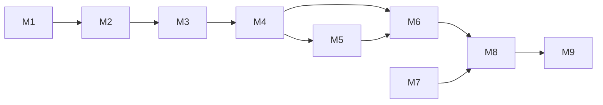

# AeroLink: Delivery Plan

Milestones, epics, and acceptance criteria. Design: [ARCHITECTURE](ARCHITECTURE.md). Overview: [README](../README.md).

**Product:** a navigation app for Florida's low-altitude air corridors with AI traffic prediction (ARCHITECTURE §1). The backend's route engine uses traffic-management calculations to make its predictions; it never approves, rejects, or holds a flight.

**Reuse first:** the [decisions table](ARCHITECTURE.md#17-decisions) picks off-the-shelf tools wherever they exist. Stories name them; custom code is limited to the route engine, the corridor network, the simulator, off-route detection, and the adsb.lol parser.

**Stack:** all Python for the backend (ARCHITECTURE §11), TypeScript for the web map, C for the firmware.

**How to read this**
- **Milestone:** a checkpoint that produces something working and demonstrable. Closed only when its exit criteria are met.
- **Epic:** a body of work inside a milestone, with a description, stories, and acceptance criteria.
- **Story:** a single task, written as an action.

---

## Milestones

| ID | Milestone | Goal | Depends on |
|---|---|---|---|
| M1 | Foundations | Repo, CI, and message contracts every service shares | — |
| M2 | Airspace and Network | Landing sites and a corridor network proven clear of no-go airspace | M1 |
| M3 | Simulator and Classical Baseline | A measurable non-AI navigation baseline running in simulation | M2 |
| M4 | AI Forecasting and Route Engine | AeroLink's AI route engine measured against the baseline | M3 |
| M5 | Real Data and Trained Models | Trained models, real-data validation, full ablation results | M4 |
| M6 | Live System and Web Map | The full system running live with a usable web map and shared basemap | M4, M5 |
| M7 | Device Hardware Design | A reviewed wiring schematic and datasheets for the device | — |
| M8 | Device | A handheld navigation device with a pannable map running the full flow | M6, M7 |
| M9 | Deploy and Demo | The system deployed and the demo rehearsed | M8 |

M7 has no dependencies and can run in parallel with M1–M6.

---

## M1: Foundations

**Goal:** Every service has a home, CI runs on every push, and all components agree on message formats.
**Exit criteria:** CI is green; the v4.0 contract tests accept every valid example and reject every invalid one.

### E1.1 Repository and CI ✅

Set up the repo structure and automated testing so every later epic has a place to land.

**Stories**
- [x] Create the folder layout defined in the README
- [x] Initialize the Python project in `backend/` (uv), package `aerolink`
- [x] Initialize the web page project in `web/` (Vite + TypeScript)
- [x] Add a CI workflow: `pytest` + `ty check` for the backend, type-check + build for the web page
- [x] Add `.env.example` and `.gitignore` (including `backend/data/realdata/`)

**Acceptance criteria**
- A fresh clone builds and tests pass with documented commands
- CI runs automatically and reports status on every push

### E1.2 Message Contracts v3.0 ✅

The first five messages (telemetry, route request, route response, intent, intent status) with schemas, examples, contract tests, Pydantic models, and a schema/model agreement test. Superseded in content by E1.3; the tooling carries over.

### E1.3 Message Contracts v4.0 (navigation scope) ✅

Update the contracts to the navigation scope (ARCHITECTURE §12). Reopens M1.

**Stories**
- [x] Rename `mission` → `vehicle_type` (`passenger`, `medical`) in telemetry and route request
- [x] Replace `intent` with `route-selection` and `intent-status` with `flight-status` (`planned`, `active`, `off_route`, `replaced`, `ended`); remove `rejected`
- [x] Route response: `expected_wait_s`, `bunching_risk`, `eta`, `summary`, `label`, `traffic`; `ok` needs 1–3 routes, `no_route`/`error` carry a reason and no routes
- [x] Add the `traffic` schema (nearby aircraft, edge traffic levels now / +15 / +30 min)
- [x] `schema_version` 4.0; 12 valid and 26 invalid examples across 6 messages
- [x] Pydantic models in `aerolink.contracts`; contract, model, mutation, and docs-example tests pass

**Acceptance criteria**
- All valid examples pass and all invalid examples fail
- Schemas match ARCHITECTURE §12.2

---

## M2: Airspace and Network

**Goal:** Real landing sites and a corridor network that is provably clear of commercial, military, and restricted airspace.
**Exit criteria:** The surveyed sites are in `network.yaml`; the network builds; the constraint check passes; a deliberately invalid corridor makes the build fail.

### E2.1 FAA Airspace Import ✅

Turn FAA open data into 3D no-go volumes (shape + floor + ceiling) for Florida.

**Stories**
- [x] Download the FAA Class Airspace and Special Use Airspace datasets (ADDS GeoJSON, no account)
- [x] Keep every area that touches Florida (`aerolink.airspace.clip --region florida`); raw downloads stay in gitignored `airspace/source/`
- [x] Convert each area into a no-go volume with floor and ceiling (`aerolink.airspace.convert`), flagged `in_focus_region`
- [x] Commit the snapshot with the FAA data cycle date (2026-10-29)
- [x] Add hand-modeled areas the data doesn't cover (e.g. the full MacDill base), labelled `modeled`

**Acceptance criteria**
- `airspace/constraints-fl.geojson` covers all of Florida and contains the TPA and MCO controlled airspace, MacDill, and the Avon Park range, flagged as in the focus region
- Every volume has a type, floor, ceiling, and source (`faa` or `modeled`)
- The import is reproducible with one command

### E2.2 Landing Site Survey

Find and map the real landing sites for both site types (ARCHITECTURE §3.2). Aerial cargo (cargo eVTOL, drone cargo, drone delivery) is out of scope.

**Stories**
- [x] Collect eVTOL takeoff/landing sites from FDOT's Phase 1A list (`airspace/sites-evtol.geojson`)
- [x] Collect helipads from the FDEP Airports layer (FDEM + FDOT merge)
- [x] `aerolink.airspace.sites`: filter to Central Florida, active, non-military, medical; review sheet with nearest waypoint and distance
- [x] Clean names and write `airspace/sites-helipads.geojson` (48 medical pads, 22 near a corridor)
- [x] Confirm current hospital names
- [x] Check every position on aerial imagery; mark `verified`
- [x] Copy the sites into the `nodes:` section of `airspace/network.yaml` (5 surveyed eVTOL sites + SunTrax, 22 helipads) with a connector each; remove the placeholder hospitals
- [x] Add a downtown Tampa waypoint (I-4/I-275) for Tampa General, Water Street, and the EMS pad

**Acceptance criteria**
- Every site has a type, position, source, and verified flag
- Passenger and medical each have at least two destinations in the focus region
- The sites build into the network without `bad types` errors

### E2.3 Corridor Network (hybrid build)

Hand-write the connections; take the corridor shapes from FDOT's official highway GIS (ARCHITECTURE §3.3).

**Stories**
- [x] `fetch_fdot inspect`: print the route fields and sample values of FDOT's Interstates, U.S. Highways and State Roads shapefiles
- [x] Confirm the field/value that identifies I-4, US-27, US-98, SR-60 (`RouteNum`) and set them in `network.yaml`
- [x] `fetch_fdot extract`: write `airspace/fdot-highways.geojson` (one feature per highway; committed)
- [x] Snap junction waypoints onto the highways; add edges and a connector for every surveyed site
- [x] `build_network`: follow each highway as a routable graph (bridges FDOT's gaps), add connectors, choose altitude bands, apply the landing-site airspace exemption
- [x] Apply the FDOT AAM Business Plan airspace zones: Class D with ATC coordination (avoided when possible); Class B only on designated clearance routes; Class C and special use no-go
- [x] Add US-17/92 as a second corridor into downtown Orlando
- [x] Build against the real `constraints-fl.geojson`; commit `airspace/central-fl-v1.geojson` and `airspace/build-report.txt`
- [x] Review the result on a map (geojson.io)

**Acceptance criteria**
- One command rebuilds the network from `network.yaml`, the FDOT highways, and the constraints
- Every pair of `evtol` sites at least 15 km apart has at least two distinct routes; every site is connected
- Every edge follows its FDOT highway; every site has a type and capacity
- The network covers Orlando–Tampa, Orlando–SunTrax, and Tampa–SunTrax

### E2.4 Network Validation

Make it impossible to ship a network that touches no-go airspace.

**Stories**
- [x] Do all geometry checks in UTM zone 17N (metres)
- [x] Check every edge, at its altitude band, against every blocking volume in 3D, using a spatial index (`STRtree`)
- [x] Drop and report edges with no clear band; fail if an `evtol` pair loses its second route or a site is unconnected
- [x] Re-check the committed network in a CI test against `constraints-fl.geojson` (`tests/test_network_committed.py`)
- [x] Add tests with a deliberately invalid edge (restricted area dropped and named; violation added after the build caught by `validate`)

**Acceptance criteria**
- The committed network passes the 3D check in CI
- The invalid test edge is dropped and named in the report

---

## M3: Simulator and Classical Baseline

**Goal:** Simulated traffic running on the network, routed by the classical (non-AI) navigation method, with results we can measure.
**Exit criteria:** Every scenario runs deterministically from a seed; B0 and B1 results are committed.

### E3.1 Vehicle Types ✅

Define how passenger and medical aircraft differ.

**Stories**
- [x] Define cruise speed, range, and calculation priority per vehicle type
- [x] Offer only destinations whose `serves` includes the vehicle type
- [x] Offer only routes within range

**Files**
- `backend/src/aerolink/vehicle.py`: static `VehicleCfg` for passenger and medical
- `backend/src/aerolink/network.py`: network loader with `nodes_for`, `shortest_paths`, range filtering, and ETA estimate
- `backend/tests/test_vehicle.py`, `backend/tests/test_network_routing.py`: acceptance tests

**Acceptance criteria**
- A passenger aircraft is never offered a helipad, and a medical aircraft is never offered an eVTOL site (unless `serves` says so)
- A route longer than the range is never offered

### E3.2 Simulator ✅

Generate realistic, repeatable traffic: 10 aircraft (7 passenger, 3 medical).

**Stories**
- [x] Build a custom kinematic simulator (BlueSky and MATSim-UAM reviewed and not used; see ARCHITECTURE §9.1)
- [x] Model aircraft movement along corridors with variable speed, using a seeded `numpy.random.Generator`
- [x] Model pads physically: an aircraft arriving at an occupied pad holds until it frees up
- [x] Add diversions and destination changes
- [x] Add unscheduled medical dispatches
- [x] Close the loop: simulated pilots request routes, pick the top option, fly it, and accept suggestions (acceptance rate parameter)
- [x] Run on a simulated clock (offline mode)
- [x] Make every run reproducible from a seed
- [x] Hardening ([E3.2-hardening-plan.md](E3.2-hardening-plan.md)): invariant checker and stress matrix; every flight fits the battery and medical aircraft can always get home (interim range rule, no reserve); stands so parked aircraft free the pad; optional medical dispatch timeout

**Files**
- `backend/src/aerolink/sim/clock.py`: immutable fixed-step simulated clock (no float drift)
- `backend/src/aerolink/sim/state.py`: `WorldState`, `AircraftState`, `PadState`, `FlightPlan`, `FlightLeg`, `WindField`
- `backend/src/aerolink/sim/physics.py`: direction-aware edge interpolation, wind, accel/decel, climb/descent, glide path, braking to hold points
- `backend/src/aerolink/sim/pads.py`: pad slots from clearance until the aircraft clears to a stand (or departs), FIFO queues, stands
- `backend/src/aerolink/sim/fleet.py`: fleet creation on home stands/pads, per-aircraft RNG streams, reachable destination selection
- `backend/src/aerolink/sim/reach.py`: range rules (`fits`, `can_get_home`, medical service area)
- `backend/src/aerolink/sim/demand.py`: diurnal passenger demand (thinned Poisson), medical dispatches, nearest idle aircraft
- `backend/src/aerolink/sim/telemetry.py`: contract-valid v4.0 `Telemetry` records with seeded noise and dropout
- `backend/src/aerolink/sim/controller.py`: `RouteAdvisor` protocol, `ShortestPathAdvisor`, per-step orchestration
- `backend/src/aerolink/sim/pilot.py`: pilot agent (departures, suggestions, destination changes, holding, diversions, stands)
- `backend/src/aerolink/sim/operator.py`: pad grants, medical dispatch queue (service area, timeout)
- `backend/src/aerolink/sim/events.py`: event kinds
- `backend/src/aerolink/sim/invariants.py`: read-only `InvariantChecker` (physics, plans, range, pads, stands, events); `run_simulation(..., check_invariants=True)`
- `backend/src/aerolink/sim/runner.py`: `run_simulation(network, scenario, seed)` → `SimulationResult` (telemetry, events, truth, `digest()`)
- `backend/src/aerolink/sim/scenarios.py`: validated scenario loader/saver
- `backend/scenarios/nominal_day.yaml`: example scenario
- Tests: `backend/tests/test_sim_{clock,physics,pads_fleet,demand,telemetry,scenario_load,controller,determinism,golden,wiring,invariants,stress,reach,stands}.py`, `backend/tests/test_network_edges.py`

**Acceptance criteria**
- Two runs with the same seed produce identical output
- One simulated hour runs in under a minute
- Hardened (tag `e3.2-hardened`): 0 invariant violations on the stress matrix, same digest across processes, full suite under 60 s (parallel via pytest-xdist)

### E3.3 Traffic Realism

Make simulated traffic behave like real operations: aircraft never overlap, waits happen on the ground before departure rather than in the air, arrivals are spaced by speed, battery reserve drives diversions, and demand is a timetable plus on-demand trips. Detailed plan: [E3.3-plan](E3.3-plan.md); T1: [E3.3-T1-plan](E3.3-T1-plan.md).

These are behaviours of the **simulated world** (pilots and vertiport operators), not of AeroLink. AeroLink still never approves, schedules, or holds a flight (ARCHITECTURE §1, §18). Simulated pilots keep only a physical minimum (300 m / 150 m vertical); the 1 km / 60 s spacing in ARCHITECTURE §3.4 stays a measured metric, so routing quality still shows up as bunching. Builds on the E3.2 code; do not rewrite it. Do the stories in order: each one depends on the one before.

**Stories**
- [x] T0 Foundations: split `controller.py` into `operator.py` and `pilot.py`, add a per-step traffic index (`traffic.py`), a registry of event kinds (`events.py`), and per-scenario `world` toggles (all off reproduces E3.2 output exactly, checked by a golden digest)
- [x] T1 Separation: opposite directions use different altitude halves of a corridor band; followers slow to keep the gap; aircraft take turns at junctions (medical first); holding aircraft use distinct stack points; log `bunching` and `loss_of_separation` events
- [x] T2 Energy: per-phase battery use (hover > climb > cruise, headwind cost), reserve-based diversion while holding (`max_hold_s` kept as a cap), refuse departures that do not fit with reserve, charge during turnaround
- [x] T3 Pad booking: per-pad slot calendar; book the arrival slot before departure; ground-hold on the pad when none is free; re-book in flight outside tolerance, falling back to airborne holding; medical may take a passenger slot
- [x] T4 Arrival metering: pilots adjust cruise speed within vehicle limits to arrive when the booked slot opens
- [x] T5 Schedules: scenario timetable of shuttle flights booked in advance, with the existing random demand on top
- [x] T6 Background traffic: `BackgroundTrack` aircraft that follow a fixed 4D track and ignore the system (no requests, no bookings), included in telemetry and the traffic index; synthetic rogue tracks with labelled ground truth (real-data replay is a story in E5.1)

**Acceptance criteria**
- No two airborne aircraft come within 300 m horizontally and 150 m vertically in any committed scenario
- On `nominal_day`, fewer than 5% of arrivals hold in the air; waits are ground holds
- Every behaviour can be switched off per scenario; with all switched off, the output equals E3.2's
- Same seed gives identical output; one simulated hour still runs in under a minute

### E3.4 Scenarios

**Goal:** Define the test situations the evaluation runs.

**Stories**
- [x] Write scenario files (needs E3.3: schedules for `i4_peak` and `sebring_race_weekend`, background tracks for `rogue_aircraft`): `nominal_day`, `i4_peak`, `sebring_race_weekend`, `medical_dispatch`, `slow_and_diverted`, `rogue_aircraft`, `telemetry_dropout`
- [x] Include labelled ground truth for injected deviations

**Acceptance criteria**
- All 7 scenarios load and run end to end

### E3.5 Classical Navigation (Baseline B1)

A reasonable navigation service with no AI. This is the bar AeroLink must beat (ARCHITECTURE §6).

**Stories**
- [x] Generate candidate routes (k-shortest within range)
- [x] Predict arrival times from cruise speed with fixed ±60 s windows
- [x] Build the traffic picture from planned flights only, assumed on time
- [x] Predict pad and junction waits first-come-first-served, medical first (greedy)
- [x] Rank by predicted time including wait
- [x] Flag off-route aircraft with fixed bounds (300 m, time window)

**Acceptance criteria**
- Medical flights are always calculated first
- Behaviour matches ARCHITECTURE §6

### E3.6 Evaluation Harness

Measure every configuration the same way.

**Stories**
- [x] Implement metrics: trip time, pad wait, time saved by suggestions, no-route count, bunching events, off-route detection, medical wait, ETA error and coverage, traffic-level accuracy
- [x] Run configurations B0 (shortest path, no traffic) and B1 (classical) across all scenarios
- [x] Write results as JSON to `eval-results/`

**Acceptance criteria**
- One command runs all scenarios and configurations
- B0 and B1 results are committed

---

## M4: AI Forecasting and Route Engine

**Goal:** The AeroLink route engine using AI predictions, measured against the classical baseline.
**Exit criteria:** B1 vs A1 results are committed for every scenario.

### E4.1 Forecaster Interface and Baseline

One interface for all forecasters, with constant velocity as the non-AI reference.

**Stories**
- [ ] Define the forecaster interface: position head (≤5 min) and arrival-time head (≤45 min), each returning p10/p50/p90
- [ ] Implement `cv` (constant velocity / constant cruise speed)

**Acceptance criteria**
- `cv` passes interface tests and is used as the reference in the evaluation

### E4.2 Chronos-2 Forecaster

Add the pretrained model from Hugging Face, used without training.

**Stories**
- [ ] Integrate Chronos-2 for both heads with `chronos-forecasting`; default weights `autogluon/chronos-2-small`
- [ ] Map its quantile outputs to p10/p50/p90
- [ ] Measure CPU inference time and memory for 11 aircraft, for `chronos-2-small` and `amazon/chronos-2`; record the smallest VM size that keeps the 10 s refresh
- [ ] Check whether the installed library version supports fine-tuning

**Acceptance criteria**
- Forecasts for 11 aircraft complete within the 10 s refresh interval on the target VM size
- Fine-tuning support is documented (yes/no)

### E4.3 Traffic Forecast

Turn predicted arrival times into traffic levels at each landing site, junction, and corridor.

**Stories**
- [ ] Compute expected arrivals per node per 1 min bin
- [ ] Compute traffic level as expected arrivals ÷ capacity, at p50 and p90; map to low / moderate / heavy
- [ ] Derive edge traffic levels from the nodes they lead into

**Acceptance criteria**
- Every traffic value can be traced back to the flights contributing to it

### E4.4 AeroLink Route Engine

The classical framework with AI-predicted times and risk-aware ranking (ARCHITECTURE §8).

**Stories**
- [ ] Size ETA windows from arrival-time predictions (p10–p90)
- [ ] Capacity model with OR-Tools CP-SAT: pads and junctions as time-limited resources, priority-weighted delay, medical first; output predicted waits only (verify the approach first; greedy ordering is the fallback)
- [ ] Compute bunching risk between overlapping windows
- [ ] Rank options by predicted time + wait + risk; label the fastest
- [ ] Generate a plain-text reason for each option
- [ ] Keep all hard constraints unchanged

**Acceptance criteria**
- No returned route violates a hard constraint
- No output assigns, approves, or rejects anything; results are predictions and options
- Configuration A1 runs across all scenarios

### E4.5 En-Route Suggestions

Tell aircraft already flying when a faster route appears.

**Stories**
- [ ] Re-run the route engine from each airborne aircraft's position every 2 minutes
- [ ] Send a suggestion (`route-response` with `revision` > 0) when an option beats the current route by more than 10% of cost
- [ ] Record accepted suggestions as `replaced` → new planned flight

**Acceptance criteria**
- In `medical_dispatch`, aircraft whose predictions worsen around the medical flight receive suggestions

---

## M5: Real Data and Trained Models

**Goal:** Domain-trained models, validation on real Central Florida flights, and the full ablation results.
**Exit criteria:** The full ablation table and the real-data results are committed and reproducible.

### E5.1 Real-Data Pipeline

Build a dataset of real low-altitude flights (helicopters and light aircraft) from adsb.lol.

**Stories**
- [ ] Download daily releases (start with 14 days); stream the split tar parts and extract only `traces/`
- [ ] Write a parser against the readsb trace format (README-json); handle `.json` files that contain gzip
- [ ] Keep only traces inside the region
- [ ] Keep only aircraft ≤3,000 ft and 40–160 kt in rotorcraft (A7) / light categories; exclude airline, heavy, and military traffic; drop `mlat` points
- [ ] Split tracks at the new-leg flag and at gaps over 30 s; resample to 1 Hz with the `traffic` library
- [ ] Write Parquet locally (never committed)
- [ ] Add the ODbL attribution text
- [ ] Expose filtered tracks as `BackgroundTrack` replays for the simulator (E3.3 T6), as background traffic in scenarios

**Acceptance criteria**
- The dataset is reproducible with one command
- The sample count after filtering is reported; if too low, add more days

### E5.2 Real-Data Benchmark

Test the forecasters on real flights.

**Stories**
- [ ] Split by day into training and held-out sets
- [ ] Compare `cv` and `chronos` on the held-out days (position head)

**Acceptance criteria**
- Forecast error per horizon is committed for both forecasters

### E5.3 Trained Forecaster (`aerolink-gbm`)

A model trained on simulated and real Central Florida data.

**Stories**
- [ ] Build features: kinematics, vehicle type, route context, traffic ahead, time of day
- [ ] Train both heads on simulated data plus the real training days
- [ ] Calibrate the intervals with MAPIE `ConformalizedQuantileRegressor`; report measured p10–p90 coverage against the 80% target
- [ ] Version the model files with their training seeds

**Acceptance criteria**
- Results reported against `cv` and `chronos` on both simulated and real held-out data

### E5.4 Demand Forecaster

Predict flights before they are planned, so traffic that isn't on the map yet still shows up in the forecast.

**Stories**
- [ ] Generate synthetic demand (diurnal Poisson) scaled from the FDOT AAM Business Plan's 2027 passenger-trip forecast; label it synthetic
- [ ] Passenger: departures per `evtol` site per 15 min (Chronos-2) and destinations (LightGBM)
- [ ] Medical: dispatches per `helipad` per 15 min (Chronos-2)
- [ ] Add expected flights to the traffic forecast, weighted by probability

**Acceptance criteria**
- Accuracy reported against the simple baselines (mean rate, last schedule, constant rate)

### E5.5 Off-Route Detection

Detect aircraft leaving their predicted path, using learned tolerance instead of fixed bounds.

**Stories**
- [ ] Flag aircraft outside their calibrated band for 3 or more consecutive samples
- [ ] Train a scikit-learn `IsolationForest` on residual features (cross-track error, speed and vertical-rate deviation) from clean real-data legs
- [ ] Set the flight to `off_route` and send fresh route options from the current position ("recalculating")
- [ ] Spread the flagged aircraft's possible positions into the traffic forecast

**Acceptance criteria**
- Detection precision, recall, and latency reported against the fixed-bounds baseline on `rogue_aircraft`

### E5.6 Route Summary (LLM)

Plain-language summary of the route options, like a maps app.

**Stories**
- [ ] Call OpenRouter (`LLM_BASE_URL`, `LLM_MODEL`, `LLM_API_KEY`) to generate a two-sentence summary from the structured route data
- [ ] Reject any summary whose numbers don't match the data; fall back to a template

**Acceptance criteria**
- No summary with a mismatched number reaches a user
- The pass rate is reported

### E5.7 Full Ablations

Measure what each AI component adds.

**Stories**
- [ ] Run configurations A2–A5 across all scenarios
- [ ] Run A5 with a 50% suggestion acceptance rate as a sensitivity check
- [ ] Publish the B1 vs A5 comparison

**Acceptance criteria**
- The ablation table in ARCHITECTURE §9.3 is fully populated from committed runs

---

## M6: Live System and Web Map

**Goal:** The full system running in real time, with a usable web map and the basemap shared with the device.
**Exit criteria:** 10 live aircraft on the web map with a traffic layer; the method toggle visibly changes route options; directions return in under 2 s; a medical dispatch updates other aircraft's predictions and triggers suggestions.

### E6.1 Live Integration of the Calculation Layer

Run the same calculation functions the offline evaluation uses inside the live backend.

**Stories**
- [ ] Call the calculation layer from the service layer as plain functions (no separate service)
- [ ] Run model inference in a worker thread so it never blocks MQTT ingest
- [ ] Load models once at startup; expose versions at `/api/models`

**Acceptance criteria**
- For the same input, the live backend returns the same options as the offline evaluation
- MQTT ingest keeps up at 1 Hz while forecasts run

### E6.2 Messaging

Secure messaging between aircraft and the backend.

**Stories**
- [ ] Configure Mosquitto (standard Docker image) with TLS and a project certificate authority
- [ ] Per-device credentials via `password_file`; `acl_file` pattern rules limit each device to its own topics
- [ ] Separate simulator namespace and account

**Acceptance criteria**
- A device cannot publish to another device's topics
- Anonymous connections are refused

### E6.3 Backend Service Layer

The Python service layer (FastAPI + aiomqtt) that ingests telemetry, keeps planned flights, and runs the live loops.

**Stories**
- [ ] Ingest and validate telemetry; drop duplicates and out-of-order messages
- [ ] Keep live aircraft state
- [ ] Device registry: credential → vehicle type, `demo` flag; reject messages whose vehicle type doesn't match (except demo devices, whose changes are logged)
- [ ] Keep the planned-flight registry and its statuses
- [ ] Refresh forecasts every 10 s
- [ ] Publish `traffic` to each device every 5 s (nearby aircraft, edges on or near its route)
- [ ] Run en-route suggestions every 2 min
- [ ] Handle the device flow: route request → route response → route selection → flight status
- [ ] Database migrations (e.g. Alembic) and storage
- [ ] Public API (ARCHITECTURE §11.1)

**Acceptance criteria**
- The full device flow works using a test MQTT client
- A device registered as passenger cannot request medical routes
- Restarting the backend loses no planned flights

### E6.4 Simulator Live Mode

Run the simulated fleet in real time over MQTT.

**Stories**
- [ ] Publish telemetry and requests in real time
- [ ] Switch scenarios from the API

**Acceptance criteria**
- Live and offline modes produce the same behaviour for the same seed

### E6.5 Basemap

One basemap for the web and the device (ARCHITECTURE §13.3).

**Stories**
- [ ] Extract Florida from a Protomaps basemap build with `pmtiles extract` (no account); keep it out of git; document the command
- [ ] Serve the PMTiles file from Caddy; load it in MapLibre with the `pmtiles` protocol and a Protomaps style
- [ ] `aerolink.tiles`: render raster tiles from the same file and style with TileServer GL (Docker, one-off): z5–z6 Florida, z7–z14 focus region
- [ ] Convert the PNGs to LVGL RGB565 `.bin` tiles with the `0015/map_tiles` converter script
- [ ] Export `network-device.json` (nodes, simplified edges, focus-region no-go outlines) from the network build
- [ ] Write an SD-card image layout (`/tiles/…`, `/network-device.json`, a version file)

**Acceptance criteria**
- The web map works with no third-party tile service
- One command produces the SD-card contents; the tile count and size are reported
- A device tile and the web map at the same place and zoom look the same

### E6.6 Web Map

The maps-style web page for pilots, operators, and judges (ARCHITECTURE §13.1).

**Stories**
- [ ] MapLibre GL JS page on the shared basemap
- [ ] Corridors, landing sites by type, and no-go airspace by type as 3D `fill-extrusion` layers
- [ ] Traffic layer with a time slider (+0 to +45 min)
- [ ] Live aircraft by vehicle type, with status
- [ ] Directions: vehicle type + destination → route options with ETA ranges, reasons, and summary
- [ ] Planned flights and prediction cones
- [ ] Method toggle (classical / AeroLink) and forecaster toggle
- [ ] Medical view
- [ ] AI impact panel
- [ ] Alerts and scenario control
- [ ] Data attribution footer

**Acceptance criteria**
- Every feature in ARCHITECTURE §13.1 is usable without the command line

### E6.7 Packaging

Run the whole system with one command.

**Stories**
- [ ] `compose.yaml` with five containers (`caddy`, `backend`, `mosquitto`, `postgres`, `sim`) and health checks
- [ ] Caddy serves the built `web/` files and the PMTiles file and proxies `/api` to the backend
- [ ] Caddy for HTTPS and basic auth

**Acceptance criteria**
- `docker compose up` on a clean machine starts a working system

---

## M7: Device Hardware Design

**Goal:** A reviewed wiring schematic and parts documentation the device is built from.
**Exit criteria:** The schematic PDF and pin map are committed, reviewed, and match the firmware board config.

### E7.1 Parts and Datasheets

**Stories**
- [ ] Select parts: ESP32-S3-DevKitC-1 (N8R8), 3.5″ display module (prefer ST7796) with capacitive touch, microSD (module slot or breakout), ATGM336H GNSS with active antenna, demo push button
- [ ] Confirm the display module's touch controller (FT6x36 capacitive vs XPT2046 resistive) before ordering; it decides the driver and whether pinch zoom works
- [ ] Check whether the display module has a microSD slot and which pins it uses
- [ ] Add datasheets for every part to `hardware/datasheets/`
- [ ] Check the 3.3 V power budget (backlight + GNSS + SD on the devkit regulator)

**Acceptance criteria**
- Every part has a datasheet and an exact part number

### E7.2 Wiring Schematic and Pin Map

**Stories**
- [ ] Assign pins, avoiding GPIO35–37 (memory) and handling the boot pins (0, 3, 45, 46)
- [ ] Put the SD card on its own SPI host if pins allow; otherwise share the display bus with separate chip selects
- [ ] Wire the demo button to a free GPIO with a pull-up
- [ ] Draw the KiCad schematic of the wiring in `hardware/kicad/rev0-wiring/`
- [ ] Export the schematic PDF
- [ ] Write the matching pin map in the firmware board config
- [ ] Review the schematic

**Acceptance criteria**
- The firmware pin map and the schematic agree pin for pin

---

## M8: Device

**Goal:** A handheld navigation device with a real pannable map that runs the full flow against the live system.
**Exit criteria:** In Lakeland, the device shows its position on a pannable map; as Medical, "Where to?" lists helipads; Tampa General returns route options drawn on the map with ETA ranges and traffic; picking one shows `planned`; a "Faster route available" suggestion appears; the demo button switches to Passenger and the destination list changes to eVTOL sites.

### E8.1 Build and Bring-Up

**Stories**
- [ ] Wire Rev 0 exactly to the schematic
- [ ] Verify the display, touch (including two-point reports), SD card, GNSS, button, and power
- [ ] Fix any mismatch in the schematic, not only in the wiring
- [ ] Make it portable: soldered protoboard or secured jumpers on a printed tray

**Acceptance criteria**
- All peripherals work, and the schematic reflects the build exactly

### E8.2 Firmware Platform

**Stories**
- [ ] Start from the sukesh-ak/BSP-IDF5-ESP_LCD-LVGL9 template (ST7796 + FT5x06 + LVGL 9 on ESP32-S3)
- [ ] Add registry components: `esp_lcd_st7796` (check the v1.5.0 licence or pin an earlier version), `esp_lcd_touch_ft5x06`, `esp_lvgl_port`
- [ ] ESP-IDF project with a board abstraction
- [ ] SD card over `sdspi` + FATFS
- [ ] GNSS: position, fix quality, UTC time, based on ESP-IDF's `nmea0183_parser` example
- [ ] GNSS replay mode with a recorded track, for indoor demos
- [ ] Wi-Fi, MQTT over TLS (from the `esp-mqtt` `mqtt/ssl` example, CA embedded via `EMBED_TXTFILES`), Last Will
- [ ] Telemetry at 1 Hz; out-of-region handling

**Acceptance criteria**
- The device appears live on the web map, in both live-fix and replay modes

### E8.3 Vehicle-Type Key

The device's vehicle type is part of its identity (ARCHITECTURE §14.3).

**Stories**
- [ ] Define the `VEHICLE_TYPE` field in a custom eFuse table (`EFUSE_BLK3`)
- [ ] Read the type at boot; include it in every message
- [ ] `CONFIG_AEROLINK_DEMO_MODE`: read the type from NVS instead, and let the button toggle passenger ↔ medical
- [ ] Provisioning script that registers the device with the backend and, only with `--burn-efuse` and the MAC address, burns the type
- [ ] Document that the Rev 0 demo board is never burned

**Acceptance criteria**
- A non-demo build has no way to change the type from the UI
- The backend rejects a non-demo device that sends a different type
- The demo button changes the type and the destination list within 2 s

### E8.4 Map View

A real pannable, zoomable map on the device (ARCHITECTURE §13.2–13.3).

**Stories**
- [ ] Integrate `0015/map_tiles` (MIT, LVGL 9) reading tiles from the SD card, cached in PSRAM
- [ ] Pan by drag; zoom with +/− buttons; pinch zoom if the touch controller reports two points
- [ ] Draw overlays: device position, corridors coloured by traffic, landing sites for the vehicle type, nearby aircraft
- [ ] Recenter / follow mode
- [ ] Measure the panning frame rate at the chosen SPI clock

**Acceptance criteria**
- The map pans and zooms across the focus region without a network connection
- Panning runs at 8 frames per second or better

### E8.5 Device UI and Navigation Flow

**Stories**
- [ ] Screens: map (home), "Where to?", route options, navigate, status (LVGL)
- [ ] Route request → options drawn on the map → Go → route selection → flight status
- [ ] Traffic updates applied to the map every 5 s
- [ ] "Faster route available" banner with Accept / Ignore
- [ ] "Off route — recalculating"
- [ ] Mark options and traffic stale after `expires_at`

**Acceptance criteria**
- A user can complete the whole flow on the touchscreen without instructions
- The full flow works end to end against the live system

---

## M9: Deploy and Demo

**Goal:** The system running in the cloud and a rehearsed demo.
**Exit criteria:** The demo script runs end to end on the deployed system with the device in Lakeland.

### E9.1 Cloud Deployment

**Stories**
- [ ] Provision the GCP VM at the size measured in E4.2; open only ports 80, 443, 8883
- [ ] Configure DNS, HTTPS, and MQTT TLS
- [ ] Deploy with Compose and production secrets; upload the PMTiles file

**Acceptance criteria**
- The web map and MQTT broker are reachable; nothing else is exposed

### E9.2 Operations

**Stories**
- [ ] Nightly database backups to Cloud Storage
- [ ] Run one restore drill

**Acceptance criteria**
- The data is restored successfully from a backup

### E9.3 Demo Readiness

**Stories**
- [ ] Test at the venue: GNSS by a window; Wi-Fi or hotspot on port 8883
- [ ] Prepare a spare SD card with the tile set
- [ ] Rehearse the [demo script](HACKATHON.md#demo-script-lakeland-6-minutes)
- [ ] Record a backup demo video
- [ ] Prepare judge credentials and links

**Acceptance criteria**
- A full rehearsal completes without intervention

---

## MVP Definition of Done

All milestones M1–M9 are closed, and the demo runs end to end on the deployed system with the Rev 0 device.

---

## Post-MVP Backlog

### Rev A Custom PCB

Integrate the device onto a single custom board, starting from the M7 schematic.

**Stories**
- [ ] Integrate ESP32-S3-WROOM-1-N8R8, display + touch, microSD, ATGM336H, USB-C, AP63203 3.3 V buck (no demo button)
- [ ] Verify footprints against the datasheets
- [ ] Layout: antenna keep-outs, ground plane, USB-C ESD; clean DRC/ERC
- [ ] Fab, assembly, and bring-up
- [ ] Rev A board config (same firmware)
- [ ] Rev A enclosure

---

## Risk Register

| Risk | Impact | Mitigation | Owner epic |
|---|---|---|---|
| FAA altitude fields differ from expectations | Import delayed | Inspected first (done) | E2.1 |
| Surveyed site positions inaccurate | Wrong connectors | Check on imagery; `verified` flag | E2.2 |
| Too few sites of one type in the focus region | Thin destination list | Widen the search; use `serves` overrides | E2.2 |
| A corridor can't avoid a no-go volume | Network redesign | Validation fails early in CI | E2.4 |
| Corridor bands conflict with Class B shelf floors | Network redesign | Bands set per corridor; validation catches it | E2.3 |
| Contract change ripples into finished M1 code | Rework | Done once in E1.3 before any consumer exists | E1.3 |
| adsb.lol releases are several GB per day | Slow download | Download in the background; not on the critical path | E5.1 |
| Too few qualifying real tracks after filtering | Weak validation | Report counts; add more days | E5.1 |
| Emitter category missing in the data | Weaker filtering | Fall back to altitude, speed, and callsign rules | E5.1 |
| Chronos-2 too slow on CPU | Refresh interval missed | Default to `chronos-2-small`; measure early; resize the VM | E4.2 |
| OR-Tools CP-SAT modelling takes too long | Capacity model delayed | Greedy priority ordering fallback | E4.4 |
| Trained model doesn't beat `cv` or `chronos` | Weaker AI story | Report as measured | E5.3 |
| A5 doesn't beat B1 in some scenarios | Weaker claim | Report as measured; analyze why | E5.7 |
| TileServer GL rendering setup (fonts, sprites, style) takes long | Device map delayed | Start early in M6; fall back to Protomaps' published style assets | E6.5 |
| Tile set too large or slow to copy | SD prep slow | Drop z14 outside the corridors | E6.5 |
| Map panning too slow over SPI | Poor device feel | Raise the SPI clock; partial redraws; PSRAM tile cache | E8.4 |
| Touch controller doesn't report two points | No pinch zoom | +/− buttons always present | E8.4 |
| eFuse burned on the demo board by mistake | Board stuck on one type | Provisioning script requires `--burn-efuse` + MAC | E8.3 |
| `esp_lcd_st7796` v1.5.0 licence unclear | Licence risk | Check it, or pin an earlier Apache-2.0 version | E8.2 |
| Display module has a different touch controller than expected | Wrong driver | Confirm before ordering | E7.1 |
| Wiring doesn't match the schematic | Device bugs | Bring-up check; fix the schematic | E8.1 |
| Breadboard fails while carried | Demo failure | Protoboard or secured tray | E8.1 |
| Indoor GNSS or venue Wi-Fi fails | Demo failure | Replay mode; hotspot; map works offline from SD | E9.3 |
| LLM states wrong numbers | Misleading summary | Number check with template fallback | E5.6 |
