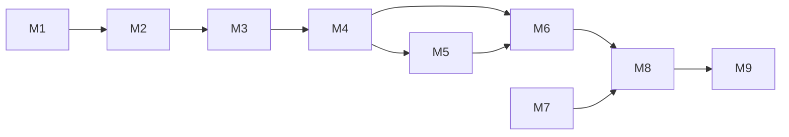

# AeroLink: Delivery Plan

Milestones, epics, and acceptance criteria. Design: [ARCHITECTURE](ARCHITECTURE.md). Overview: [README](../README.md).

**Reuse first:** the [reuse research](ARCHITECTURE.md#17-decisions) picked off-the-shelf tools wherever they exist. Stories name them; custom code is limited to the planning core, the corridor network, the simulator, the conformance monitor, and the adsb.lol parser.

**Stack:** all Python for the backend (decided for time constraints; ARCHITECTURE §11), TypeScript for the map page, C for the firmware.

**How to read this**
- **Milestone:** a checkpoint that produces something working and demonstrable. Closed only when its exit criteria are met.
- **Epic:** a body of work inside a milestone, with a description, stories, and acceptance criteria.
- **Story:** a single task, written as an action.

---

## Milestones

| ID | Milestone | Goal | Depends on |
|---|---|---|---|
| M1 | Foundations | Repo, CI, and message contracts every service shares | — |
| M2 | Airspace and Network | A corridor network proven clear of no-go airspace | M1 |
| M3 | Simulator and Classical Baseline | A measurable non-AI baseline running in simulation | M2 |
| M4 | AI Forecasting and Planner | AeroLink's AI planner measured against the baseline | M3 |
| M5 | Real Data and Trained Models | Trained models, real-data validation, full ablation results | M4 |
| M6 | Live System and Dashboard | The full system running live with a usable dashboard | M4, M5 |
| M7 | Device Hardware Design | A reviewed wiring schematic and datasheets for the device | — |
| M8 | Device | A working handheld device running the full flight flow | M6, M7 |
| M9 | Deploy and Demo | The system deployed and the demo rehearsed | M8 |

M7 has no dependencies and can run in parallel with M1–M6.

---

## M1: Foundations

**Goal:** Every service has a home, CI runs on every push, and all components agree on message formats.
**Exit criteria:** CI is green; the contract tests accept every valid example and reject every invalid one.

### E1.1 Repository and CI

Set up the repo structure and automated testing so every later epic has a place to land.

**Stories**
- [ ] Create the folder layout defined in the README
- [ ] Initialize the Python project in `backend/` (uv), package `aerolink`
- [ ] Initialize the web page project in `web/` (Vite + TypeScript)
- [ ] Add a CI workflow that runs `pytest` on every push
- [ ] Add `.env.example` and `.gitignore` (including `backend/data/realdata/`)

**Acceptance criteria**
- A fresh clone builds and tests pass with documented commands
- CI runs automatically and reports status on every push

### E1.2 Message Contracts

Define the five messages exchanged between the device, simulator, and backend, so all components are built against the same formats.

**Stories**
- [ ] Write JSON Schemas (v3.0): telemetry, route request, route response, intent, intent status
- [ ] Align intent fields and states with ASTM F3548 (accepted, activated, nonconforming, contingent, ended), using the InterUSS repositories as the naming reference
- [ ] Add one valid example per schema
- [ ] Add invalid examples covering common mistakes (missing fields, wrong types, bad enums)
- [ ] Add contract tests in Python (with format checking for UUIDs and timestamps enabled)
- [ ] Generate or hand-write Pydantic models that match the schemas, with a test that they agree

**Acceptance criteria**
- All valid examples pass and all invalid examples fail
- Schemas match ARCHITECTURE §12

---

## M2: Airspace and Network

**Goal:** A map of landing sites and corridors that is provably clear of commercial, military, and restricted airspace.
**Exit criteria:** The network builds, the constraint check passes, and a deliberately invalid corridor makes the build fail.

### E2.1 FAA Airspace Import

Turn FAA open data into 3D no-go volumes (shape + floor + ceiling) for the region.

**Stories**
- [ ] Download the FAA Class Airspace and Special Use Airspace datasets (ADDS GeoJSON, no account); document the `LOWER_VAL` / `UPPER_VAL` fields and their `*_CODE` / `*_UOM` companions
- [ ] Clip the data to the region's bounding box
- [ ] Convert each area into a no-go volume with floor and ceiling in metres MSL
- [ ] Add hand-modeled areas the data doesn't cover (e.g. the full MacDill base), labelled `modeled`
- [ ] Commit the snapshot with the FAA data cycle date

**Acceptance criteria**
- `airspace/constraints-central-fl.geojson` contains the TPA and MCO controlled airspace, MacDill, and the Avon Park range
- Every volume has a type, floor, ceiling, and source (`faa` or `modeled`)
- The import is reproducible with one command

### E2.2 Corridor Network

Define the landing sites, junctions, and corridors the aircraft fly on.

**Stories**
- [ ] Add vertiports: Tampa Executive, Orlando Executive, Sebring Regional
- [ ] Add SunTrax as the cargo hub
- [ ] Add hospital pads: Tampa General, Lakeland Regional, AdventHealth Sebring, Orlando Health ORMC (positions verified, labelled `modeled`)
- [ ] Add junction waypoints along the corridors
- [ ] Add corridors along I-4, US-27, and connecting highways, with at least two routes per city pair
- [ ] Set node capacities (pads, junction throughput)
- [ ] Set corridor altitude bands within FDOT's 1,000–3,000 ft eVTOL band, below any overlying controlled-airspace floor
- [ ] Confirm the network covers FDOT's first routes: Orlando–Tampa, Orlando–SunTrax, Tampa–SunTrax

**Acceptance criteria**
- `airspace/central-fl-v1.geojson` loads without errors
- Every city pair has at least two distinct routes
- Every node has a type and capacity

### E2.3 Network Validation

Make it impossible to build a network that touches no-go airspace.

**Stories**
- [ ] Convert coordinates to UTM zone 17N (metres) for all geometry checks
- [ ] Build the graph from the network file
- [ ] Check every corridor, at its altitude band, against every no-go volume in 3D
- [ ] Fail the build with a clear message identifying the offending corridor
- [ ] Add a CI test with a deliberately invalid corridor

**Acceptance criteria**
- The valid network builds in CI
- The invalid test corridor fails the build and names the volume it violates

---

## M3: Simulator and Classical Baseline

**Goal:** Simulated traffic running on the network, planned by the classical (non-AI) method, with results we can measure.
**Exit criteria:** Every scenario runs deterministically from a seed; B0 and B1 results are committed.

### E3.1 Mission Profiles

Define how passenger, cargo, and medical flights differ.

**Stories**
- [ ] Define speed, range, priority, and allowed destinations per mission
- [ ] Enforce range and destination rules when a request is made

**Acceptance criteria**
- A request to a destination not allowed for its mission is rejected
- A route longer than the mission range is rejected

### E3.2 Simulator

Generate realistic, repeatable traffic: 10 aircraft (5 passenger, 3 cargo, 2 medical).

**Stories**
- [ ] Build a custom kinematic simulator (BlueSky and MATSim-UAM reviewed and not used; see ARCHITECTURE §9.1)
- [ ] Model aircraft movement along corridors with variable speed, using a seeded `numpy.random.Generator`
- [ ] Add holds, diversions, and destination changes
- [ ] Add unscheduled medical dispatches
- [ ] Close the loop: simulated aircraft request routes, file intents, and fly them
- [ ] Run on a simulated clock (offline mode)
- [ ] Make every run reproducible from a seed

**Acceptance criteria**
- Two runs with the same seed produce identical output
- One simulated hour runs in under a minute

### E3.3 Scenarios

Define the test situations the evaluation runs.

**Stories**
- [ ] Write scenario files: `nominal_day`, `i4_peak`, `sebring_race_weekend`, `medical_dispatch`, `cargo_wave`, `holds_and_diversions`, `rogue_aircraft`, `telemetry_dropout`
- [ ] Include labelled ground truth for injected deviations

**Acceptance criteria**
- All 8 scenarios load and run end to end

### E3.4 Classical Planner (Baseline B1)

Implement the method the FAA/industry framework describes today, with no AI. This is the bar AeroLink must beat.

**Stories**
- [ ] Generate candidate routes (shortest paths within range)
- [ ] Build operational intents with fixed ±60 s time windows per node
- [ ] Check new intents against accepted ones, first-come-first-served (junction, spacing, landing slot)
- [ ] Resolve conflicts: next route, then ground hold in 30 s steps, then reject
- [ ] Allocate landing slots first-come-first-served with medical priority (greedy)
- [ ] Flag non-conforming aircraft with fixed bounds (300 m, time window)

**Acceptance criteria**
- No accepted intents conflict with each other in any scenario
- Medical flights are never delayed by lower-priority flights
- Behaviour matches ARCHITECTURE §6

### E3.5 Evaluation Harness

Measure every configuration the same way.

**Stories**
- [ ] Implement metrics: delay, slot utilization, rejected requests, loss-of-spacing events, conformance detection, medical delay
- [ ] Run configurations B0 (shortest path, no coordination) and B1 (classical) across all scenarios
- [ ] Write results as JSON to `backend/eval-results/`

**Acceptance criteria**
- One command runs all scenarios and configurations
- B0 and B1 results are committed

---

## M4: AI Forecasting and Planner

**Goal:** The AeroLink planner using AI predictions, measured against the classical baseline.
**Exit criteria:** B1 vs A1 results are committed for every scenario.

### E4.1 Forecaster Interface and Baseline

One interface for all forecasters, with constant velocity as the non-AI reference.

**Stories**
- [ ] Define the forecaster interface: position head (≤5 min) and arrival-time head (≤45 min), each returning p10/p50/p90
- [ ] Implement `cv` (constant velocity / constant cruise speed)

**Acceptance criteria**
- `cv` passes interface tests and is used as the reference in the evaluation

### E4.2 Chronos-2 Forecaster

Add the pretrained model from Hugging Face, used without training.

**Stories**
- [ ] Integrate Chronos-2 for both heads with `chronos-forecasting`; default weights `autogluon/chronos-2-small`
- [ ] Map its quantile outputs to p10/p50/p90
- [ ] Measure CPU inference time and memory for 11 aircraft, for `chronos-2-small` and `amazon/chronos-2`; record the smallest VM size that keeps the 10 s refresh
- [ ] Check whether the installed library version supports fine-tuning

**Acceptance criteria**
- Forecasts for 11 aircraft complete within the 10 s refresh interval on the target VM size
- Fine-tuning support is documented (yes/no)

### E4.3 Congestion Forecast

Turn predicted arrival times into expected load at each landing site and junction.

**Stories**
- [ ] Compute expected arrivals per node per 1 min bin
- [ ] Compute congestion as expected arrivals ÷ capacity, at p50 and p90

**Acceptance criteria**
- Every congestion value can be traced back to the flights contributing to it

### E4.4 AeroLink Planner

The same framework as the classical method, with AI-based time windows and risk-aware ranking.

**Stories**
- [ ] Size intent time windows from arrival-time predictions (p10–p90)
- [ ] Solve DCB with OR-Tools CP-SAT: landing sites and junctions as time-limited resources, priority-weighted delay objective (verify the approach first; greedy priority allocation is the fallback)
- [ ] Compute conflict probability between overlapping windows
- [ ] Rank candidates by expected delay plus conflict risk
- [ ] Generate a plain-text reason for each ranking
- [ ] Keep medical priority and all hard constraints unchanged

**Acceptance criteria**
- No returned route violates a hard constraint
- Configuration A1 runs across all scenarios

### E4.5 En-Route Re-planning

Update plans for aircraft already flying when conditions change.

**Stories**
- [ ] Re-evaluate airborne aircraft every 2 minutes
- [ ] Offer a revised plan when it improves cost by more than 10% or a medical flight displaces the aircraft

**Acceptance criteria**
- In `medical_dispatch`, displaced flights receive revised plans

---

## M5: Real Data and Trained Models

**Goal:** Domain-trained models, validation on real Central Florida flights, and the full ablation results.
**Exit criteria:** The full ablation table and the real-data results are committed and reproducible.

### E5.1 Real-Data Pipeline

Build a dataset of real low-altitude flights (helicopters and light aircraft) from adsb.lol.

**Stories**
- [ ] Download daily releases (start with 14 days); stream the split tar parts and extract only `traces/`
- [ ] Write a parser against the readsb trace format (README-json); handle `.json` files that contain gzip
- [ ] Keep only traces inside the region
- [ ] Keep only aircraft ≤3,000 ft and 40–160 kt in rotorcraft (A7) / light categories; exclude airline, heavy, and military traffic; drop `mlat` points
- [ ] Split tracks at the new-leg flag and at gaps over 30 s; resample to 1 Hz with the `traffic` library
- [ ] Write Parquet locally (never committed)
- [ ] Add the ODbL attribution text

**Acceptance criteria**
- The dataset is reproducible with one command
- The sample count after filtering is reported; if too low, add more days

### E5.2 Real-Data Benchmark

Test the forecasters on real flights.

**Stories**
- [ ] Split by day into training and held-out sets
- [ ] Compare `cv` and `chronos` on the held-out days (position head)

**Acceptance criteria**
- Forecast error per horizon is committed for both forecasters

### E5.3 Trained Forecaster (`aerolink-gbm`)

A model trained on simulated and real Central Florida data.

**Stories**
- [ ] Build features: kinematics, mission, route context, time of day
- [ ] Train both heads on simulated data plus the real training days
- [ ] Calibrate the intervals with MAPIE `ConformalizedQuantileRegressor`; report measured p10–p90 coverage against the 80% target
- [ ] Version the model files with their training seeds

**Acceptance criteria**
- Results reported against `cv` and `chronos` on both simulated and real held-out data

### E5.4 Demand Forecaster

Predict flights before they are filed so capacity can be reserved.

**Stories**
- [ ] Generate synthetic demand (diurnal Poisson) scaled from the FDOT AAM Business Plan's 2027 passenger-trip forecast; label it synthetic
- [ ] Passenger: departures per vertiport per 15 min (Chronos-2) and destinations (LightGBM)
- [ ] Cargo: next wave timing and size
- [ ] Medical: dispatches per hospital per 15 min (Chronos-2)
- [ ] Add predicted flights to the congestion forecast, weighted by probability

**Acceptance criteria**
- Accuracy reported against the simple baselines (mean turnaround, last schedule, constant rate)

### E5.5 Conformance Monitor

Detect aircraft leaving their predicted path, using learned tolerance instead of fixed bounds.

**Stories**
- [ ] Flag aircraft outside their calibrated band for 3 or more consecutive samples
- [ ] Train a scikit-learn `IsolationForest` on residual features (cross-track error, speed and vertical-rate deviation) from clean real-data legs
- [ ] Move flagged intents to the `nonconforming` state
- [ ] Spread the flagged aircraft's possible positions into the congestion forecast
- [ ] Re-check affected intents

**Acceptance criteria**
- Detection precision, recall, and latency reported against the fixed-bounds baseline on `rogue_aircraft`

### E5.6 Pilot Briefing (LLM)

Plain-language explanation of each plan.

**Stories**
- [ ] Call OpenRouter (`LLM_BASE_URL`, `LLM_MODEL`, `LLM_API_KEY`) to generate a two-sentence briefing from the structured plan data
- [ ] Reject any briefing whose numbers don't match the data; fall back to a template

**Acceptance criteria**
- No briefing with a mismatched number reaches a user
- The pass rate is reported

### E5.7 Full Ablations

Measure what each AI component adds.

**Stories**
- [ ] Run configurations A2–A5 across all scenarios
- [ ] Publish the B1 vs A5 comparison

**Acceptance criteria**
- The ablation table in ARCHITECTURE §9.3 is fully populated from committed runs

---

## M6: Live System and Dashboard

**Goal:** The full system running in real time, with a dashboard someone can use.
**Exit criteria:** 10 live aircraft on the dashboard; the method toggle visibly changes plans; what-if plans return in under 2 s; a medical dispatch re-plans other flights.

### E6.1 Live Integration of the Planning Layer

Run the same planning and AI functions the offline evaluation uses inside the live backend.

**Stories**
- [ ] Call the planning and AI layer from the service layer as plain functions (no separate service)
- [ ] Run model inference in a worker thread so it never blocks MQTT ingest
- [ ] Load models once at startup; expose versions at `/api/models`

**Acceptance criteria**
- For the same input, the live backend returns the same plan as the offline evaluation
- MQTT ingest keeps up at 1 Hz while forecasts run

### E6.2 Messaging

Secure messaging between aircraft and the backend.

**Stories**
- [ ] Configure Mosquitto (standard Docker image) with TLS and a project certificate authority
- [ ] Per-device credentials via `password_file`; `acl_file` pattern rules limit each device to its own topics
- [ ] Separate simulator namespace and account

**Acceptance criteria**
- A device cannot publish to another device's topics
- Anonymous connections are refused

### E6.3 Backend Service Layer

The Python service layer (FastAPI + aiomqtt) that ingests telemetry, holds the intents, and runs the live loops. It calls the planning and AI layer as plain functions.

**Stories**
- [ ] Ingest and validate telemetry; drop duplicates and out-of-order messages
- [ ] Keep live aircraft state
- [ ] Maintain the registry of accepted intents
- [ ] Refresh forecasts every 10 s
- [ ] Run en-route re-planning every 2 min
- [ ] Handle the device flow: route request → response → intent → intent status
- [ ] Database migrations (e.g. Alembic) and storage
- [ ] Public API (ARCHITECTURE §11.1)

**Acceptance criteria**
- The full device flow works using a test MQTT client
- Restarting the backend loses no accepted intents

### E6.4 Simulator Live Mode

Run the simulated fleet in real time over MQTT.

**Stories**
- [ ] Publish telemetry and requests in real time
- [ ] Switch scenarios from the API

**Acceptance criteria**
- Live and offline modes produce the same behaviour for the same seed

### E6.5 Dashboard

The web interface for operators and judges.

**Stories**
- [ ] MapLibre GL JS page with the OpenFreeMap basemap (no key)
- [ ] Map with corridors, landing sites, and no-go airspace by type, as 3D `fill-extrusion` layers
- [ ] Live aircraft by mission, with status
- [ ] Filed intents and prediction cones
- [ ] Congestion timeline (+45 min)
- [ ] Method toggle (classical / AeroLink) and forecaster toggle
- [ ] Route planner with reasons and briefing
- [ ] Medical priority panel
- [ ] AI impact panel
- [ ] Alerts and scenario control
- [ ] Data attribution footer

**Acceptance criteria**
- Every feature in ARCHITECTURE §13.1 is usable without the command line

### E6.6 Packaging

Run the whole system with one command.

**Stories**
- [ ] `compose.yaml` with five containers (`caddy`, `backend`, `mosquitto`, `postgres`, `sim`) and health checks
- [ ] Caddy serves the built `web/` files and proxies `/api` to the backend
- [ ] Caddy for HTTPS and basic auth

**Acceptance criteria**
- `docker compose up` on a clean machine starts a working system

---

## M7: Device Hardware Design

**Goal:** A reviewed wiring schematic and parts documentation the device is built from.
**Exit criteria:** The schematic PDF and pin map are committed, reviewed, and match the firmware board config.

### E7.1 Parts and Datasheets

**Stories**
- [ ] Select parts: ESP32-S3-DevKitC-1 (N8R8), 3.5″ display module (prefer ST7796) with capacitive touch, ATGM336H GNSS with active antenna
- [ ] Confirm the display module's touch controller (FT6x36 capacitive vs XPT2046 resistive) before ordering; it decides the driver
- [ ] Add datasheets for every part to `hardware/datasheets/`
- [ ] Check the 3.3 V power budget (backlight + GNSS on the devkit regulator)

**Acceptance criteria**
- Every part has a datasheet and an exact part number

### E7.2 Wiring Schematic and Pin Map

**Stories**
- [ ] Assign pins, avoiding GPIO35–37 (memory) and handling the boot pins (0, 3, 45, 46)
- [ ] Draw the KiCad schematic of the wiring in `hardware/kicad/rev0-wiring/`
- [ ] Export the schematic PDF
- [ ] Write the matching pin map in the firmware board config
- [ ] Review the schematic

**Acceptance criteria**
- The firmware pin map and the schematic agree pin for pin

---

## M8: Device

**Goal:** A handheld device that runs the full flight flow against the live system.
**Exit criteria:** In Lakeland, a live position appears on the dashboard; Medical → Tampa General returns ranked routes; the filed intent is accepted; a re-route offer appears on the device.

### E8.1 Build and Bring-Up

**Stories**
- [ ] Wire Rev 0 exactly to the schematic
- [ ] Verify the display, touch, GNSS, and power
- [ ] Fix any mismatch in the schematic, not only in the wiring
- [ ] Make it portable: soldered protoboard or secured jumpers on a printed tray

**Acceptance criteria**
- All peripherals work, and the schematic reflects the build exactly

### E8.2 Firmware Platform

**Stories**
- [ ] Start from the sukesh-ak/BSP-IDF5-ESP_LCD-LVGL9 template (ST7796 + FT5x06 + LVGL 9 on ESP32-S3)
- [ ] Add registry components: `esp_lcd_st7796` (check the v1.5.0 licence or pin an earlier version), `esp_lcd_touch_ft5x06`, `esp_lvgl_port`
- [ ] ESP-IDF project with a board abstraction
- [ ] GNSS: position, fix quality, UTC time, based on ESP-IDF's `nmea0183_parser` example
- [ ] GNSS replay mode with a recorded track, for indoor demos
- [ ] Wi-Fi, MQTT over TLS (from the `esp-mqtt` `mqtt/ssl` example, CA embedded via `EMBED_TXTFILES`), Last Will
- [ ] Telemetry at 1 Hz; out-of-region handling

**Acceptance criteria**
- The device appears live on the dashboard, in both live-fix and replay modes

### E8.3 Device UI

**Stories**
- [ ] Screens: mission, destination, routes, flight, status (LVGL)

**Acceptance criteria**
- A user can complete the whole flow on the touchscreen without instructions

### E8.4 Flight Flow

**Stories**
- [ ] Route request → ranked routes → select → file intent → intent status
- [ ] Show re-route offers and medical priority status in flight
- [ ] Mark responses stale after expiry

**Acceptance criteria**
- The full flow works end to end against the live system

---

## M9: Deploy and Demo

**Goal:** The system running in the cloud and a rehearsed demo.
**Exit criteria:** The demo script runs end to end on the deployed system with the device in Lakeland.

### E9.1 Cloud Deployment

**Stories**
- [ ] Provision the GCP VM at the size measured in E4.2; open only ports 80, 443, 8883
- [ ] Configure DNS, HTTPS, and MQTT TLS
- [ ] Deploy with Compose and production secrets

**Acceptance criteria**
- The dashboard and MQTT broker are reachable; nothing else is exposed

### E9.2 Operations

**Stories**
- [ ] Nightly database backups to Cloud Storage
- [ ] Run one restore drill

**Acceptance criteria**
- The data is restored successfully from a backup

### E9.3 Demo Readiness

**Stories**
- [ ] Test at the venue: GNSS by a window; Wi-Fi or hotspot on port 8883
- [ ] Rehearse the [demo script](HACKATHON.md#demo-script-lakeland-6-minutes)
- [ ] Record a backup demo video
- [ ] Prepare judge credentials and links

**Acceptance criteria**
- A full rehearsal completes without intervention

---

## MVP Definition of Done

All milestones M1–M9 are closed, and the demo runs end to end on the deployed system with the Rev 0 device.

---

## Post-MVP Backlog

### Rev A Custom PCB

Integrate the device onto a single custom board, starting from the M7 schematic.

**Stories**
- [ ] Integrate ESP32-S3-WROOM-1-N8R8, display + touch, ATGM336H, USB-C, AP63203 3.3 V buck
- [ ] Verify footprints against the datasheets
- [ ] Layout: antenna keep-outs, ground plane, USB-C ESD; clean DRC/ERC
- [ ] Fab, assembly, and bring-up
- [ ] Rev A board config (same firmware)
- [ ] Rev A enclosure

---

## Risk Register

| Risk | Impact | Mitigation | Owner epic |
|---|---|---|---|
| FAA altitude fields differ from expectations | Import delayed | Inspect the data first | E2.1 |
| A corridor can't avoid a no-go volume | Network redesign | Validation fails early in CI | E2.3 |
| adsb.lol releases are several GB per day | Slow download | Download in the background; not on the critical path | E5.1 |
| Too few qualifying real tracks after filtering | Weak validation | Report counts; add more days | E5.1 |
| Emitter category missing in the data | Weaker filtering | Fall back to altitude, speed, and callsign rules | E5.1 |
| Chronos-2 too slow on CPU | Refresh interval missed | Default to `chronos-2-small`; measure early; resize the VM | E4.2 |
| OR-Tools CP-SAT modelling takes too long | DCB delayed | Greedy priority allocation fallback | E4.4 |
| `esp_lcd_st7796` v1.5.0 licence unclear | Licence risk | Check it, or pin an earlier Apache-2.0 version | E8.2 |
| Display module has a different touch controller than expected | Wrong driver | Confirm before ordering | E7.1 |
| Corridor bands conflict with Class B shelf floors | Network redesign | Set bands per corridor; validation catches it | E2.2 |
| Trained model doesn't beat `cv` or `chronos` | Weaker AI story | Report as measured | E5.3 |
| A5 doesn't beat B1 in some scenarios | Weaker claim | Report as measured; analyze why | E5.7 |
| Wiring doesn't match the schematic | Device bugs | Bring-up check; fix the schematic | E8.1 |
| Breadboard fails while carried | Demo failure | Protoboard or secured tray | E8.1 |
| Indoor GNSS or venue Wi-Fi fails | Demo failure | Replay mode; hotspot; venue test | E9.3 |
| LLM states wrong numbers | Misleading briefing | Number check with template fallback | E5.6 |
| Hospital pad positions inaccurate | Modeling error | Verify; label `modeled` | E2.2 |
